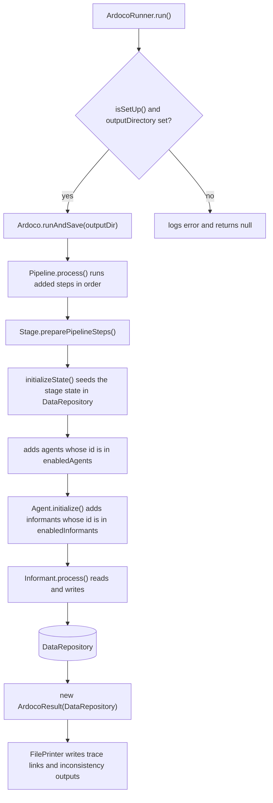
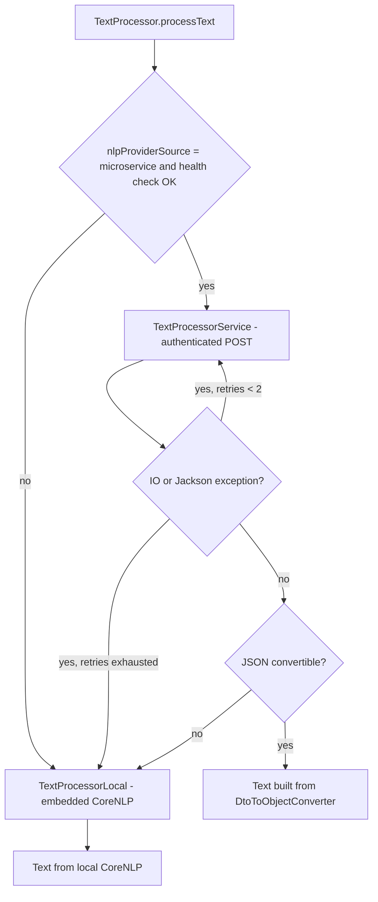

# Architecture

This page covers ARDoCo's pipeline architecture, data model, and intermediate artifacts. For the original wiki pages, see [Pipeline.md](../docs/Pipeline.md) and [Intermediate-Artifacts.md](../docs/Intermediate-Artifacts.md).

The one invariant to keep in mind: **pipeline components communicate only through the shared `DataRepository`**. Stages, agents, and informants receive the same repository instance at construction, read inputs and write results under string identifiers, and never call each other directly. The only other cross-cutting mechanisms are the configuration system, which pushes values into `@Configurable` fields down the same composite hierarchy, and the shared Jackson configuration in `JsonHandling`.

## Pipeline Composite Pattern

ARDoCo's pipeline follows a **composite pattern** with three levels of hierarchy:

```
Ardoco (extends Pipeline)
  └── AbstractExecutionStage (Level 1: Stage)
        └── PipelineAgent (Level 2: Agent)
              └── Informant (Level 3: actual computation)
```

### Core Classes

| Class | Source | Role |
|-------|--------|------|
| `AbstractPipelineStep` | `core/framework/common/.../pipeline/AbstractPipelineStep.java` | Base class for all pipeline components; extends `AbstractConfigurable`, provides the lifecycle (`before()` → `process()` → `after()` via `run()`), logging, and the `DataRepository` reference |
| `Pipeline` | `core/framework/common/.../pipeline/Pipeline.java` | Composite container that executes added steps sequentially in `process()`, logs per-step timing, and sets `hasFinished()` in `after()`; `preparePipelineSteps()` re-delegates configuration to children |
| `AbstractExecutionStage` | `core/framework/common/.../pipeline/AbstractExecutionStage.java` | Specialized `Pipeline` for stages; final `preparePipelineSteps()` calls `initializeState()`, then adds only agents listed in `enabledAgents` |
| `PipelineAgent` | `core/framework/common/.../pipeline/agent/PipelineAgent.java` | A `Pipeline` + `Agent` that runs a list of `Informant`s; final `initialize()` adds only informants listed in `enabledInformants` |
| `Informant` | `core/framework/common/.../pipeline/agent/Informant.java` | Abstract `AbstractPipelineStep` implementing `Claimant`; performs the actual computation inside an agent |
| `Claimant` | `core/framework/common/.../pipeline/agent/Claimant.java` | Marker interface for classes that claim intermediate results; `Confidence` tracks the contributing `Claimant`s |

### Three-Level Hierarchy

1. **Stages** — high-level pipeline phases (e.g., `TextExtraction`, `RecommendationGenerator`, `ConnectionGenerator`, `InconsistencyChecker`)
2. **Agents** — each stage contains multiple agents; an agent initializes its state and coordinates its informants
3. **Informants** — concrete `AbstractPipelineStep` implementations that execute specific heuristics or algorithms and write their results into the repository

Execution is strictly sequential and depth-first: a stage's `process()` runs its agents one after another, and each agent runs its informants one after another. Steps are added during preparation (`preparePipelineSteps()`), so gating via `enabledAgents`/`enabledInformants` happens at run time, not construction time.



*Stage → agent → informant execution over the `DataRepository` blackboard, and the `runAndSave` data flow from runner to saved output files.*

## DataRepository (Blackboard)

All pipeline steps share one central **DataRepository** (`core/framework/common/.../data/DataRepository.java`):

- It is a sorted map of `String` identifier → `PipelineStepData`, and the repository itself is `Serializable`.
- `getData(id, class)` returns an `Optional<T>`: empty when the identifier is unknown or the stored data cannot be cast to the requested class (`PipelineStepData.asPipelineStepData`).
- `addData(id, data)` overwrites silently but logs a warning when an identifier is reused — states are usually written once per stage.
- Well-known identifiers are declared as `ID` constants on the state interfaces (e.g., `TextState.ID`, `ModelStates.ID = "ModelStatesData"`, `ProjectPipelineData.ID`, `PreprocessingData.ID`).
- `PipelineStepData` also offers `serialize()`/`deserialize()` JSON helpers built on the shared `JsonHandling.createObjectMapper()`.

Because every component holds the same repository instance, heuristic cooperation works without direct coupling: multiple informants contribute complementary analyses into the same states, later steps read earlier results, and intermediate results remain observable for debugging. `DataRepositorySyncer` is the one sanctioned cross-state hook (it propagates noun-mapping deletions into all recommendation states).

## Execution Entry Points

| Class | Source | Role |
|-------|--------|------|
| `Ardoco` | `core/pipeline-core/.../execution/Ardoco.java` | Main pipeline entry point; extends `Pipeline` with id `"ARDoCo"`, creates its own `DataRepository`, and seeds `ProjectPipelineData` with the project name; `runAndSave(outputDir)` runs the pipeline and writes output files |
| `ArdocoRunner` | `core/pipeline-core/.../execution/runner/ArdocoRunner.java` | Abstract runner wrapping an `Ardoco` instance; owns the `isSetUp` flag and the output directory; final `run()`/`runWithoutSaving()` guard on it |
| `AnonymousRunner` | `core/pipeline-core/.../execution/runner/AnonymousRunner.java` | Abstract `ArdocoRunner` subclass for tests; the constructor calls `setUp()`, which invokes the abstract `initializePipelineSteps(dataRepository)` and adds the returned steps to `Ardoco` |
| `ArdocoResult` | `core/pipeline-core/.../api/output/ArdocoResult.java` | Record wrapping the `DataRepository` after execution; the public typed read API for trace links, inconsistencies, models, and text |

Concrete runners wire actual pipelines and live in the application modules: `Arcotl`, `Ardocode`, `Swattr`, `Transarc`, `ExArch`, `Artemis`, `ArtemisInExArch`, and `ArtemisInTransArC` in `tlr/pipeline-tlr/.../execution/`, plus `InconsistencyDetection`, `ArtemisInconsistencyDetection`, `ProgrammingLanguageInconsistencyDetection`, and `ArchitecturalStylePatternInconsistencyDetection` in `inconsistency-detection/pipeline-id/.../execution/runner/`. Each provides a `setUp(...)` that adds its pipeline steps to `getArdoco()`, sets the output directory via the protected `setOutputDirectory(...)`, and then flips `isSetUp = true`.

### Runner contract

- `ArdocoRunner.run()` is final and returns `@Nullable ArdocoResult`: it calls `Ardoco.runAndSave(outputDirectory)` only when `isSetUp()` is true **and** an output directory was set; otherwise it logs an error and returns `null`.
- `ArdocoRunner.runWithoutSaving()` requires only `isSetUp()`; it runs the pipeline and returns the raw `DataRepository` (not a result wrapper), writing nothing to disk.
- `AnonymousRunner` performs setup eagerly in its constructor. `setUp()` catches `IOException` from `initializePipelineSteps` and reports `isSetUp = false` in that case; implementers load input data and return the `List<AbstractPipelineStep>` to execute.
- `Ardoco.runAndSave(outputDir)` itself returns `null` when no steps were added (pipeline never defined). After a successful run it constructs `new ArdocoResult(getDataRepository())` and writes, via `FilePrinter`: `traceLinks_<project>.txt` (human-readable trace links), `inconsistencyDetection_<project>.txt`, and — per link type, only when non-empty — `sadSamTlr_<project>.csv`, `samCodeTlr_<project>.csv`, `sadCodeTlr_<project>.csv`.

### ArdocoResult

`ArdocoResult(DataRepository dataRepository)` is the typed façade over the repository:

- `getProjectName()`, `getText()`, `getMetamodels()`, `getModelState(metamodel)`
- Trace links: `getTraceLinksForModel(metamodel)`, `getArchitectureTraceLinks()`, `getSamCodeTraceLinks()`, `getSadCodeTraceLinks()`, `getAllTraceLinksAsBeautifiedStrings()`
- Inconsistencies: `getAllInconsistencies()`, `getAllTextInconsistencies()`, `getAllModelInconsistencies()`, `getInconsistentSentences()`, `getAllInconsistenciesForModel(metamodel)`, `getInconsistenciesOfTypeForModel(metamodel, type)`
- Per-metamodel state accessors: `getConnectionState(metamodel)`, `getInconsistencyState(metamodel)`
- ArTEMiS accessors keyed by `ArtemisTarget`: `getArtemisConnectionState(artemisTarget)`, `getArtemisInconsistencyState(artemisTarget)`

State accessors degrade gracefully: when `ConnectionStates`, `InconsistencyStates`, the code-traceability state, or the matching Artemis container state are absent from the repository, the accessor logs a warning and returns `null` (and derived accessors return empty collections). In contrast, `getPreprocessingData()`, `getSimplePreprocessingData()`, and `getText()` throw (`NoSuchElementException` via `orElseThrow`) when preprocessing never ran.

## Configuration System

All pipeline components extend `AbstractConfigurable` (`core/framework/common/.../configuration/AbstractConfigurable.java`), which is also the base of `AbstractPipelineStep` — so every stage, agent, informant, and state is configurable. Fields annotated with `@Configurable` can be overridden at runtime, enabling fine-grained control over thresholds, filters, and algorithm parameters without code changes.

### Key resolution and supported types

- `applyConfiguration(ImmutableSortedMap<String, String>)` reflects over declared fields of the class hierarchy (stopping at `Object`/`AbstractConfigurable`), applies values for matching keys, then delegates the same map to child components.
- The default key is `<SimpleClassName>::<fieldName>` (`CLASS_ATTRIBUTE_CONNECTOR = "::"`); a custom key can be set via `@Configurable(key = "...")`. With `@ChildClassConfigurable`, the key uses the **concrete** subclass name instead of the declaring class, so inherited fields are configurable per subclass (combining both on one field throws).
- `@NoConfiguration` on a class skips that class level entirely.
- Supported field types: `Integer`, `Double`, `Boolean`, enums (by constant name), and `List<String>` (values separated by `LIST_SEPARATOR = ","`). Other types are rejected.

### File format and defaults

`ConfigurationHelper.loadAdditionalConfigs(File)` (in `core/pipeline-core/.../execution/`) parses UTF-8 text files with one `KEY::attribute=VALUE` per line, e.g. `ConnectionGenerator::initialFilters=true` (blank lines are skipped, malformed lines are logged). `ConfigurationHelper.getDefaultConfigurationOptions()` reflects over all concrete `AbstractConfigurable` subclasses under `edu.kit.kastel.mcse.ardoco` (excluding tests), instantiates each, and records every `@Configurable` field's default value as a string — this is how the full set of tunable options is discovered.

### Configuration flows down the composite

Configuration is applied top-down through the same composite that executes steps: `Pipeline.delegateApplyConfigurationToInternalObjects` applies the map to each step, `AbstractExecutionStage` additionally applies it to all agents, and `PipelineAgent` to all informants. Because agents and informants are only added as pipeline steps during `preparePipelineSteps()`, each `Pipeline` re-applies its `getLastAppliedConfiguration()` there — a configuration applied to a stage before the run reaches every enabled agent and informant. Stages and agents therefore expose static factories like `TextExtraction.get(additionalConfigs, dataRepository)` that construct and then `applyConfiguration`.

### Gating: stages gate agents, agents gate informants

- `AbstractExecutionStage` declares `@Configurable @ChildClassConfigurable List<String> enabledAgents`, initialized to the ids of all constructor-provided agents; at run time only agents whose id is in the list are added as pipeline steps.
- `PipelineAgent` declares `enabledInformants` the same way, defaulting to all informants.
- Commenting an id out of `enabledAgents`/`enabledInformants` (or overriding the key `<ClassName>::enabledAgents`) is the standard way to switch parts of the pipeline off without code changes.

### Enforcement

The ArchUnit test `configurableFieldsOnlyInConfigurableClasses` in `core/tests-base/.../tests/architecture/BasicArchitectureTest.java` enforces that `@Configurable` fields are declared only in classes assignable to `AbstractConfigurable` — configuration by reflection cannot silently escape the framework.

## Enforced Architectural Invariants (ArchUnit)

The framework's structure is enforced by ArchUnit tests in `core/tests-base/src/main/java/edu/kit/kastel/mcse/ardoco/core/tests/architecture/` (`ArchitectureTest`, `BasicArchitectureTest`, `DeterministicArdocoTest`), all analyzing `edu.kit.kastel.mcse.ardoco`. Violations fail the build. The full invariant catalogue is cross-referenced in [Constraints](constraints.md).

### Layered architecture (ArchitectureTest)

`layerRule` defines **ten layers** with explicit "may only be accessed by" rules that mirror the pipeline's data flow. `Common`, `Pipeline`, and `CodeTraceability` have no access restriction as targets.

| Layer | Defined by packages | May only be accessed by |
|-------|--------------------|-------------------------|
| Common | `..common..`, `..data..`, `..api..`, `..tests..` | (unrestricted) |
| TextExtractor | `..textextraction..` | RecommendationGenerator, ConnectionGenerator, InconsistencyDetection, Pipeline, Common, Execution, Artemis |
| ModelExtractor | `..models..` | RecommendationGenerator, ConnectionGenerator, CodeTraceability, InconsistencyDetection, Pipeline, Common, Execution, Artemis |
| RecommendationGenerator | `..recommendationgenerator..` | ConnectionGenerator, InconsistencyDetection, Pipeline, Common, Execution |
| ConnectionGenerator | `..connectiongenerator..` | CodeTraceability, InconsistencyDetection, Pipeline, Common, Execution, Artemis |
| Artemis | `..artemis..` | ConnectionGenerator, Pipeline, Execution, Common, InconsistencyDetection, CodeTraceability |
| InconsistencyDetection | `..inconsistency..`, `..id..` | Pipeline, Common, Execution |
| CodeTraceability | `..codetraceability..` | (unrestricted) |
| Pipeline | `..pipeline..` | (unrestricted) |
| Execution | `..execution..` | Common (needed for tests) |

Additional rules pin down ordering and naming constraints:

- `noDependencyOnExecution`: only `execution` and `tests` packages may depend on `..execution..`.
- `modelInstancesOnlyAfterModelExtraction`: classes with the simple name `Model` are only usable from model-related, recommendation, connection, inconsistency, pipeline, common, output, tests, and artemis packages.
- `linksOnlyAfterConnectionGenerator`: `*Link` classes are consumed only after connection generation (by connectiongenerator, codetraceability, tracelinks, inconsistency, id, pipeline, common, api, tests, and artemis packages).
- `usingLinkAsNamingOnlyInConnectionGenerator`: `*Link` classes live only in `tracelink`, `codetraceability`, and `connectiongenerator` packages.
- `inconsistencyOnlyAfterInconsistencyDetection`: classes whose name contains `Inconsistency` are usable only after the inconsistency stage (by inconsistency, id, execution, api, common, and tests packages).

### General structure rules (BasicArchitectureTest)

- `@Configurable` fields only in `AbstractConfigurable` subclasses (see above).
- `traceLinksShouldBeFinal`: every `TraceLink` subclass (except `TraceLink` itself) must be `final`.
- `jacksonIsConfiguredGlobally`: only `JsonHandling` may create or configure a Jackson mapper — this covers constructors of `ObjectMapper` and its subclasses (e.g. `JsonMapper`) as well as the `builder`, `shared`, and `rebuild` methods on them.
- `noJackson2`: classes under `edu.kit.kastel.mcse.ardoco..` must not depend on `com.fasterxml.jackson.core..` or `com.fasterxml.jackson.databind..` — ARDoCo uses Jackson 3 (`tools.jackson`); only the shared Jackson annotations (`com.fasterxml.jackson.annotation`) remain allowed.
- `noGetEnv`: only the `Environment` utility may call `System.getenv` (this is why `ConfigManager` reads env vars via `Environment.getEnv`).
- `noForEachInCollectionsOrStream`: `forEach`/`forEachOrdered` on streams and lists are banned (side-effect lambdas).
- `preferEclipseCollections`: interface methods must not use raw `java.util` `List`/`Set`/`SortedSet`/`Map`/`SortedMap` types (outside `..metrics..`); the Eclipse Collections equivalents are preferred.

### Determinism rules (DeterministicArdocoTest)

- `forbidUnorderedSetsAndMaps`: classes not annotated with `@Deterministic` (and outside `..tests..`, `..metrics..`, `..magika..`) may not access or depend on `Set`/`Map` types and factories (`HashSet`, `HashMap`, Eclipse `Mutable/ImmutableSet/Map`, `Sets`, `Maps`) — deterministic code must use ordered/sorted collections.
- `forbidHashMapAndHashSetInFavorOfLinkedVersions`: outside tests, `HashMap`/`HashSet` are banned outright; use the linked variants for predictable iteration order.
- `forbidEqualsAndHashCodeInCertainClasses`: classes annotated `@NoHashCodeEquals` must not implement `equals`/`hashCode`.
- `ensureContractBetweenEqualsHashCodeAndCompareTo`: classes directly implementing `Comparable` (that are not enums/interfaces/anonymous) must implement both `equals` and `hashCode`.
- `ensureSortedCollectionsOnlyForComparableTypes*`: sorted collection fields and sorted-collection return types must be parameterized with `Comparable` types.

## Text Preprocessing Decision Flow

Text preprocessing (`tlr/stages-tlr/text-preprocessing/.../corenlp/`) chooses between a remote CoreNLP microservice and an embedded Stanford CoreNLP at run time. The provisioning entry is `CoreNLPProvider`, the `NlpInformant` behind `TextPreprocessingAgent`: its `process()` checks `DataRepositoryHelper.hasAnnotatedText` and, when absent, reads the raw `InputTextData` from the repository and delegates to `TextProcessor`, storing the annotated `Text` under `PreprocessingData.ID`.

1. `ConfigManager` (`.../corenlp/config/ConfigManager.java`) is a singleton that loads `config.properties` from the classpath; if the file cannot be loaded it falls back to the defaults `microserviceUrl=http://localhost:8080`, `nlpProviderSource=local`, `corenlpService=/stanfordnlp`, `healthService=/stanfordnlp/health`. The `MICROSERVICE_URL` and `NLP_PROVIDER_SOURCE` environment variables (read through the sanctioned `Environment` utility) override the properties when set.
2. `TextProcessor.processText(String)` first asks `MicroserviceChecker.isMicroserviceAvailable()`, which sends an authenticated GET to `<microserviceUrl><healthService>` and returns true only when the response is exactly `"Microservice is healthy"`.
3. The microservice path is taken only when **both** `nlpProviderSource` equals `"microservice"` and the health check succeeded. Failures are retried up to `MAX_FAILED_SERVICE_REQUESTS = 2` times on `IOException`/`JacksonException`; a conversion failure (`NotConvertableException`/`InvalidJsonException`) falls back immediately. After exhausting retries — or when the microservice is unavailable/not selected — processing falls back to `TextProcessorLocal` (embedded Stanford CoreNLP).
4. `TextProcessorService` URL-encodes the input text (`URLEncoder.encode`, UTF-8), wraps it in a `{"text": "..."}` JSON body, and sends an authenticated POST to `<microserviceUrl><corenlpService>`; the JSON response is parsed with `JsonConverter.fromJsonString` and converted via `DtoToObjectConverter.convertText` (`textprovider-json`).

So the effective decision tree is: not configured for microservice → local; microservice unreachable or unhealthy → local; microservice transiently failing → up to 2 retries, then local; unconvertible response → local.



*Preprocessing decision flow: microservice selection, bounded retries, and local fallback.*

## Metamodels and Model API

`Metamodel` (`core/framework/common/.../api/models/Metamodel.java`) distinguishes `ARCHITECTURE_WITH_COMPONENTS` from `ARCHITECTURE_WITH_COMPONENTS_AND_INTERFACES`, plus `CODE_WITH_COMPILATION_UNITS` and `CODE_WITH_COMPILATION_UNITS_AND_PACKAGES`. `ModelStates` (`ID = "ModelStatesData"`) stores one `Model` per metamodel in a sorted map. The `ModelFormat` enum enumerates the supported input formats: `PCM`, `UML`, `COMPONENT_LISTING`, and `ACM` (code model for ArCoTL).

- Architecture API (`.../api/models/architecture/`): `ArchitectureComponent`, `ArchitectureInterface`, `ArchitectureMethod` (with DTOs under `.../architecture/dto/`, see [Architecture Model Serialization](#architecture-model-serialization)).
- Code API (`.../api/models/code/`): `CodeCompilationUnit`, `CodePackage`, `CodeFile`, `ClassUnit`, `InterfaceUnit`, etc. (deep dive in [Code Model](code-model.md)).
- Text API (`.../api/text/`): `Text`/`Sentence`/`Word`/`Phrase`; `SimpleText` for lightweight preprocessing.
- Stage state APIs under `.../api/stage/` for textextraction, recommendationgenerator, connectiongenerator (+ artemis), inconsistency, and codetraceability (table below).

### Shared JSON handling (JsonHandling)

`JsonHandling` (`core/framework/common/.../common/JsonHandling.java`) is the single factory for Jackson mappers. `createObjectMapper()` returns one shared, immutable, thread-safe Jackson 3 (`tools.jackson`) `ObjectMapper` built from `JsonFactory.builderWithJackson2Defaults()`; the builder calls `configureForJackson2()` so the serialized format stays compatible with the previous Jackson 2 defaults (property sorting, enum handling, visibility). A second factory method accepts `StreamReadConstraints` for models with large payloads. Field-based visibility is configured explicitly (getters/setters disabled, fields and creators visible). The `jacksonIsConfiguredGlobally` and `noJackson2` ArchUnit rules (above) make this the only legal mapper source in the codebase.

## Intermediate Artifacts

ARDoCo converts inputs into standardized intermediate representations that enable uniform analysis across different text sources, modeling languages, and programming languages. Everything is stored in the `DataRepository`: input text as `InputTextData`, the preprocessed `Text` inside `PreprocessingData` (`ID = "PreprocessingData"`), and all models inside `ModelStates` (`ID = "ModelStatesData"`), keyed by `Metamodel`.

### Text Representation

Internal model for natural language documentation preserving all NLP annotations from preprocessing (`core/framework/common/.../api/text/`):

- **Tokenization**: `Text` → `Sentence` → `Word` (word and sentence boundaries, positions)
- **Part-of-Speech Tags**: `Word.getPosTag()` (`POSTag`)
- **Dependency Parsing**: `Word.getOutgoingDependencyWordsWithType(...)` / incoming (`DependencyTag`)
- **Lemmatization**: `Word.getLemma()`
- **Phrases**: `Sentence.getPhrases()` (`Phrase`, `PhraseType`)

Interfaces: `Text`, `Word`, `Sentence`, `Phrase`, `POSTag`, `DependencyTag`; `NlpInformant` is the abstract `Informant` that supplies an annotated `Text`. A lightweight variant exists as `SimpleText`/`SimplePreprocessingData`.

### Software Architecture Models (SAM)

Unified representation of architecture models independent of the original modeling language (PCM, UML, component listing) — `core/framework/common/.../api/models/architecture/`:

| Element | Description |
|---------|-------------|
| `ArchitectureItem` | Sealed base (`permits` Component, Interface, Method); extends `ArchitectureEntity`, provides `name` and `id` |
| `ArchitectureComponent` | Components with provided/required interfaces, subcomponents, and a type |
| `ArchitectureInterface` | Interface contracts containing `ArchitectureMethod` signatures |
| `ArchitectureMethod` | Method declarations within interfaces |

**Hierarchy**: Component → provides/requires → Interface → contains → ArchitectureMethod. `ArchitectureModelWithComponentsAndInterfaces` holds the component/interface roots; its `getEndpoints()` returns the content, i.e. every root item is a trace-link target.

#### Architecture Model Serialization

Architecture models serialize to a stable JSON form for caching and reuse. `ArchitectureModel.createArchitectureModelDto()` (`.../api/models/ArchitectureModel.java`) walks the component/interface/method tree and produces an `ArchitectureModelDto` — a flat, id-keyed repository of DTOs plus the list of root content ids:

- **DTO package**: `core/framework/common/.../api/models/architecture/dto/` — `ArchitectureModelDto` (record: `id`, `ArchitectureItemRepository`), `ArchitectureItemRepository` (record: `repository` sorted map of id → item, `content` id list), and the sealed `ArchitectureItemDto` permitted set `ComponentDto`, `InterfaceDto`, `MethodDto`, discriminated in JSON by a `type` property (`"Component"`, `"Interface"`, `"Method"`). Each DTO stores only ids for its children (`subcomponentsIds`, `providedInterfacesIds`, `requiredInterfacesIds`, `methodSignaturesIds`), so the graph is reconstructable by id lookup.
- **`ArchitectureMethod`** has a `(name, id)` constructor so a serialized method retains its identifier rather than regenerating one.
- **Writer**: `ArchitectureExtractor.writeOutArchitectureModel(model, file)` (`tlr/stages-tlr/model-provider/.../generators/architecture/ArchitectureExtractor.java`) serializes via the shared `JsonHandling.createObjectMapper()` to the conventional `.aam` file name (`architectureModel.aam`).
- **Write-only today**: unlike the code model, no code path reads an `ArchitectureModelDto` back into an `ArchitectureModel`; the `.aam` output is a cache/export artifact. Add a reader before relying on deserialization.

When extending the architecture model, add any new item kind to the `ArchitectureItemDto` sealed permits list and handle it in `ArchitectureModel.collectItem` so it is covered by serialization.

### Code Model

Standardized representation of source code inspired by the [Knowledge Discovery Model (KDM)](https://www.omg.org/spec/KDM/1.3/PDF) — `core/framework/common/.../api/models/code/`. The model is a **repository-backed tree**:

- Sealed `CodeItem` (extends `CodeEntity`) permits `CodeModule` (→ `CodeAssembly`, `CodeCompilationUnit`, `CodePackage`), `ComputationalObject` (→ `ControlElement`), and `Datatype` (→ `ClassUnit`, `InterfaceUnit`). Every item registers itself in an id-keyed `CodeItemRepository` at construction; relationships and content are stored as **id lists** resolved via `getCodeItemsByIds(...)`, and `init()` re-registers deserialized items with their repository.
- The model is rooted by `CodeModel` subclasses — `CodeModelWithCompilationUnits` and `CodeModelWithCompilationUnitsAndPackages`, selected by `Metamodel.CODE_WITH_COMPILATION_UNITS[_AND_PACKAGES]` — each holding the `CodeItemRepository`, the root `content` id list, and a list of `CodeFile`s.
- `CodeFile` is a `CodeEntity` (not a `CodeItem`) describing a file by `pathElements` and `extension` with an optional `compilationUnitId`; extractors create one `CodeFile` per compilation unit plus entries for files without extracted units.
- Cross-element relationships: `getImportedModuleNames()` on `CodeCompilationUnit`/`CodeAssembly` and `getCalleeNames()` on `ControlElement` (both `@JsonProperty`-serialized, defaulting to empty), plus 1-indexed `startLine`/`endLine` on `Datatype`/`ControlElement` (`-1` when unknown).
- `equals`/`hashCode` fold in these relationship fields (content, imports, callees, line ranges), so deserialized instances stay identity-stable; `CodeModel` itself is `@NoHashCodeEquals` and the concrete models are `@Deterministic`.
- Model ids survive serialization: `Model` has a protected `Model(String id)` constructor (a `null` id falls back to `IdentifierProvider.createId()`), `CodeModelDto` carries the model id alongside the repository and content ids, and the `CodeModelWithCompilationUnits(dto)`/`CodeModelWithCompilationUnitsAndPackages(dto)` constructors rebuild a model that retains its original id.

**Extraction wiring**: `CodeConfiguration.extractors()` in DIRECTORY mode — the only main-source factory — instantiates `AllLanguagesExtractor`, which maps `ProgrammingLanguage.JAVA` to the Eclipse-JDT `JavaExtractor`, `ProgrammingLanguage.SHELL` to `ShellExtractor`, `ProgrammingLanguage.PYTHON` to the ANTLR-based `Python3Extractor`, and `ProgrammingLanguage.CPP` to `CppExtractor`. The ANTLR-based Java extractor and mappers under `generators/antlr/extraction/java` exist but are not referenced by any main-source wiring (exercised by tests only).

Extraction internals, the `CodeModelDto` format, and the `codeModel.acm` round-trip are documented in [Code Model](code-model.md).

### Entity Hierarchy

**Source**: `core/framework/common/.../api/entity/`

```
Entity (sealed; id + name, Serializable)
├── TextEntity
└── ModelEntity (sealed)
    ├── ArchitectureEntity
    └── CodeEntity
```

`Entity` provides identity (`IdentifierProvider`-generated id) and name; `ModelEntity` adds `getType()`/`getTypeParts()` used for name/type-based matching.

### Stage State Interfaces

Each pipeline stage has corresponding state interfaces stored in the DataRepository. Model-dependent stages use per-metamodel container states; the ArTEMiS features use per-target container states keyed by `ArtemisTarget`:

| Package | Key Interfaces | Repository ID |
|---------|----------------|---------------|
| `...api.stage.textextraction` | `TextState`, `NounMapping`, `PhraseMapping`, `MappingKind` | `TextState` |
| `...api.stage.connectiongenerator` | `ConnectionState`, `ConnectionStates`, `SentenceModelTraceLink`, `RecommendationModelTraceLink` | `ConnectionStates` |
| `...api.stage.connectiongenerator.artemis` | `ArtemisConnectionState`, `ArtemisConnectionStates`, `ArtemisTarget`, `NamedArchitectureEntity` | `ArtemisConnectionStates` |
| `...api.stage.recommendationgenerator` | `RecommendationState`, `RecommendedInstance`, `RecommendationStates` | `RecommendationStates` |
| `...api.stage.inconsistency` | `BaseInconsistencyState`, `AbstractInconsistencyState`, `InconsistencyState`, `InconsistencyStates`, `ArtemisInconsistencyState`, `ArtemisInconsistencyStates`, `Inconsistency`, `ModelInconsistency`, `TextInconsistency` | `InconsistencyStates` / `ArtemisInconsistencyStates` |
| `...api.stage.codetraceability` | `CodeTraceabilityState`, `ArchitectureCodeTraceLink` | `CodeTraceabilityState` |

Container states resolve the per-metamodel state (`ConnectionStates`, `RecommendationStates`, `InconsistencyStates`) or the per-`ArtemisTarget` state (`ArtemisConnectionStates`, `ArtemisInconsistencyStates`); `ArdocoResult` reads them back through the same IDs. All inconsistency states share the `BaseInconsistencyState` contract (add/get inconsistencies), implemented once in `AbstractInconsistencyState`; the metamodel-keyed `InconsistencyState` adds recommended-instance management, while the ArTEMiS `ArtemisInconsistencyState` uses only the base contract.

## Extending the Pipeline

To add a new approach or analysis step:

1. Implement a new `Informant` with your algorithm
2. Add it to an existing `PipelineAgent` or create a new one
3. Read required data from the `DataRepository` using the appropriate state interface
4. Store results back to the repository under a well-known identifier
5. Wire the agent into the pipeline stage or create a new `AbstractExecutionStage`

For approach-level composition (which stages form TLR or inconsistency pipelines), see [TLR Approaches](tlr-approaches.md) and [Inconsistency Detection](inconsistency-detection.md); for running pipelines from the CLI, see [Quickstart](quickstart.md) and [Operations](operations.md).

## Source Map

| Area | Key Path |
|------|----------|
| Pipeline framework | `/core/framework/common/src/main/java/.../core/pipeline/` |
| Data layer | `/core/framework/common/src/main/java/.../core/data/` |
| API interfaces (text, models, stage states) | `/core/framework/common/src/main/java/.../core/api/` |
| Execution entry points and configuration helper | `/core/pipeline-core/src/main/java/.../core/execution/` |
| Runners (`ArdocoRunner`, `AnonymousRunner`) | `/core/pipeline-core/src/main/java/.../core/execution/runner/` |
| Text provider (JSON) | `/core/framework/text-provider-json/` |
| Configuration | `/core/framework/common/src/main/java/.../core/configuration/` |
| Similarity utilities | `/core/framework/common/src/main/java/.../core/common/similarity/` |
| Model providers / extractors (SAM, code) | `/tlr/stages-tlr/model-provider/` |
| ArTEMiS stage (NER-based trace links) | `/tlr/stages-tlr/artemis/` |
| Architecture tests (`@Configurable` enforcement) | `/core/tests-base/src/main/java/.../core/tests/architecture/BasicArchitectureTest.java` |
