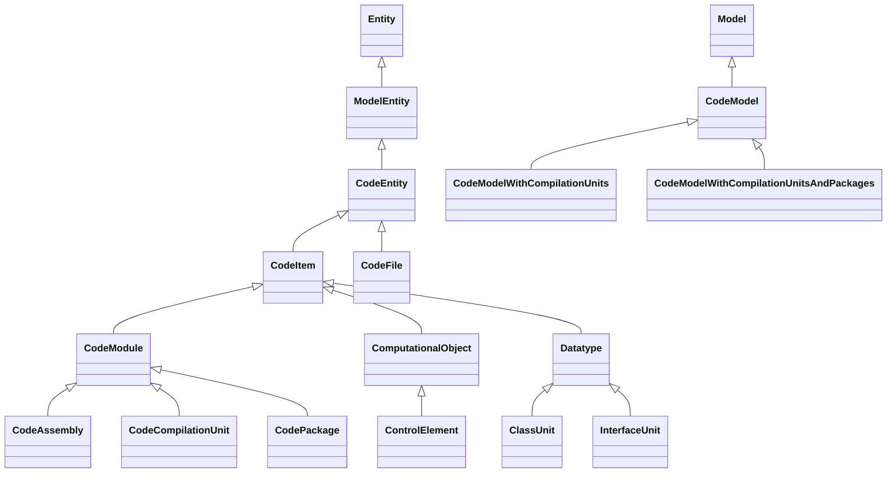
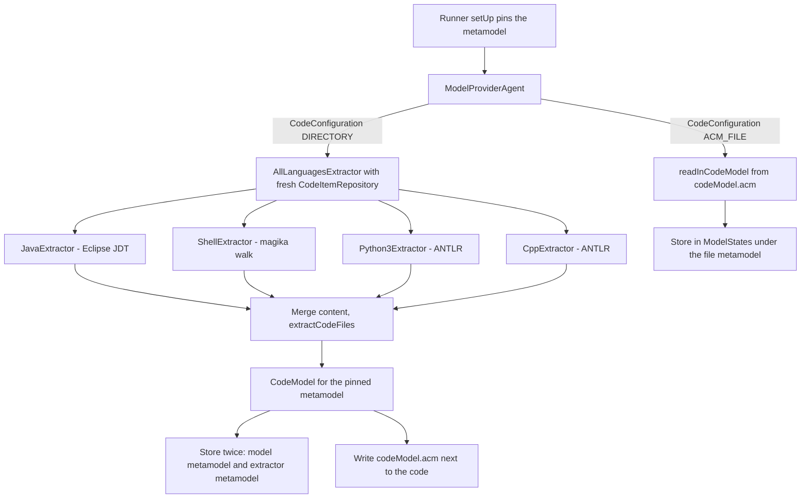

The **code model** is ARDoCo's normalized representation of source code, inspired by the OMG Knowledge Discovery Model (KDM). It lives in `core/framework/common` (`.../api/models/` and `.../api/models/code/`), is produced either by extracting a code directory or by deserializing a shipped `codeModel.acm` fixture, and is consumed by the code-traceability and ArTEMiS stages in `tlr` as well as by the LLM read-only tools used for inconsistency detection. [Architecture](architecture.md) describes the model API in pipeline context; this page owns the data model itself, the `.acm` serialization contract, and the extraction backends in `tlr/stages-tlr/model-provider`. Linking strategy details stay on [TLR Approaches](tlr-approaches.md), LLM tool mechanics on [LLM Integration](llm-integration.md).

## Type Hierarchy and Identity

`Model` (`.../api/models/Model.java`) is a sealed base that owns the model id: the no-arg constructor generates one via `IdentifierProvider.createId()`, and the `Model(String id)` constructor falls back to a generated id when passed `null`, so ids survive deserialization. `CodeModel` is its abstract sealed code specialization, permitting exactly the two concrete variants. `CodeFile` is deliberately *not* part of the `CodeItem` tree — see [CodeFile](#codefile).



*Code model type hierarchy: sealed `Model`/`CodeModel` roots, the three-way `CodeItem` split into `CodeModule`, `ComputationalObject`, and `Datatype`, and `CodeFile` as a non-item `CodeEntity`.*

- `CodeModelWithCompilationUnits` — `@Deterministic`, metamodel `CODE_WITH_COMPILATION_UNITS`; `getEndpoints()` flattens every contained item's `getAllCompilationUnits()`.
- `CodeModelWithCompilationUnitsAndPackages` — `@Deterministic`, metamodel `CODE_WITH_COMPILATION_UNITS_AND_PACKAGES`; wraps an inner `CodeModelWithCompilationUnits` and returns **all packages first, then all compilation units** from `getEndpoints()` — the source comments: *"The order is more than important here! Otherwise, ARDoCo Heuristics might not work properly."* The ArCoTL heuristics and the gold-standard enrollment in [Testing and Evaluation](testing.md) depend on this order.
- Both variants expose `getContent()`, `getEndpoints()`, `getMetamodel()`, `getTypeIdentifiers()`; the packages variant delegates `getContent()` to `getEndpoints()`.

`CodeItem` is a sealed `CodeEntity` whose three branches mirror the KDM split:

| Branch | Permits | Meaning |
|--------|---------|---------|
| `CodeModule` | `CodeAssembly`, `CodeCompilationUnit`, `CodePackage` | structural containers with `parentId` and id-list `content` |
| `ComputationalObject` | `ControlElement` | behavior (methods, constructors) |
| `Datatype` | `ClassUnit`, `InterfaceUnit` | types with line ranges and type relationships |

Every concrete class carries a Jackson polymorphism discriminator (`@JsonTypeInfo(property = "type")` / `@JsonTypeName`), so the `.acm` JSON tags each item (`"CodeCompilationUnit"`, `"CodePackage"`, `"ClassUnit"`, `"ControlElement"`, ...).

### CodeItemRepository — the identity anchor

`CodeItemRepository` is an id-keyed (`TreeMap<String, CodeItem>`) registry and the single source of truth for object identity inside a model. Two rules make it work:

1. **Register on construction.** Every `CodeItem` constructor takes the repository and calls `addCodeItem(this)`, keyed by the item's `IdentifierProvider` id.
2. **Reference by id, resolve lazily.** Content, parents, and type relationships are stored as **id lists** (`parentId`, `content`, `compilationUnitId`, `parentDatatypeId`, `extendedDataTypesIds`, `implementedDataTypesIds`, `datatypeReferencesIds`), resolved via `getCodeItem(id)` / `getCodeItemsByIds(ids)` through the repository.

`init()` re-registers all contained items with *this* repository instance (guarded by an `initialized` flag) — this is what stitches a freshly deserialized item graph to its repository. `CodeModel` calls it lazily from `initialize()`, and the `CodeModelDto.codeItemRepository()` accessor calls it before handing the repository out.

### Relationship fields and equality

The serialized relationship surface, all folded into `equals`/`hashCode` of the concrete classes (so deserialized instances stay identity-stable):

- `importedModuleNames` on `CodeCompilationUnit` and `CodeAssembly` — fully-qualified names of imported modules/packages, defaults to empty.
- `calleeNames` on `ControlElement` — plain names of invoked methods and instantiated types, unmodifiable view, defaults to empty.
- 1-indexed `startLine`/`endLine` on `Datatype` and `ControlElement`, `-1` when unknown.
- `CodeCompilationUnit` additionally holds `pathElements`, `extension`, and a `ProgrammingLanguage`; `getPath()` renders them back to a forward-slash relative path.
- `CodePackage.getType()` is `"Package"`; `CodeCompilationUnit.getType()` heuristically returns `"Class"`/`"Interface"` (by content name match), `"PackageInfo"` for `package-info.java`, `"Class"` as the `.java` default, and `"ShellScript"` for SHELL units.

Inherited equality: `Entity` compares id and name; `CodeModule` adds `parentId` + `content`; `Datatype` adds all relationship ids and line ranges; `CodeCompilationUnit` adds path elements, extension, language, and imports; `ControlElement` adds line ranges and callees; `ClassUnit`/`InterfaceUnit` only restrict the instanceof check. In contrast, the abstract `CodeModel` is annotated `@NoHashCodeEquals` (identity semantics — the ArchUnit rule `forbidEqualsAndHashCodeInCertainClasses` in `DeterministicArdocoTest` forbids implementing `equals`/`hashCode` there), while the two concrete models are `@Deterministic` (ordering reviewed by hand). See [Constraints](constraints.md) for the annotation contract.

### Identifiers

`IdentifierProvider.createId()` formats an `AtomicInteger` counter as `"acm%09djsd"`, starting at `1337` (`acm000001337jsd`). `ModelProviderInformant.process()` calls `IdentifierProvider.reset()` before every extraction, so repeated runs over the same code produce identical ids — which is what makes the shipped benchmark `.acm` fixtures stable and comparable against gold standards. Shipped models reflect the format: the MediaStore model id is `acm000003038jsd`, its items start at `acm000001338jsd`.

### CodeFile

`CodeFile` extends `CodeEntity` but is *not* a `CodeItem` and never enters the repository. It describes a file by `pathElements` + `extension` and optionally references its compilation unit via `compilationUnitId`. `CodeFile.fromRelativePath(...)` parses forward-slash relative paths into name/elements/extension. Extractors create one `CodeFile` per compilation unit **plus** `CodeFile`s for every other file found in the directory, so the model also covers files that carry no extractable structure (configs, resources, non-supported languages). The LLM tools navigate almost exclusively over this file list.

## `CodeModelDto` and the `.acm` Format

`CodeModel.CodeModelDto` (a record nested in `CodeModel`) is the entire serialization unit:

```java
public record CodeModelDto(@JsonProperty String id, @JsonProperty CodeItemRepository codeItemRepository,
                           @JsonProperty List<String> content, @JsonProperty List<CodeFile> codeFiles)
```

- `id` — the model id (`acm…jsd`), preserved across the round trip via the `Model(String id)` fallback-free path (non-null ids are kept as-is).
- `codeItemRepository` — the flat id → item map; polymorphic `type` discriminators make each entry self-describing.
- `content` — the root content id list (packages and/or parentless compilation units, depending on the metamodel).
- `codeFiles` — the `CodeFile` list.

`CodeModel.createCodeModelDto()` builds it; the record's `codeItemRepository()` accessor calls `repository.init()` first so a deserialized DTO yields a usable graph.

### Round trip

- **Write**: `CodeExtractor.writeOutCodeModel(model)` serializes the DTO to `codeModel.acm` (`CODE_MODEL_FILE_NAME`) next to the code directory via the shared mapper; a `JacksonException` is logged as a warning, not fatal.
- **Read**: `CodeExtractor.readInCodeModel(file, metamodel)` deserializes the DTO and switches on the requested `Metamodel` to construct `CodeModelWithCompilationUnits` or `CodeModelWithCompilationUnitsAndPackages`; a missing file or unparsable JSON yields `null` after a warning. Note the sharp edge: `ModelProviderInformant.process()` immediately dereferences the result, so a corrupt `.acm` surfaces as a `NullPointerException`, not a graceful skip.

The on-disk shape (MediaStore fixture, trimmed):

```json
{"id":"acm000003038jsd","codeItemRepository":{"repository":{"acm000001338jsd":{"type":"CodeCompilationUnit","id":"acm000001338jsd","name":"BaseEJB","comment":null,"parentId":"acm000001344jsd","content":["acm000001348jsd"],"pathElements":["Implementation","mediastore.basic","src","edu","kit","ipd","sdq","mediastore","basic"],"extension":"java","language":"JAVA","importedModuleNames":["java.util.HashMap","java.util.Map"]}}},"content":["acm000001339jsd"],"codeFiles":[{"name":"BaseEJB","pathElements":["Implementation","mediastore.basic","src","edu","kit","ipd","sdq","mediastore","basic"],"extension":"java","compilationUnitId":"acm000001338jsd"}]}
```

### Why the shared mapper re-configures Jackson 3 to Jackson 2 behavior

`JsonHandling` (`.../core/common/JsonHandling.java`) is the **only** legal Jackson mapper factory: it returns one shared, immutable, thread-safe Jackson 3 (`tools.jackson`) `ObjectMapper` (a second factory method accepts `StreamReadConstraints` for large payloads). The mapper is built from `JsonFactory.builderWithJackson2Defaults()` plus `configureForJackson2()`, and the source states the reason directly — *"Jackson 3 changed several defaults (e.g., alphabetic property sorting, enum handling, escaping of forward slashes, final fields as mutators). Keep the Jackson 2 behavior to retain the serialized format."* On top of that it disables `INDENT_OUTPUT` and `FAIL_ON_UNKNOWN_PROPERTIES` and pins visibility to field/creator `ANY` with getters/setters/is-getters `NONE` (the Jackson 2 creator default).

This is a deliberate format-stability contract: the shipped benchmark `.acm` fixtures (below) were written with Jackson 2 semantics, and both the ArchUnit rules `jacksonIsConfiguredGlobally` (only `JsonHandling` may construct or configure an `ObjectMapper`, including `builder`/`shared`/`rebuild`) and `noJackson2` (Jackson 2 core/databind are banned; only the shared `com.fasterxml.jackson.annotation` annotations are allowed) in `BasicArchitectureTest` keep every mapper in the codebase flowing through this one configuration. Changing it risks breaking `.acm` round-trip compatibility with every shipped fixture. [Architecture](architecture.md#shared-json-handling-jsonhandling) covers the mapper in its cross-model context.

## Benchmark Fixtures and Consumers of the Format

Ten `EvaluationProject` enum entries ship a `codeModel.acm` under `core/tests-base/src/main/resources/benchmark/<project>/model_<year>/code/` (mediastore, teastore, teammates, bigbluebutton, jabref, zengarden, scons, beets, rod, coronawarnapp), each paired with a GitHub repo URL and pinned commit:

- `getCodeModelFromResources()` loads the ACM fixture — fast and deterministic; used by default (`ArdocodeEvaluation` always, `ArcotlEvaluation`/`TransarcEvaluation` unless the full-clone variant is selected, ArTEMiS class/datafile tasks).
- `getCodeDirectory()` shallow-clones the pinned commit into `$TMPDIR/ARDoCo/<PROJECT>` for DIRECTORY-mode extraction; `CodeRunnerBaseTest` switches its TeaStore ACM fixture (`/code/teastore/codeModel.acm`) to a DIRECTORY configuration only when the env variable `testCodeFull` is set.

`ArdocodeEvaluation` builds its runner with `CodeConfiguration(inputCode, CodeConfigurationType.ACM_FILE)`, pinning `CODE_WITH_COMPILATION_UNITS_AND_PACKAGES` and enrolling the package-suffixed gold standard (`…/`) against the model's endpoints. Run-level details: [Testing and Evaluation](testing.md).

## Extraction Pipeline (`tlr/stages-tlr/model-provider`)

### Agent and configuration wiring

`ModelProviderAgent` (a `PipelineAgent`) is constructed with an optional `ArchitectureConfiguration` and an optional `CodeConfiguration` — at least one is required — and turns each into `ModelProviderInformant`s:

- `ArchitectureConfiguration.extractor()` maps `ModelFormat.PCM`/`UML`/`COMPONENT_LISTING` to the corresponding architecture extractor and rejects `ACM` (that format is code-only). Architecture extraction is out of scope here; see [Architecture](architecture.md).
- `CodeConfiguration` is a record `(File code, CodeConfigurationType type, Metamodel metamodel)` whose compact constructor validates shape (must exist; `DIRECTORY` needs a directory, `ACM_FILE` needs a file — else `IllegalArgumentException`). Its `extractors()` **only supports `DIRECTORY`**: it creates a fresh `CodeItemRepository` and one `AllLanguagesExtractor(repository, path, metamodel)`. In `ACM_FILE` mode it throws `IllegalStateException`; the agent handles that mode by passing the file plus metamodel directly to a file-reading informant instead.

`ModelProviderInformant.process()` is the extraction contract:

1. **ACM_FILE path**: `CodeExtractor.readInCodeModel(fromFile, metamodel)` → store the model in `ModelStates` (data id `ModelStatesData`) under its metamodel. No id reset, no extraction, no write-out.
2. **Extraction path**: `IdentifierProvider.reset()` → `extractor.extractModel()` → store under the **model's** metamodel → for `CodeExtractor` results, `writeOutCodeModel(codeModel)` writes `codeModel.acm` back into the code directory → store again under the **extractor's** metamodel (the double add covers extractors whose pinned metamodel differs from the requested one).

### AllLanguagesExtractor dispatch

`AllLanguagesExtractor` (`@Deterministic`) is the only main-source code entry point. Its constructor builds a fixed `Map<ProgrammingLanguage, CodeExtractor>`:

| Language | Backend | Constructed with |
|----------|---------|------------------|
| `JAVA` | `JavaExtractor` (Eclipse JDT, `generators/code/java/`) | repository, path, **requested metamodel** |
| `SHELL` | `ShellExtractor` (`generators/code/shell/`) | repository, path, **requested metamodel** |
| `PYTHON` | `Python3Extractor` (ANTLR, `generators/antlr/extraction/python3/`) | repository, path — **no metamodel** |
| `CPP` | `CppExtractor` (ANTLR, `generators/antlr/extraction/cpp/`) | repository, path — **no metamodel** |

The asymmetry is intentional but unfinished: `AntlrExtractor` hard-pins `Metamodel.CODE_WITH_COMPILATION_UNITS` in its constructor (`// TODO Allow different meta models`), and `ModelMapper.mapToCodeModel()` likewise always builds a `CodeModelWithCompilationUnits`. Feeding `CODE_WITH_COMPILATION_UNITS_AND_PACKAGES` to an ANTLR extractor therefore still yields a compilation-units model, and the informant's double `addModelStateToDataRepository` is what records the mismatch on both metamodel keys.

`synchronized extractModel()` is memoized: on the first call it runs every per-language extractor, merges all `getContent()` items into one `TreeSet`, builds the `CodeFile` list via `extractCodeFiles(...)`, and constructs the model for the pinned metamodel — an unhandled metamodel throws `IllegalStateException("This extractor does not support this metamodel")`.

`CodeExtractor.extractCodeFiles(codeEndpoints)` creates a `CodeFile` referencing each compilation unit, then walks the directory with the shared `FileTypePredictor` (magika) and adds `CodeFile`s (without unit reference) for every file whose relative path is not already a known compilation-unit path.



*Code model provisioning: runners pin the metamodel; the agent either deserializes the ACM fixture or dispatches directory extraction to the per-language backends, memoizes, and persists the result.*

### Java backend — Eclipse JDT

`JavaExtractor` (JDT, `generators/code/java/`) is the wired Java path:

1. `parseDirectory` collects `.java`-labeled files via the magika predictor, configures an `ASTParser` (`AST.getJLSLatest()`, latest `JavaCore` compliance/source/target, `setStatementsRecovery(true)`, empty compiler environment, UTF-8 per-file encodings), and parses with a `FileASTRequestor` into a `TreeMap` keyed by **relative path**. Notably the parser calls `setResolveBindings(true)` and then resets to `setResolveBindings(false)` before parsing — AST syntax is fully available, but whether `ITypeBinding`s resolve depends on this configuration.
2. `JavaModel` (`@Deterministic`) walks the ASTs: packages derive from `PackageDeclaration`s (`getPackageNames` splits qualified names; `mergePackages` merges same-named packages and fixes parent links), types become `ClassUnit`/`InterfaceUnit` with 1-indexed `startLine`/`endLine` from `CompilationUnit.getLineNumber`, methods become `ControlElement`s whose `calleeNames` are collected by an `ASTVisitor` over `MethodInvocation` names and `ClassInstanceCreation` type names, and `importedModuleNames` come from `ImportDeclaration` fully-qualified names.
3. Extended/implemented/referenced datatypes are matched by **type binding erasure** against the collected `JavaType`/`JavaClassifier`/`JavaInterface` records (`orElseThrow` on missing matches) — these passes only populate when bindings actually resolve.

`JavaModel.getCodeModel(Metamodel)` switches: `CODE_WITH_COMPILATION_UNITS` returns the internally built model, `CODE_WITH_COMPILATION_UNITS_AND_PACKAGES` wraps the same repository/content in the packages variant.

### ANTLR backend pattern (Python3, C++, and an unwired Java)

All ANTLR languages follow the same two-phase pattern, deliberately split for flexibility:

1. **Extract elements.** A per-language `ElementExtractor` (subclass of the abstract `ElementExtractor`) walks the directory, builds a `CommonTokenStream` from the generated lexer, and calls per-file `extractElements(tokens)` plus `extractComments(...)`. Extracted structure is stored as `Element`s — identity is an `ElementIdentifier(name, path, Type)` record with an optional parent identifier, plus start/end lines, callee names, imports, and a comment slot. `Type` enumerates `INTERFACE, CLASS, FUNCTION, FILE, PACKAGE, COMPILATIONUNIT, MODULE, NAMESPACE, VARIABLE`. Storage is a per-language `ElementStorageRegistry` (an `EnumMap<Type, ElementStorage<?>>` filled by the abstract `registerStorage()` hook): Java registers VARIABLE/FUNCTION/CLASS/INTERFACE/COMPILATIONUNIT/PACKAGE (with `JavaClassElement`), Python3 registers VARIABLE/FUNCTION/CLASS/MODULE/PACKAGE, C++ registers VARIABLE/FUNCTION/CLASS/NAMESPACE/FILE.
2. **Map to code items.** A `ModelMapper` takes root identifiers from the registry and builds the tree via a `CodeItemMapperCollection`, which dispatches each `Element` to the first mapper whose `supports(element)` matches. The per-language collections:
   - **Java** (`JavaCodeItemMapperCollection`): FUNCTION→`ControlElement` (with calleeNames and comment), CLASS/INTERFACE→`ClassUnit`/`InterfaceUnit`, COMPILATIONUNIT→`CodeCompilationUnit` (path parts split from the element path, imports attached, comment set, contained datatypes wired back to the unit), PACKAGE→`CodePackage`.
   - **Python3** (`Python3CodeItemMapperCollection`): same four roles, with MODULE→`CodeCompilationUnit.fromRelativePath(..., module.getImports())`.
   - **C++** (`CppCodeItemMapperCollection`): FUNCTION→`ControlElement`, CLASS→`ClassUnit`, NAMESPACE→`CodeAssembly` (language name attached), FILE→`CodeAssembly` (language name **and** file-level imports).

**Comments.** `CommentMatcher.matchComments` attaches each extracted `Comment` to the closest element on the **same path**: distance is the line difference, with distance `0` when the comment starts exactly one line after the element start (ideally a doc comment just above). Only equal-or-closer matches win; `Python3CommentMatcher` overrides the rule so comments *before* an element are never matched (its distance becomes `MAX_VALUE`), i.e., Python matches only comments following the element.

**Python3 specifics** (`Python3ElementExtractor`): imports (`import x`, `from x import y`) are accumulated per file path in `pendingImportsByPath` and attached when the module element is registered; assignments get variable elements with inferred types (`int`/`float`/`str`/`bool`, anything else `any`), skipping mismatches (e.g., tuple unpacking of different lengths) with a warning; packages are created recursively from the module path so modules always have parent packages.

**Grammars.** The grammars live in `src/main/antlr/grammar/{java,python3,cpp}/*.g4` (`JavaLexer/JavaParser`, `Python3Lexer/Python3Parser`, `CPP14Lexer/CPP14Parser`) and are compiled by the `antlr4-maven-plugin` (visitor generation, per-language packages under `edu.kit.kastel.mcse.ardoco.tlr.models.antlr4.*`) into `src/main/antlr-generated`, which `build-helper-maven-plugin` adds as a source folder.

**Wiring status.** A complete ANTLR Java stack exists (`generators/antlr/extraction/java/JavaExtractor`, `JavaElementExtractor`, `JavaModelMapper`, …) and is pinned by the mapper/element tests — but `AllLanguagesExtractor` maps `JAVA` to the **JDT** extractor, so the ANTLR Java stack is exercised by tests only. Switching Java to ANTLR (or unpinning the ANTLR metamodel) is the obvious extension point. Unrelated but worth knowing: the module declares a `com.github.javaparser:javaparser-core` dependency that no main-source class uses; the JDT dependency (`org.eclipse.jdt.core`) is what the Java backend actually runs on.

### Shell backend

`ShellExtractor` walks the directory with a `FileVisitor` (`ShellVisitor`), reads each file, and classifies it as shell via the magika predictor (`predictBytes(...).label()` equal to `"shell"`). Shell files become `CodeCompilationUnit`s (`ProgrammingLanguage.SHELL`, empty imports, path elements relativized to the root) with **no packages and no control elements**; the result is a plain `CodeModelWithCompilationUnits`.

## Consumers

- **ArCoTL code traceability** (`tlr/stages-tlr/code-traceability`): `CodeTraceabilityHelper.crossProductFromArchitectureItemsToCompilationUnits` cross-products architecture endpoints with code endpoints, filtered to `CodeCompilationUnit` (*"Currently only supported for codeCompilationUnits due to Heuristics"*), feeding the heuristic computation tree. `ArchitectureLinkToCodeLinkTransformerInformant` reads the `CODE_WITH_COMPILATION_UNITS_AND_PACKAGES` connection state and expands package links into compilation-unit links by path prefix, filling the `CodeTraceabilityState`. Pipeline composition: [TLR Approaches](tlr-approaches.md).
- **ArTEMiS NER/connection** (`tlr/stages-tlr/artemis`): strategies pin `CODE_WITH_COMPILATION_UNITS`; `ClassArtemisConnectionInformant` matches `codeModel.getClasses()` against named entities case-insensitively (including alternative names), `DatafileArtemisConnectionInformant` matches `getCodeFiles()` by `name + "." + extension`.
- **ExArch** (`LlmArchitectureProviderInformant` in model-provider): consumes the packages model — `getAllPackages()` feeds the `PACKAGES` and `PACKAGES_AND_THEIR_CLASSES` code prompts.
- **LLM read-only tools** (`core/framework/common/.../common/readonlytools/`): `CodeModelReadOnlyTools` serves `listDirectory`/`tree`/`findFiles`/`getFileInfo` over the `CODE_WITH_COMPILATION_UNITS` model (limits: 50 search results, 200 directory entries, 500 tree entries at depth 8; path normalization rejects absolute and `../` paths with `IllegalArgumentException("Path escapes project root: …")`; the model is loaded lazily via the `initializeCodeModel()` hook that validation agents register with `beforeToolExecution`, and `findFiles` re-fetches the model from the repository). `CodeDirectoryReadOnlyTools` is the filesystem counterpart with `readFile`/`readFileLines`/`search` and its own ignore list. The ID validation agents use them on `createUncached()` chat models (the cached one does not support tool calling) with `MAX_VALIDATION_RETRIES = 3` — 5 for the code-directory architectural-style informant. Tool surfaces and retry semantics: [LLM Integration](llm-integration.md); the consuming checkers: [Inconsistency Detection](inconsistency-detection.md).

## Validation and Tests

```bash
mvn -pl core/framework/common clean verify
mvn -pl tlr/stages-tlr/model-provider clean verify
```

Focused entry points for this page's subject matter:

| Test | Covers |
|------|--------|
| `JavaModelMapperTest` (`tlr/stages-tlr/model-provider/.../generators/antlr/mappers/`) | ANTLR Java end-to-end: 8 endpoints, 3 packages, `AClass` imports `edu.zwei.OtherInterface` |
| `Python3ModelMapperTest` (same package) | Python3 mapping: 3 packages, imports (`abc.ABC`, `dataclasses.dataclass`), every CU has a parent package |
| `JavaControlExtractorTest` (`.../generators/antlr/extraction/java/`) | ANTLR Java `ControlElement` extraction incl. `calleeNames` (`caller` → `helper`, `TestClass`, `method`) |
| `JavaExtractorTest` (`.../generators/java/`, JDT) | JDT model: same endpoint/import/callee assertions against the wired backend |
| `JavaExtractorTest` (`.../generators/antlr/extraction/java/`, ANTLR) | per-type registry counts (4 vars, 4 funcs, 8 classes, 4 interfaces, 8 CUs, 3 packages) |
| `Python3ExtractorTest` / `CppExtractorTest` (plus `CppModelMapperTest`) | per-language registry counts (Python3: 14 vars, 20 funcs, 11 classes, 9 modules; C++: 9 vars, 10 funcs, 2 namespaces, 5 classes) |
| `DeterministicArdocoTest`, `BasicArchitectureTest` (core/tests-base) | `@NoHashCodeEquals`/`@Deterministic` contract and the two Jackson rules |

Round-trip behavior is exercised implicitly by every ACM-based evaluation (`ArdocodeEvaluation`, `CodeRunnerBaseTest`); the ArchUnit suites are shared across trees as described in [Testing and Evaluation](testing.md), and the invariant catalogue they encode is on [Constraints](constraints.md).

## Extension Points

- **New language**: add a `ProgrammingLanguage` entry (the enum already lists many languages without extractors), implement an extractor, and wire it into the `AllLanguagesExtractor` map — keep in mind the ANTLR metamodel pinning TODO if you follow the ANTLR pattern.
- **New code item kind**: extend the sealed `CodeItem`/branch permits lists *and* the corresponding `@JsonSubTypes` registrations, or older `.acm` files will fail to deserialize.
- **Different metamodel for ANTLR languages**: lift the `CODE_WITH_COMPILATION_UNITS` pin in `AntlrExtractor`/`ModelMapper` and start passing the requested metamodel through `Python3Extractor`/`CppExtractor` constructors.
