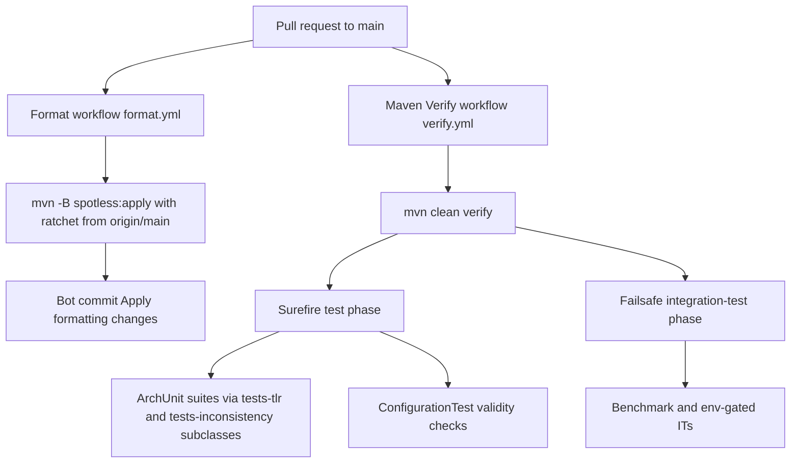

# Constraints - Enforced Code Invariants

This page catalogues the invariants a change to ARDoCo can violate, together with the exact mechanism that catches each violation. The constraints fall into three channels:

1. **Formatting invariants** — [Spotless](#formatting-spotless-with-ratchet) with a shared Eclipse formatter profile, license header, and import order, ratcheted to files changed against `origin/main`.
<!-- openwiki: broken internal link [#determinism-deterministicardoctest] heading anchor "determinism-deterministicardoctest" does not exist in /openwiki/constraints.md. Fix the href or restore the target, then delete this comment. -->
<!-- openwiki: broken internal link [#determinism-deterministicardoctest] heading anchor "determinism-deterministicardoctest" does not exist in /openwiki/constraints.md. Fix the href or restore the target, then delete this comment. -->
2. **Structural and semantic invariants** — [ArchUnit rule suites](#archunit-suites) in `core/tests-base` (layering, naming, stage ordering, the `Environment` env gateway, the tightened Jackson rules) and the annotation-driven contracts [`@Deterministic`](#determinism-deterministicardoctest) and [`@NoHashCodeEquals`](#determinism-deterministicardoctest), plus the [`Configurable`](#the-configurable-configuration-contract) field contract checked by reflection tests.
3. **Build-pipeline invariants** — [JSpecify](#nullness-jspecify-nullmarked-generation) `NullMarked` generation, the [pinned `flatten-maven-plugin`](#build-pipeline-pinned-flatten-maven-plugin), and [Renovate](#dependency-updates-renovate) as the dependency-update mechanism.



*How the constraints reach a pull request: formatting is auto-applied by the Format workflow, while the structural suites run as Surefire tests inside Maven verify; the Failsafe-run integration tests measure behavior and do not enforce these invariants.*

## Verification Commands

```bash
mvn spotless:check                              # Formatting gate (local; CI auto-fixes instead of failing)
mvn clean verify                                # Full monorepo: runs all ArchUnit + configuration suites (Surefire) and ITs (Failsafe)
mvn -pl core clean verify                       # Core tree: compiles the shared suites, runs module-local tests
mvn -pl tlr clean verify                        # Runs the suites against the core + tlr classpath
mvn -pl inconsistency-detection clean verify    # Runs the suites against the core + tlr + id classpath
```

The ArchUnit suites live in `core/tests-base/src/main`, so they compile into the regular `tests-base` jar — but they *execute* only where a test class with `@AnalyzeClasses` runs them — see [Where the suites run](#where-the-suites-run). Build/test basics live in [Quickstart](quickstart.md), the full build system in [Operations](operations.md).

## Formatting: Spotless with Ratchet

[Spotless](https://github.com/diffplug/spotless/tree/main/plugin-maven) (3.10.4, pinned via `spotless.version` in the root [pom.xml](../pom.xml)) is configured **once** in the root POM's `pluginManagement` and inherited by all four trees (`io.github.ardoco:parent`, `parent-core`, `parent-tlr`, `parent-id`). Every path is resolved via `${maven.multiModuleProjectDirectory}`, so building inside `core/`, `tlr/`, or `inconsistency-detection/` uses that tree's own copies of the config files (kept in sync across trees):

| Setting | File / value | Effect |
|---------|--------------|--------|
<!-- openwiki: broken internal link [../formatter.xml] file "../formatter.xml" does not exist. Fix the href or restore the target, then delete this comment. -->
| Java formatter | [`formatter.xml`](../formatter.xml) | Eclipse formatter profile; import it into your IDE |
| Unused imports | `removeUnusedImports` | Removed on every format |
<!-- openwiki: broken internal link [../license-header] file "../license-header" does not exist. Fix the href or restore the target, then delete this comment. -->
| License header | [`license-header`](../license-header) | `/* Licensed under MIT $YEAR. */` enforced on all Java sources (`$YEAR` substituted per file) |
<!-- openwiki: broken internal link [../spotless.importorder] file "../spotless.importorder" does not exist. Fix the href or restore the target, then delete this comment. -->
| Import order | [`spotless.importorder`](../spotless.importorder) | `java`, `javax`, `org`, `com`, then all remaining imports |
| POMs | `sortPom` | Dependencies, dependency management, plugins, modules, and executions sorted (`groupId,artifactId`); two-space indent |
| Markdown + `.gitignore` | `<formats>` | Trailing whitespace trimmed, files end with a newline, tab indentation |
| Line endings | `UNIX` | Enforced everywhere |
| **Ratchet** | `ratchetFrom origin/main` | Only files changed relative to `origin/main` are checked or rewritten — `spotless:apply` never reformats untouched code |

The ratchet has two operational consequences: a checkout needs full git history (the [Format workflow](../.github/workflows/format.yml) checks out with `fetch-depth: 0` for exactly this reason), and a file untouched relative to `origin/main` is exempt until you modify it.

**Enforcement channel.** Spotless is deliberately *not* bound to a Maven lifecycle phase — `mvn clean verify` does **not** run it. Instead:

- Locally: `mvn spotless:check` (fails with a diff) or `mvn spotless:apply`.
- CI: the [Format workflow](../.github/workflows/format.yml) runs on pull requests to `main` (and manual dispatch), determines the Java major version by probing `maven.compiler.target`/`maven.compiler.release`/`java.version` in the POM, runs `mvn -B spotless:apply`, and auto-commits the result ("Apply formatting changes") via `git-auto-commit-action`. A formatting violation on a PR is therefore fixed by a bot commit rather than failing the build.

## Nullness: JSpecify NullMarked Generation

Nullness is an enforced default, not a per-class decision:

- `org.fuchss:jspecify-maven-plugin` (0.1.0, inherited from the root `pluginManagement`) runs its `generate` goal in the `process-sources` phase, writing `package-info.java` files annotated `@NullMarked` directly into each module's source directory. Every package is therefore **non-null by default**; nullable references must be declared explicitly with `org.jspecify.annotations.Nullable` — no other nullness annotation family is used.
- `org.jspecify:jspecify` (1.0.1) is a dependency on the root POM, so every module gets the annotations without per-module setup.
- The generated `package-info.java` files are **git-ignored** (every tree's `.gitignore` lists `package-info.java`). Do not commit them manually and do not hand-write a package-info to "opt out": the plugin regenerates them on the next build.

**Enforcement channel:** build time (`process-sources`) in every module. IDE warnings for unannotated `null` usage rely on the generated markers; there is no separate CI gate for nullness.

## Build Pipeline: Pinned flatten-maven-plugin

All POMs use CI-friendly `${revision}` placeholders (currently `2.2.0-SNAPSHOT`). The root POM resolves them with `org.codehaus.mojo:flatten-maven-plugin`, **pinned to exactly 1.9.0** in the `pluginManagement` section — the pin comment records that 1.8.0's CI-friendly interpolator threw an NPE against this POM ([mojohaus/flatten-maven-plugin#523](https://github.com/mojohaus/flatten-maven-plugin/issues/523)), fixed in 1.9.0. The plugin runs with `flattenMode=resolveCiFriendliesOnly` and `updatePomFile=true`, expands `dependencyManagement` and `dependencies`, and executes at the `clean` and `process-resources` phases, so deployed POMs carry fully resolved versions.

**Invariant:** do not remove or float this pin; upgrading it requires re-verifying the `${revision}` resolution across all four trees.

## Dependency Updates: Renovate

Dependency updates for this monorepo are managed by **Renovate**, configured by a minimal [renovate.json](../renovate.json) that extends the shared preset `local>ArDoCo/actions:renovate-preset`. There is **no** root `.github/dependabot.yml` — Dependabot was removed in favor of Renovate. The three module trees (`core/`, `tlr/`, `inconsistency-detection/`) still carry their own `.github/dependabot.yml` files (github-actions ecosystem, weekly Wednesday 11:00 Europe/Berlin, `Dependency` commit prefix); these apply only when a tree is used as its own standalone GitHub repository, not in the monorepo. Version-pin policy for the build itself is otherwise handled by the root POM's `versions-maven-plugin`, which ignores `alpha`/`beta`/`RC` versions.

## ArchUnit Suites

The structural invariants are ArchUnit rules in `core/tests-base/src/main/java/edu/kit/kastel/mcse/ardoco/core/tests/architecture/`: [`ArchitectureTest`](../core/tests-base/src/main/java/edu/kit/kastel/mcse/ardoco/core/tests/architecture/ArchitectureTest.java) (which extends [`BasicArchitectureTest`](../core/tests-base/src/main/java/edu/kit/kastel/mcse/ardoco/core/tests/architecture/BasicArchitectureTest.java)) and [`DeterministicArdocoTest`](../core/tests-base/src/main/java/edu/kit/kastel/mcse/ardoco/core/tests/architecture/DeterministicArdocoTest.java). All analyze `edu.kit.kastel.mcse.ardoco`. The suites describe *what* must hold; how the resulting architecture fits together is explained in [Architecture](architecture.md), and the test infrastructure in [Testing & Evaluation](testing.md).

### Where the suites run

A structural quirk matters when reasoning about enforcement: the suites live in **`src/main`**, not `src/test`. They compile into the regular `tests-base` jar (with **compile**-scoped `archunit-junit5`) so other modules can consume them on their test classpath — and `tests-base` itself has **no test tree**, so the rules never execute in the core tree from their own module. ArchUnit only evaluates `@ArchTest` rules when a test class carrying `@AnalyzeClasses` runs, and that happens through tiny subclasses in the two test modules:

- [`tlr/tests-tlr/.../ArchitectureTest.java`](../tlr/tests-tlr/src/test/java/edu/kit/kastel/mcse/ardoco/tlr/tests/ArchitectureTest.java) and its `DeterministicArdocoTest` sibling — analyze `edu.kit.kastel.mcse.ardoco.core` + `edu.kit.kastel.mcse.ardoco.tlr`.
- [`inconsistency-detection/tests-inconsistency/.../ArchitectureTest.java`](../inconsistency-detection/tests-inconsistency/src/test/java/edu/kit/kastel/mcse/ardoco/id/tests/ArchitectureTest.java) and its `DeterministicArdocoTest` sibling — analyze `core` + `tlr` + `id` (the widest classpath).

Both subclasses are named `*Test`, so they run under **Surefire** during `mvn test`/`mvn verify` — not under Failsafe, which runs the benchmark/evaluation `*IT` harnesses. Because each module's analysis classpath differs, the same rules are re-evaluated against each tree's classpath. `core/tests-base/src/main/resources/archunit.properties` sets `archRule.failOnEmptyShould=false`, so a rule that matches nothing on a given classpath passes silently instead of failing — a module that lacks, say, any `*Link` class does not fail on that rule.

A rule violation surfaces as a Surefire failure and fails `mvn verify`.

### Layered architecture (`layerRule`)

`layerRule` defines **ten layers** with "may only be accessed by" restrictions that mirror the pipeline's data flow. `Common`, `Pipeline`, and `CodeTraceability` have no access restriction as targets.

| Layer | Defined by packages | May only be accessed by |
|-------|--------------------|-------------------------|
| Common | `..common..`, `..data..`, `..api..`, `..tests..` | (unrestricted) |
| TextExtractor | `..textextraction..` | RecommendationGenerator, ConnectionGenerator, InconsistencyDetection, Pipeline, Common, Execution, Artemis |
| ModelExtractor | `..models..` | RecommendationGenerator, ConnectionGenerator, CodeTraceability, InconsistencyDetection, Pipeline, Common, Execution, Artemis |
| RecommendationGenerator | `..recommendationgenerator..` | ConnectionGenerator, InconsistencyDetection, Pipeline, Common, Execution |
| ConnectionGenerator | `..connectiongenerator..` | CodeTraceability, InconsistencyDetection, Pipeline, Common, Execution, Artemis |
| Artemis | `..artemis..` | ConnectionGenerator, Pipeline, Execution, Common, InconsistencyDetection, CodeTraceability |
| InconsistencyDetection | `..inconsistency..`, `..id..` | Pipeline, Common, Execution |
| CodeTraceability | `..codetraceability..` | (unrestricted) |
| Pipeline | `..pipeline..` | (unrestricted) |
| Execution | `..execution..` | Common (needed for tests) |

The layering protects the stage pipeline described in [Architecture](architecture.md): extraction stages feed recommendation and connection generation, detection consumes results, and the `execution` runners sit on top where only common/test code may call back into them.

### Stage-ordering and naming rules

Five sibling rules pin down *when* a type may be used and *where* it may live:

- **`noDependencyOnExecution`** — classes in `..execution..` may only be depended on by `..execution..` and `..tests..` code; runners are entry points, not libraries.
- **`modelInstancesOnlyAfterModelExtraction`** — classes with the simple name `Model` may only be used (as dependency targets) by the model, recommendation, connection, inconsistency (`..inconsistency..`/`..id..`), pipeline, common, output, tests, and artemis packages. Model instances are produced by model extraction and consumed downstream.
- **`linksOnlyAfterConnectionGenerator`** — classes whose simple name ends in `Link` may only be depended on by connection-generator, code-traceability, trace-link, inconsistency, pipeline, common, api, tests, and artemis packages: links exist only after the connection generator produced them.
- **`usingLinkAsNamingOnlyInConnectionGenerator`** — `*Link`-named classes may live only in the `..tracelink..`, `..codetraceability..`, and `..connectiongenerator..` packages. Introducing a `SomethingLink` class anywhere else (e.g., in a stage or util package) violates the naming contract even if no dependency direction is broken.
- **`inconsistencyOnlyAfterInconsistencyDetection`** — classes whose name contains `Inconsistency` may only be depended on by the inconsistency, id, execution, api, common, and tests packages: inconsistency findings exist only after the detection stage.

### `BasicArchitectureTest`: cross-cutting rules

The base class of `ArchitectureTest` enforces seven cross-cutting rules.

**`noGetEnv` — the `Environment` gateway.** No class except `edu.kit.kastel.mcse.ardoco.core.common.util.Environment` may call `System.getenv()` or `System.getenv(String)`. `Environment` (module `common`, the lowest framework module, so present on every classpath) is thus the single environment-variable gateway:

- On class initialization it checks for a `.env` file in the working directory and loads it once (`io.github.cdimascio:dotenv-java`); with no `.env` it logs an info and runs without one.
- `Environment.getEnv(key)` returns the **`.env` value first** and falls back to the system environment — a `.env` entry beats the system variable. Missing values return `null`.
- `Environment.getEnvNonNull(key)` logs an error ("use '.env' or your system to set it up") when the variable is missing, but still returns `null` — the strictness is in the log, not an exception.

All environment variables are documented in [`/sample.env`](../sample.env); the runtime configuration surface is covered in [Operations](operations.md). If you need a new variable, read it via `Environment` — a direct `System.getenv` call will fail the suite.

**Tightened Jackson rules.** ARDoCo standardizes on Jackson 3 (`tools.jackson`); two rules keep serialization uniform:

- **`jacksonIsConfiguredGlobally`** — only [`JsonHandling`](../core/framework/common/src/main/java/edu/kit/kastel/mcse/ardoco/core/common/JsonHandling.java) may create or configure a Jackson mapper. The rule forbids every other class from calling constructors of `ObjectMapper` and its subclasses (e.g. `JsonMapper`) and from calling `builder`, `shared`, or `rebuild` on them. `JsonHandling` returns one shared, immutable, thread-safe mapper built from `JsonFactory.builderWithJackson2Defaults()` with `configureForJackson2()`, keeping the Jackson-2-era serialized format (alphabetic property sorting, enum handling, field-based visibility) while disabling `INDENT_OUTPUT` and `FAIL_ON_UNKNOWN_PROPERTIES`; an overload accepts custom `StreamReadConstraints` for large payloads. Centralizing mapper configuration guarantees that every module serializes models identically (see [Code Model](code-model.md) for the serialized artifacts).
- **`noJackson2`** — classes under `edu.kit.kastel.mcse.ardoco..` must not depend on `com.fasterxml.jackson.core..` or `com.fasterxml.jackson.databind..`. Jackson 2 remains on the classpath only transitively (e.g., via langchain4j); the shared Jackson **annotations** package `com.fasterxml.jackson.annotation` stays allowed because Jackson 3 consumes it too.

**`configurableFieldsOnlyInConfigurableClasses`.** A field annotated `@Configurable` must be declared in a class assignable to [`AbstractConfigurable`](#the-configurable-configuration-contract) — configuration by reflection cannot silently escape the framework.

**`traceLinksShouldBeFinal`** plus the module-local [`TraceLinkArchitectureTest`](../core/framework/common/src/test/java/edu/kit/kastel/mcse/ardoco/core/TraceLinkArchitectureTest.java): every `TraceLink` subclass except `TraceLink` itself must be `final`, and non-private methods must not expose `TraceLink` subclasses in return or parameter types — API positions use the base `TraceLink` type, and concrete link types are closed for extension. The module-local variant runs in the core tree's own Surefire run (`core/framework/common`'s test tree).

**`noForEachInCollectionsOrStream`.** `forEach`/`forEachOrdered` on `Stream` and `List` are banned with the stated reason "Lambdas should be functional. ForEach is typically used for side-effects." Use `forEachWithIndex`, collection-specific iteration, or pure transformations instead.

**`preferEclipseCollections`.** Interface methods (outside `..metrics..`) must not expose or accept raw JDK `List`, `Set`, `SortedSet`, `Map`, or `SortedMap` types — the [Eclipse Collections](https://www.eclipse.org/collections/) equivalents (`ImmutableList`, `SortedSet`, …) are the API standard, giving the immutability and ordering guarantees the data model relies on.

### Determinism: `DeterministicArdocoTest` and the annotations

Two annotations in `core/framework/common/.../architecture/` carry the determinism contract; the rules in `DeterministicArdocoTest` enforce it:

- **`@Deterministic`** marks a class as *deterministic by user review* — its ordering behavior has been audited by hand, with an optional `value()` string as the reviewer's comment. It is the documented opt-out for code that provably needs an unordered type (e.g. fixed lookup tables whose iteration order is never observable).
- **`@NoHashCodeEquals`** marks a class that must **not** override `equals`/`hashCode` — instances keep identity semantics. `forbidEqualsAndHashCodeInCertainClasses` fails any `@NoHashCodeEquals` class that implements either method. The abstract `CodeModel` uses this deliberately (identity semantics; see [Code Model](code-model.md)).

The collection rules keep pipeline runs reproducible (same input → same iteration order → same output):

- **`forbidUnorderedSetsAndMaps`** — classes outside `..tests..`, `..metrics..`, and `..magika..` that are **not directly annotated** `@Deterministic` (the exemption is per-class; it is not inherited from a superclass) must not access or depend on the unordered JDK/Eclipse types and factories: `Set`/`HashSet`, `MutableSet`/`ImmutableSet`/`Sets`, `Map`/`HashMap`, `MutableMap`/`ImmutableMap`/`Maps`.
- **`forbidHashMapAndHashSetInFavorOfLinkedVersions`** — outside `..tests..` and `..magika..`, `HashMap` and `HashSet` are banned outright; use the linked variants (`LinkedHashMap`/`LinkedHashSet`) whose iteration order follows insertion order.
- **`ensureContractBetweenEqualsHashCodeAndCompareTo`** — a class that directly implements `Comparable` (and is not an enum, interface, or anonymous class) must implement **both** `equals` and `hashCode`; ordering-based and equality-based containers then agree on the same notion of sameness.
- **`ensureSortedCollectionsOnlyForComparableTypes`** (fields) and its two return-type variants — sorted collection fields and sorted-collection return types (`SortedMap`, `ImmutableSortedMap`, `MutableSortedMap`, `SortedSet`, `ImmutableSortedSet`, `MutableSortedSet`) must be parameterized with a `Comparable` element type, so sorted containers are actually sortable.

**Consequence for contributors:** if the build rejects an unordered collection, either switch to the sorted/linked variant (preferred) or annotate the class `@Deterministic` and record why the order is unobservable in the annotation's `value()` — a reviewer will check that claim.

## The `Configurable` Configuration Contract

Every pipeline component extends [`AbstractConfigurable`](../core/framework/common/src/main/java/edu/kit/kastel/mcse/ardoco/core/configuration/AbstractConfigurable.java) (the base of `AbstractPipelineStep`), so stages, agents, informants, and states share one configuration mechanism. The contract has three enforced parts.

**Field targeting.** Fields annotated [`@Configurable`](../core/framework/common/src/main/java/edu/kit/kastel/mcse/ardoco/core/configuration/Configurable.java) may only exist in `AbstractConfigurable` subclasses (ArchUnit rule above), and the reflection test [`ConfigurationTestBase.testValidityOfConfigurableFields`](../core/tests-base/src/main/java/edu/kit/kastel/mcse/ardoco/core/tests/eval/ConfigurationTestBase.java) (bound to JUnit by a `ConfigurationTest` in each test tree) asserts such fields are **neither `final` nor `static`** — reflection must be able to overwrite them per run.

**Key resolution and application.** `AbstractConfigurable.applyConfiguration(ImmutableSortedMap<String, String>)` is `final`: it reflects over the class hierarchy's declared fields (stopping at `Object`/`AbstractConfigurable`), applies values whose key matches, delegates the same map to internal child components (`delegateApplyConfigurationToInternalObjects`), and stores the map as `lastAppliedConfiguration`. Keys default to `<SimpleClassName>::<fieldName>` (connector `"::"`); a custom key can be set via `@Configurable(key = "...")`; with `@ChildClassConfigurable` the key uses the **concrete** subclass name instead of the declaring class, so inherited fields are configurable per subclass — combining `@ChildClassConfigurable` with an explicit key throws. A class-level `@NoConfiguration` skips that hierarchy level entirely. Supported field types are `Integer`, `Double`, `Boolean`, enums (by constant name), and `List<String>` (values split on `","`); unsupported types are logged as errors instead of failing the run — the field simply keeps its default. The configuration flows top-down through the pipeline composite (see [Architecture](architecture.md)).

**Default map extraction.** [`ConfigurationHelper`](../core/pipeline-core/src/main/java/edu/kit/kastel/mcse/ardoco/core/execution/ConfigurationHelper.java) (module `pipeline-core`, annotated `@Deterministic`) provides the two entry points:

- `loadAdditionalConfigs(File)` parses UTF-8 override files with one `KEY=VALUE` per line (blank lines skipped, malformed lines logged), e.g. `ConnectionGenerator::initialFilters=true`.
- `getDefaultConfigurationOptions()` scans all concrete `AbstractConfigurable` subclasses under `edu.kit.kastel.mcse.ardoco` (non-abstract, outside `tests` packages) with Reflections, instantiates each via [`ConfigurationInstantiatorUtils.createObject`](../core/framework/common/src/main/java/edu/kit/kastel/mcse/ardoco/core/configuration/ConfigurationInstantiatorUtils.java) (which tries the known constructor signatures in order: no-arg, `(Map)`, `(DataRepository)`, `(String, DataRepository)`, …), and records every `@Configurable` field's default value as a string — `Double` formatted `%f` (English locale), `List<String>` joined with `","`, enums by constant name. A duplicate key or an unsupported default type aborts only that class's extraction (logged at debug, class skipped), keeping the generated map complete for everything else. `ConfigurationTestBase.showCurrentConfiguration` prints the same map as a ready-to-use `key=value` configuration file.

**Enforcement channel:** the ArchUnit rule and the `ConfigurationTest` validity checks run under Surefire in `tests-tlr` and `tests-inconsistency`; the default-map extraction is exercised whenever those tests run (and implicitly by every run that loads an additional-configs file).

## Invariant Enforcement Map

| Constraint | Enforced by | Runs where / when | Check with |
|------------|-------------|-------------------|------------|
| Formatting, header, import order, POM sorting | Spotless 3.10.4 + `ratchetFrom origin/main` | Format workflow (PR: auto-apply + commit); not lifecycle-bound | `mvn spotless:check` |
| Null-marked packages | `jspecify-maven-plugin` 0.1.0 | Every module, `process-sources` phase | Build (generated `package-info.java`) |
| `${revision}` resolution | `flatten-maven-plugin` pinned 1.9.0 | Every module, `clean` + `process-resources` | `mvn clean verify` |
| Dependency updates | Renovate (`renovate.json` → `local>ArDoCo/actions:renovate-preset`) | Repository automation | Renovate PRs |
| Layering | `layerRule` (ArchitectureTest) | Surefire in `tests-tlr` (core+tlr) and `tests-inconsistency` (core+tlr+id) | `mvn clean verify` / per-tree verify |
| Stage ordering + naming (`Model`, `*Link`, `Inconsistency`, execution) | `ArchitectureTest` sibling rules | Same Surefire suites | same |
| Env gateway (`System.getenv`) | `noGetEnv` + `Environment` dotenv semantics | Same Surefire suites; runtime via `Environment` | same + [Operations](operations.md) |
| Jackson mapper source; no Jackson 2 | `jacksonIsConfiguredGlobally`, `noJackson2` + `JsonHandling` | Same Surefire suites | same |
| `TraceLink` type discipline | `traceLinksShouldBeFinal`; module-local `TraceLinkArchitectureTest` | Surefire in tlr/id trees; `TraceLinkArchitectureTest` in `core/framework/common`'s own test tree | `mvn -pl core clean verify` |
| Deterministic iteration order | `@Deterministic`, `forbidUnorderedSetsAndMaps`, `forbidHashMapAndHashSetInFavorOfLinkedVersions` | Surefire in tlr/id trees | `mvn -pl tlr clean verify`, `mvn -pl inconsistency-detection clean verify` |
| Equality contracts | `@NoHashCodeEquals` rule, `ensureContractBetweenEqualsHashCodeAndCompareTo`, sorted-collection rules | Same Surefire suites | same |
| Configurable field contract | `configurableFieldsOnlyInConfigurableClasses` + `ConfigurationTestBase` (`ConfigurationTest` in each test tree) | Surefire in tlr/id trees | same |
| Functional style, Eclipse Collections API | `noForEachInCollectionsOrStream`, `preferEclipseCollections` | Same Surefire suites | same |

## Violation Semantics

- **ArchUnit / configuration tests:** a violated rule is a Surefire failure and fails `mvn verify` (and the Maven Verify workflow on `main`/PRs). Because the suites are re-run per tree, a violation introduced in a TLR or ID module is caught even though the rule classes live in core.
- **Spotless:** not a build failure — the Format workflow commits the fix onto the PR. Run `mvn spotless:check` before pushing if you want immediate feedback.
- **Empty classpaths:** `archRule.failOnEmptyShould=false` means a rule with no matching subjects passes; a suite subclass only meaningfully checks the packages listed in its `@AnalyzeClasses`.
- **Changing the rules:** the suites are ordinary (published) classes in `tests-base`; any weakening is itself a reviewable diff and immediately re-applies to every downstream tree on the next `mvn clean verify`.
