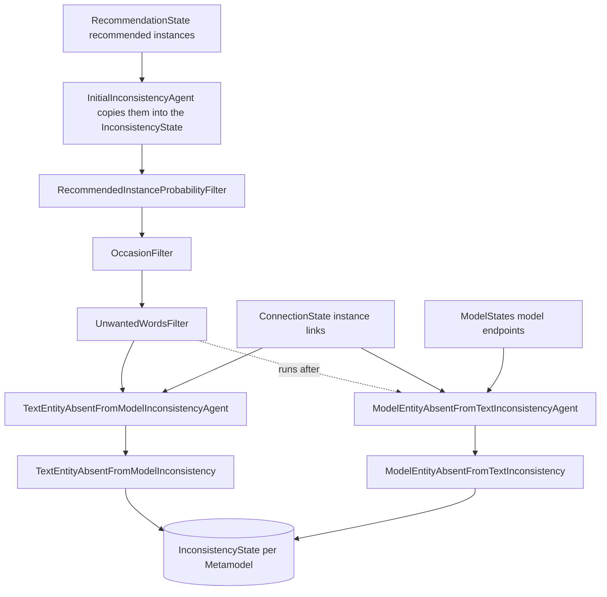
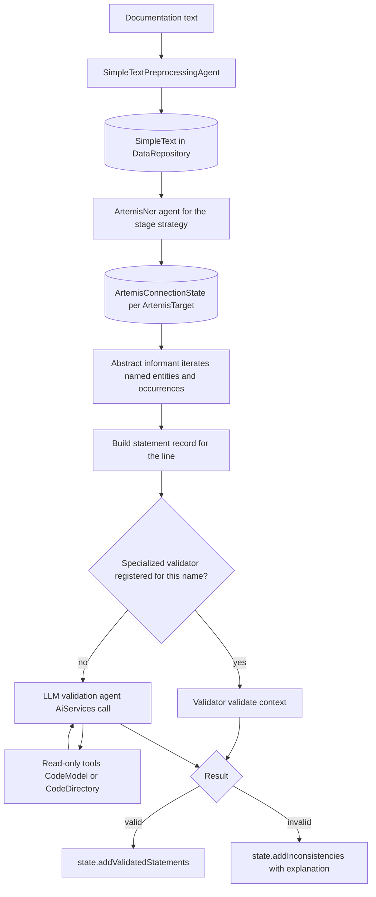

# Inconsistency Detection

ARDoCo's Inconsistency Detection (ID) identifies missing or deviating elements (**inconsistencies**) between artifacts such as software architecture documentation (SAD), the software architecture model (SAM), and code. The classic stage reuses trace link recovery results as a bridge: once trace links connect documentation sentences to model elements, ID flags the "orphan" elements on both sides of that bridge. The implementation lives in the `inconsistency-detection` module tree (`io.github.ardoco.id`); the classic stage is appended to the SWATTR pipeline, and three newer LLM-validated stages build on the ArTEMiS named-entity-recognition pipeline.

> **Terminology note**: In ARDoCo V1 the two SAD/SAM inconsistency kinds were called "Missing Model Elements" (MME) and "Unmentioned/Undocumented Model Elements" (UME). V2 renamed them to Text Entity Absent from Model (TEAM) and Model Entity Absent from Text (MEAT). The V1 names survive in file names, e.g., the `*_UME.csv` gold standards used by the evaluation.

## Module Layout

The `inconsistency-detection` tree (parent POM `io.github.ardoco.id:parent-id`) contains three Maven aggregators:

| Aggregator | Contents |
|------------|----------|
| `pipeline-id` | The four executable runners (`InconsistencyDetection`, `ArtemisInconsistencyDetection`, `ProgrammingLanguageInconsistencyDetection`, `ArchitecturalStylePatternInconsistencyDetection`); depends on all four stage modules plus the TLR `artemis`, `connection-generator`, `model-provider`, `recommendation-generator`, and `text-preprocessing` stages |
| `stages-id` | The stage modules `artemis-inconsistency-detection`, `inconsistency-detection`, and `programming-language-inconsistency-detection` |
| `tests-inconsistency` | Evaluation ITs, the hold-back harness, and the baseline stage (only built under the default `complete` profile) |

The fourth stage, `stages-id/architectural-style-pattern-inconsistency-detection`, is mounted **directly** in the parent POM's module list rather than in `stages-id`, so it is built alongside the other three stage modules.

The `artemis-inconsistency-detection` stage depends on the TLR `artemis` stage (NER strategies and connection states) and on the classic `inconsistency-detection` stage, whose inconsistency type records it reuses. The two LLM-validated stages depend on the TLR `artemis` stage and core `common`.

## The Four Pipeline-Id Runners

Each runner extends `ArdocoRunner`, defines its pipeline in `definePipeline`, rejects blank input text with an `IllegalArgumentException`, and puts the raw text into the `DataRepository` itself via `DataRepositoryHelper.putInputText` (no separate preprocessing pipeline step). The runner contract (`isSetUp` flag, `run()` vs. `runWithoutSaving()`) is documented on [Architecture](architecture.md).

| Runner | Composed stages |
|--------|-----------------|
| `InconsistencyDetection` | `TextPreprocessingAgent` → `ModelProviderAgent` → `TextExtraction` → `RecommendationGenerator` → `ConnectionGenerator` → `InconsistencyChecker` |
| `ArtemisInconsistencyDetection` | `ArtemisPreprocessing` → `ArtemisNer` → `ArtemisConnectionGenerator` → `ArtemisInconsistencyChecker` |
| `ProgrammingLanguageInconsistencyDetection` | `SimpleTextPreprocessingAgent` → `ArtemisNer` (single `ProgrammingLanguageNerStrategy`) → `ModelProviderAgent` + `ProgrammingLanguageInconsistencyChecker.getForCodeModel` (ACM_FILE) or `ProgrammingLanguageInconsistencyChecker.getForCodeDirectory` (DIRECTORY) |
| `ArchitecturalStylePatternInconsistencyDetection` | `SimpleTextPreprocessingAgent` → `ArtemisNer` (single `ArchitecturalStylePatternNerStrategy`) → `ModelProviderAgent` + `ArchitecturalStylePatternInconsistencyChecker.getForCodeModel` (ACM_FILE) or `ArchitecturalStylePatternInconsistencyChecker.getForCodeDirectory` (DIRECTORY) |

### Runner: InconsistencyDetection (classic SAD/SAM)

The end-to-end runner is `InconsistencyDetection` (`inconsistency-detection/pipeline-id/.../execution/runner/InconsistencyDetection.java`), an `ArdocoRunner` whose `setUp` calls `definePipeline`. This is the SWATTR trace link recovery pipeline (see [TLR Approaches](tlr-approaches.md)) with the `InconsistencyChecker` stage appended. Three details matter:

- The runner pins the architecture `Metamodel` to `ARCHITECTURE_WITH_COMPONENTS_AND_INTERFACES` by constructing the `ArchitectureConfiguration` directly with that metamodel and passing it to `ModelProviderAgent.getModelProviderAgent(...)` (unlike the TLR runners, whose `setUp` forbids a pre-set metamodel with an `IllegalArgumentException` and then calls `withMetamodel(...)` itself; see [TLR Approaches](tlr-approaches.md)). Note the contrast with the SWATTR runner, which pins `ARCHITECTURE_WITH_COMPONENTS`.
- Blank input text is rejected up front with an `IllegalArgumentException`.
- `definePipeline` puts the input text into the `DataRepository` itself rather than adding a separate preprocessing pipeline step.

Because the informants read `ConnectionStates`, `ModelStates`, and `InconsistencyStates` from the shared `DataRepository`, the `InconsistencyChecker` only produces results when the upstream stages have already run.

### Runner: ArtemisInconsistencyDetection

`ArtemisInconsistencyDetection.setUp` takes an input text, an optional `ArchitectureConfiguration`, an optional `CodeConfiguration`, additional configs, an output directory, a `LargeLanguageModel` for NER, and a list of `ArtemisNerStrategy` objects. It:

- **rejects pre-set metamodels**: if either configuration already carries a metamodel, `setUp` throws `IllegalArgumentException` — "Metamodel shall not be set in configurations. The runner defines the metamodels." It then pins the architecture configuration to `Metamodel.ARCHITECTURE_WITH_COMPONENTS` and the code configuration to `Metamodel.CODE_WITH_COMPILATION_UNITS` via `withMetamodel(...)`.
- composes `ArtemisPreprocessing.get(...)` (a `SimpleTextPreprocessingAgent` plus a `ModelProviderAgent` for the optional models), `ArtemisNer.get(...)` (one LLM NER agent per strategy), `ArtemisConnectionGenerator.get(...)`, and `ArtemisInconsistencyChecker.get(...)`.

The NER and connection-generation stages themselves are part of the ArTEMiS approach and are documented on [TLR Approaches](tlr-approaches.md); the model-selection and prompt mechanics they rely on are documented on [LLM Integration](llm-integration.md).

### Runners: ProgrammingLanguageInconsistencyDetection / ArchitecturalStylePatternInconsistencyDetection

Both runners share the same shape: `setUp` takes an input text, a mandatory `CodeConfiguration`, additional configs, an optional output directory, a `LargeLanguageModel` for NER (`llmForNer`), and a second `LargeLanguageModel` used by the validation agent (`validationAgentLlm`). `definePipeline` adds `SimpleTextPreprocessingAgent`, then `ArtemisNer` with exactly one NER strategy (the stage's own), and then dispatches on `CodeConfiguration.type()`:

- `ACM_FILE`: a `ModelProviderAgent` for `Metamodel.CODE_WITH_COMPILATION_UNITS` plus the checker's `getForCodeModel` variant;
- `DIRECTORY`: the checker's `getForCodeDirectory` variant with the code directory path;
- anything else: `IllegalArgumentException`.

## Classic TEAM/MEAT: The InconsistencyChecker Stage

**Source**: `inconsistency-detection/stages-id/inconsistency-detection/src/main/java/edu/kit/kastel/mcse/ardoco/id/InconsistencyChecker.java`

`InconsistencyChecker` extends `AbstractExecutionStage` and constructs exactly three agents in this order:

1. `InitialInconsistencyAgent`
2. `TextEntityAbsentFromModelInconsistencyAgent` (TEAM)
3. `ModelEntityAbsentFromTextInconsistencyAgent` (MEAT)

Its `initializeState()` builds an `InconsistencyStatesImpl` and registers it in the `DataRepository` under `InconsistencyStates.ID` (`"InconsistencyStates"`); this happens in `preparePipelineSteps` before any agent runs. The static factory `InconsistencyChecker.get(additionalConfigs, dataRepository)` applies configuration before execution. As with every stage, agents can be switched off via the stage's `enabledAgents` configuration (see [Architecture](architecture.md)).

### Inconsistency Types

#### TEAM — Text Entity Absent from Model

Elements described in the documentation that cannot be traced to any model element.

- **Agent**: `TextEntityAbsentFromModelInconsistencyAgent`
- **Informant**: `TextEntityAbsentFromModelInconsistencyInformant`
- **Type class**: `TextEntityAbsentFromModelInconsistency` — a record `(name, sentence, confidence, origin)` implementing `TextInconsistency`
- **Type string**: `"TextEntityAbsentFromModel"`

**Detection logic** (`minSupport` configurable, default `1`):

1. Read the recommended instances that `InitialInconsistencyAgent` copied into the inconsistency state (already reduced by the pre-filters), for each metamodel of `ModelStates`.
2. Remove every recommended instance that participates in a trace link, i.e., that appears as the first endpoint of an instance link in `ConnectionState.getInstanceLinks()`.
3. Additionally remove candidates whose words overlap with any linked recommended instance (they describe the same concept that is already linked).
4. Remaining candidates become `MissingElementInconsistencyCandidate`s with `ELEMENT_WITH_NO_TRACE_LINK` support; candidates that overlap each other accumulate `MULTIPLE_OVERLAPPING_RECOMMENDED_INSTANCES` support.
5. Candidates whose accumulated support is at least `minSupport` produce one `TextEntityAbsentFromModelInconsistency` **per distinct word** of the recommended instance, recording the word's 1-based sentence number (`getSentenceNumber() + 1`) and the recommended instance's probability as confidence.

#### MEAT — Model Entity Absent from Text

Model elements that have no (or insufficient) corresponding documentation.

- **Agent**: `ModelEntityAbsentFromTextInconsistencyAgent`
- **Informant**: `ModelEntityAbsentFromTextInconsistencyInformant`
- **Type class**: `ModelEntityAbsentFromTextInconsistency` (implements `ModelInconsistency`, wraps the flagged `ModelEntity`)
- **Type string**: `"ModelEntityAbsentFromText"`

**Detection logic**:

1. Collect the distinct model entities that appear as second endpoints of instance links, per metamodel of `ModelStates`.
2. Walk all `Model.getEndpoints()` and keep entities of a targeted type whose link count is below `minimumNeededTraceLinks` (default `1`).
3. Remove whitelist matches: a whitelist entry is a regex that must **fully match** the entity name or any of its name parts; matching entities are excluded (the helper is `static` and directly unit-tested).
4. Each remaining candidate becomes one `ModelEntityAbsentFromTextInconsistency`.

**Configuration options**:

| Option | Default | Meaning |
|--------|---------|---------|
| `minimumNeededTraceLinks` | `1` | Minimum number of trace links to a model entity required to avoid being flagged |
| `whitelist` | `[]` | Regex patterns (full match on name or name parts) for entities to exclude |
| `types` | `["Component", "BasicComponent", "CompositeComponent"]` | Model entity types (or type parts) to check |

### Detection Flow

*Agent order and data flow in the `InconsistencyChecker`: recommended instances are pre-filtered by three informants before the TEAM agent derives text inconsistencies from them; MEAT reads model endpoints and instance links directly. Both agents write into the per-metamodel inconsistency state.*

Within the stage, the TEAM and MEAT informants each iterate the metamodels of `ModelStates` and write into the per-metamodel `InconsistencyState`; MEAT works directly from `Model.getEndpoints()` and `ConnectionState` instance links and consumes no output of `InitialInconsistencyAgent`, whereas TEAM consumes the recommended instances that `InitialInconsistencyAgent` copied and pre-filtered.

### Agent 1: InitialInconsistencyAgent (Pre-filtering)

`initializeState()` copies the recommended instances from the per-metamodel `RecommendationState` into the matching per-metamodel `InconsistencyState`. The agent then runs three filter informants. All of them extend the `Filter` base class, an `Informant` whose `process()` iterates the metamodels derived from `ModelStates`, resolves each metamodel's inconsistency state, and rewrites that state's recommended instances by calling the abstract `filterRecommendedInstances(InconsistencyState)`.

| Informant | Purpose | Key defaults |
|-----------|---------|--------------|
| `RecommendedInstanceProbabilityFilter` | Drops RIs with low probability | `threshold=0.5`, `dynamicThreshold=true`, `dynamicThresholdFactor=0.7`, `thresholdNameAndTypeProbability=0.3`, `thresholdNameOrTypeProbability=0.8` |
| `OccasionFilter` | Drops RIs that do not recur | `expectedAppearances=2` |
| `UnwantedWordsFilter` | Drops RIs with unwanted words | `enableCommonBlacklist=true`, custom/common word lists, common file endings |

**RecommendedInstanceProbabilityFilter**: with `dynamicThreshold=true`, the threshold is recomputed per run as `dynamicThresholdFactor × highest RI probability` (calculated over the RIs the state currently holds). An RI survives if its probability exceeds the threshold **and** `checkProbabilitiesForNounMappingTypes` passes one of the three gates: highest type and highest name probability both above `thresholdNameAndTypeProbability`, or the type probability above `thresholdNameOrTypeProbability`, or the name probability above `thresholdNameOrTypeProbability`. Implementation quirk: the "name" probability is computed via `getHighestNameProbability(getTypeMappings())` rather than from the name mappings, so with the default thresholds all three gates collapse to a single test of the highest type-mapping probability against `thresholdNameAndTypeProbability`; real name mappings are never consulted and an RI without any type mapping is always dropped.

**OccasionFilter**: counts how many *distinct text positions* the RI's name-mapping words occupy (consecutive word positions count as one position); the RI survives only if the count is at least `expectedAppearances`.

**UnwantedWordsFilter**: removes an RI when any name mapping's reference trips one of four heuristics:

- the **lemma** of any reference word is on the blacklist — the configurable `customBlacklist` (default `meta`, `log`, `browser`, `task`, `operation`, `case`, `instance`, `script`) or, when `enableCommonBlacklist=true`, the common blacklist loaded once from the classpath resource `unwanted_words_filter_common.json` (`cpu`, `gpu`, `file`, `directory`, `event`, `bus`, `browser`, `chrome`, `firefox`, `safari`, `edge`, `instance`, `object`, `module`, `code`, `java`, `javascript`, `nodejs`, `npm`, `kotlin`, `request`, `response`, `servlet`, `unit`, `test`);
- any reference word's POS tag name contains `plural`;
- the lowercased reference **consists only of numbers** (full match of the pattern `-?\d+(\.\d+)?`);
- any reference word's text **ends with a common file ending** — a word like `model.pdf` matches the configurable `commonFileEndings` list (default `pdf`, `png`, `md`, `xml`, `yml`, `json`, `html`, `sh`, `bat`, `java`, `gradle`, `cpp`, `c`, `h`, `groovy`, `js`, `ts`, `css`, `sc`, `scala`).

Surviving RIs are written back with `setRecommendedInstances`. The source notes this filter is a prototype; the comment lists improvement ideas such as using computer-science words, lowering probabilities instead of removing high-probability RIs, considering phrases, and checking whether the word looks like a named entity.

### Agents 2 and 3

- `TextEntityAbsentFromModelInconsistencyAgent` is a thin `PipelineAgent` wrapper around `TextEntityAbsentFromModelInconsistencyInformant`, which implements the five-step TEAM logic described above. Its only `@Configurable` is `minSupport` (default `1`).
- `ModelEntityAbsentFromTextInconsistencyAgent` is a thin `PipelineAgent` wrapper around `ModelEntityAbsentFromTextInconsistencyInformant`, which implements the MEAT logic and owns the three `@Configurable` options listed in the table above. Type targeting checks the entity's `type` and `typeParts` against the configured `types` list, so `"Component"` also matches a `BasicComponent`.

## State and Candidate Model

| Class | Role |
|-------|------|
| `InconsistencyStatesImpl` | `EnumMap<Metamodel, InconsistencyStateImpl>` container; `build()` creates one state per `Metamodel` value |
| `InconsistencyStateImpl` | `AbstractState` holding `recommendedInstances` and `inconsistencies` per metamodel |
| `MissingElementInconsistencyCandidate` | Wraps a `RecommendedInstance` plus the set of accumulated `MissingElementSupport`s |
| `MissingElementSupport` | Enum: `ELEMENT_WITH_NO_TRACE_LINK`, `TRACED_ELEMENT_IN_SAME_SENTENCE`, `DEPENDENCY_TO_TRACED_ELEMENT`, `MULTIPLE_OVERLAPPING_RECOMMENDED_INSTANCES` |

Behavioral notes:

- `InconsistencyStateImpl.addInconsistency` (inherited from `AbstractInconsistencyState`) skips duplicates (equality per inconsistency type), so repeated word-level TEAM records with identical name/sentence/confidence collapse; `setRecommendedInstances` replaces the stored list in place.
- The pre-filters do not just remove entries; they **replace** the state's recommended instances via `setRecommendedInstances`, which is why filter order (probability → occasion → unwanted words) defines a narrowing funnel.
- `MissingElementInconsistencyCandidate.getAmountOfSupport()` is the number of *distinct* support kinds; `equals`/`hashCode` are keyed only by the wrapped `RecommendedInstance`.
- Of the four support kinds, only `ELEMENT_WITH_NO_TRACE_LINK` and `MULTIPLE_OVERLAPPING_RECOMMENDED_INSTANCES` are currently produced; `TRACED_ELEMENT_IN_SAME_SENTENCE` and `DEPENDENCY_TO_TRACED_ELEMENT` are declared for future heuristics.

### Shared State API vs. Per-Stage States

The shared interfaces and the common base implementation live in `core/framework/common` under `edu.kit.kastel.mcse.ardoco.core.api.stage.inconsistency`:

- `BaseInconsistencyState` — `addInconsistency(Inconsistency)`, `getInconsistencies()`, and a default `getInconsistenciesOfType(Class<T>)`; extends `IConfigurable`.
- `AbstractInconsistencyState` — adds the duplicate-skipping `addInconsistency` and the backing inconsistency list.
- `InconsistencyState` / `InconsistencyStates` — add the recommended-instance API and the per-`Metamodel` keying.
- `ArtemisInconsistencyState` (marker extension of `BaseInconsistencyState`) and `ArtemisInconsistencyStates` — per-`ArtemisTarget` keying, where `ArtemisTarget` is the record `(Metamodel, NamedEntityType)`.

The state accessors `getInconsistencyState(Metamodel)` and `getArtemisInconsistencyState(ArtemisTarget)` return `null` (with a warning) when the corresponding state is absent, while the collection accessors built on them (`getAllInconsistenciesForModel`, `getInconsistenciesOfTypeForModel`, `getAllInconsistencies`, `getAllTextInconsistencies`, `getAllModelInconsistencies`) return an empty list in that case; `getInconsistentSentences()` groups text inconsistencies by sentence number.

The two LLM-validated stages deliberately do **not** use this API: `ProgrammingLanguageInconsistencyState` and `ArchitecturalStylePatternInconsistencyState` are plain `PipelineStepData` interfaces registered under their own IDs, with exactly one state instance per run (no metamodel or target keying).

## Artemis-Based Inconsistency Detection

**Source**: `inconsistency-detection/stages-id/artemis-inconsistency-detection/src/main/java/edu/kit/kastel/mcse/ardoco/id/ArtemisInconsistencyChecker.java`

`ArtemisInconsistencyChecker` detects TEAM/MEAT inconsistencies between the SAD and a **code or architecture model produced by the ArTEMiS NER pipeline** rather than between SAD and SAM. Its constructor receives the `DataRepository` and the strategy list, builds the agents up front via the `ArtemisInconsistencyAgent` factory, and applies configuration through the static `get(additionalConfigs, dataRepository, strategies)` factory.

- `ArtemisInconsistencyAgent.createAgents` creates one `ArtemisTeamInconsistencyAgent` per strategy, plus an `ArtemisMeatInconsistencyAgent` **only** when the strategy's `NamedEntityType` is `COMPONENT` — `CLASS` and `DATAFILE` strategies are TEAM-only. Agent ids are derived from the strategy id (`<ENTITY_TYPE>Artemis`), e.g., `COMPONENTArtemisTeamInconsistencyAgent`.
- `initializeState()` builds an `ArtemisInconsistencyStatesImpl` over the strategies' `ArtemisTarget`s (a `LinkedHashMap` keyed by target) and registers it under `ArtemisInconsistencyStates.ID`. `getState(target)` lazily creates a state for unknown targets via `computeIfAbsent`, so states are keyed per `(Metamodel, NamedEntityType)` pair rather than by metamodel alone.
- `ArtemisTeamInconsistencyInformant` reads the per-target `ArtemisConnectionState` and reports **every occurrence of every unlinked named entity** as a `TextEntityAbsentFromModelInconsistency` with a fixed confidence of `DEFAULT_PROBABILITY = 0.92` and no origin candidate.
- `ArtemisMeatInconsistencyInformant` (only for `COMPONENT`) collects the model-entity ids referenced by the target's trace links into a set and flags every endpoint of the strategy's model (`modelStates.getModel(strategy.getMetamodel()).getEndpoints()`) whose id is not in that set, as a `ModelEntityAbsentFromTextInconsistency`. The informant is `@Deterministic`.
- Both informants extend the shared base class `ArtemisInconsistencyInformant`, which stores the `ArtemisNerStrategy` handed to the constructor and exposes `getStrategy()`/`getTarget()` so subclasses read traceability data for exactly their target; informant ids are derived from the strategy id as well (`<ENTITY_TYPE>ArtemisTeamInconsistencyInformant` / `…MeatInconsistencyInformant`).

Both informants reuse the type records of the classic `inconsistency-detection` stage and write into the per-target `ArtemisInconsistencyState`, which extends the core `AbstractInconsistencyState` (duplicate-skipping adds).

## LLM-Validated Checkers

Two newer stages validate documentation claims against code instead of trace links: `ProgrammingLanguageInconsistencyChecker` (are the documented programming-language statements true of the code?) and `ArchitecturalStylePatternInconsistencyChecker` (are the documented architectural styles/patterns implemented?). Both share the same skeleton:

### Stage Shape and Factories

Each checker is an `AbstractExecutionStage` that wraps **exactly one agent**, created by one of two static factories:

- `getForCodeModel(additionalConfigs, dataRepository, nerStrategy, validationAgentLlm)` → `CodeModel…InconsistencyAgent` (validates against the code model in the `DataRepository`);
- `getForCodeDirectory(additionalConfigs, dataRepository, nerStrategy, codeProjectPath, validationAgentLlm)` → `CodeDirectory…InconsistencyAgent` (validates against the source-code directory on disk).

Both factories call `applyConfiguration(additionalConfigs)`. `initializeState()` registers a **single** state instance under the stage's own ID — `ProgrammingLanguageInconsistencyState.ID` / `ArchitecturalStylePatternInconsistencyState.ID` — with no metamodel or target keying.

### NER Strategies and Prompts

Each stage ships an `ArtemisNerStrategy` implementation that tells the shared `ArtemisNer` stage what to recognize:

- `ProgrammingLanguageNerStrategy`: `NamedEntityType.PROGRAMMING_LANGUAGE`, metamodel `CODE_WITH_COMPILATION_UNITS`, prompt assembled from `programming-language-task-prompt.txt` + `programming-language-formatting-prompt.txt`.
- `ArchitecturalStylePatternNerStrategy`: `NamedEntityType.ARCHITECTURAL_PATTERN`, metamodel `CODE_WITH_COMPILATION_UNITS`, prompt assembled from `architectural-style-pattern-task-prompt.txt` + `architectural-style-pattern-formatting-prompt.txt`.

The strategy interface derives `ArtemisTarget(metamodel, entityType)` and the id `<ENTITY_TYPE>Artemis`; prompts are read from `/artemis/prompts/` below the stage's resources via `readPromptResource`. Neither ID strategy is `@Configurable` — it has no knobs beyond the runner-supplied LLMs. The task prompts define what counts as an occurrence (full documentation lines; explicit mentions only; specific rules for file extensions, web/query languages, or recognized patterns), and the formatting prompts fix the JSON shape (`name`, `type`, `alternativeNames`, `occurrences`). Prompt conventions and LLM selection are covered on [LLM Integration](llm-integration.md).

### Informant Loop and Statement/State Records

Both abstract informants (`AbstractProgrammingLanguageInconsistencyInformant`, `AbstractArchitecturalStylePatternInconsistencyInformant`) implement the same `process()`:

1. Resolve the per-target `ArtemisConnectionState` via `DataRepositoryHelper.getArtemisConnectionStates(dataRepository).getState(nerStrategy.getTarget())` and the stage's own inconsistency state.
2. Read the `SimpleText` produced by `SimpleTextPreprocessingAgent` and join its lines into the full documentation text. Occurrence sentence numbers are 1-based documentation line numbers, mapped to line index `sentenceNumber - 1`; out-of-bounds occurrences are skipped with a warning.
3. For each named entity and each occurrence, build a statement record and validate it (via the abstract hook, or — for the architectural-style stage — via the specialized-validator registry first).
4. Valid results are collected into `validatedStatements`; invalid results into `inconsistencies` together with the validator's `explanation`; both lists are added to the state in bulk.

The state records are deterministic and `TreeSet`-backed, so duplicates collapse by `compareTo`:

- `ProgrammingLanguageStatement(sentenceNumber, programmingLanguage, originalProgrammingLanguageName, sentenceText)` — `sentenceNumber` must be `>= 1`; the constructor resolves the `ProgrammingLanguage` enum by normalized name or file extension (fallback `OTHER`) and `getProgrammingLanguageDisplayName()` lowercases the resolved name. Ordering: sentence number, language, original name.
- `ProgrammingLanguageInconsistency(statement, explanation)` — comparable by statement then explanation; the state keeps `SortedSet`s of both statements and inconsistencies.
- `ArchitecturalStylePatternStatement(sentenceNumber, architecturalStylePatternName, normalizedArchitecturalStylePatternName, sentenceText)` — `normalize` lowercases, replaces underscores with dashes, collapses whitespace, and canonicalizes common aliases (e.g., MVC variants → `mvc`; layered/n-tier variants → `layered architecture`; microservice variants → `microservices`; client-server variants → `client-server`; pipes-and-filters → `pipe-and-filter`; event-driven variants → `event-driven architecture`; ports-and-adapters/hexagonal → `hexagonal architecture`).
- `ArchitecturalStylePatternInconsistencyStateImpl` mirrors the programming-language state with `TreeSet`s.

### Validation Agents, Tools, and Retries

Validation is delegated to a langchain4j **AiServices** agent interface per stage — `ProgrammingLanguageValidationLlmAgent` and `ArchitecturalStylePatternValidationLlmAgent` — each with two `@SystemMessage`/`@UserMessage`-annotated methods, one per evidence source (code directory vs. code model). The programming-language agent implements `validateProgrammingLanguageStatementAgainstCodeDirectory` and `validateProgrammingLanguageStatementAgainstCodeModel`; the architectural-style agent implements the corresponding `validateArchitecturalStylePatternStatementAgainstCodeDirectory`/`…AgainstCodeModel` methods. Both return a `(valid, explanation)` record (`ProgrammingLanguageValidationResult` / `ArchitecturalStylePatternValidationResult`). The system messages impose the same core contract: use only the provided read-only tools, never guess, treat only *repository-specific* claims as falsifiable (non-specific statements return `true`), base the final determination on source-code evidence, and do not use repository documentation as final evidence. The programming-language agent must explicitly verify "strictly/only/purely/exclusively/entirely in language X" claims; the architectural-style agent must not accept a mere naming coincidence (a `controller` package alone does not prove MVC).

The agents are built with:

- `validationAgentLlm.createUncached()` as the chat model — deliberately uncached because the ARDoCo `CachedChatLanguageModel` does not support tool calling;
- `CodeDirectoryReadOnlyTools(codeProjectPath)` for the directory variant, or `CodeModelReadOnlyTools(dataRepository)` for the code-model variant, plus a `.beforeToolExecution(...)` hook that lazily initializes the code model from `ModelStates` (`CODE_WITH_COMPILATION_UNITS`) on first tool use.

`CodeDirectoryReadOnlyTools` exposes `listDirectory`, `tree`, `readFile`, `readFileLines`, `findFiles`, `search`, and `getFileInfo` over a project root it resolves to a real path for symlink-aware containment; outputs are bounded (max 50 search results, 20 000 chars per file, 200 directory entries, 500 tree entries, depth 8) and generated/IDE directories (`.git`, `.idea`, `.gradle`, `.mvn`, `target`, `build`, `node_modules`, `out`, `bin`) are skipped. `CodeModelReadOnlyTools` provides the navigation/metadata surface (`listDirectory`, `tree`, `findFiles`, `getFileInfo`) over the `CodeModelWithCompilationUnits`.

Every validation call is retried up to `MAX_VALIDATION_RETRIES` with a warning per attempt; the retry limits and failure semantics differ per informant:

| Informant | `MAX_VALIDATION_RETRIES` | Catch / rethrow |
|-----------|--------------------------|-----------------|
| `CodeDirectoryProgrammingLanguageInconsistencyInformant` | `3` | `IllegalArgumentException` → rethrow last |
| `CodeModelProgrammingLanguageInconsistencyInformant` | `3` | `IllegalArgumentException` → rethrow last |
| `CodeModelArchitecturalStylePatternInconsistencyInformant` | `3` | `Exception` → rethrow wrapped in `RuntimeException` |
| `CodeDirectoryArchitecturalStylePatternInconsistencyInformant` | `5` | `Exception` → rethrow wrapped in `RuntimeException` |

So a persistently failing validation aborts the informant (and thus the agent/stage) rather than being silently swallowed.

### Specialized Validator Registry (Architectural Style/Pattern Only)

The architectural-style-pattern stage adds a pluggable pre-LLM validation layer:

- `ArchitecturalStylePatternStatementValidator` — interface with `supports(name)` and `validate(context)`.
- `ArchitecturalStylePatternStatementValidatorRegistry` — holds an immutable validator list; `withDefaultValidators()` currently returns an **empty** list with a hook comment where concrete validators can be added. `normalize` mirrors the statement record's normalization, and `findValidator` returns the **first** validator whose `supports(normalizedName)` matches.
- `ArchitecturalStylePatternValidationContext` — record `(dataRepository, namedEntityOccurrence, architecturalStylePatternName, fullDocumentationText, sentenceText, codeProjectPath)` with non-null checks on all but the path and a `hasCodeProjectPath()` helper.

The abstract informant's `validateWithSpecializedValidatorIfAvailable` builds the context (with `codeProjectPath` supplied by `getCodeProjectPathOrNull()`, which only the `CodeDirectory` informant overrides) and dispatches to the registry validator when one matches; only if none matches does it fall back to the generic LLM validation hook `validateArchitecturalStylePatternStatement(...)`. A registered validator therefore takes precedence over the LLM for the pattern names it supports.

### LLM-Validated Checker Flow

*Shared flow of the programming-language and architectural-style/pattern checkers: NER produces the named entities and occurrences; each occurrence line becomes a statement; a specialized validator (if registered) or the LLM validation agent with read-only tools decides validity, and the per-stage state collects both validated statements and explained inconsistencies.*

## Inconsistency Types and Output

`TextEntityAbsentFromModelInconsistency` is a record with `name`, `sentence` (1-based), `confidence`, and the originating `MissingElementInconsistencyCandidate`; equality compares name, sentence, and confidence. `ModelEntityAbsentFromTextInconsistency` wraps the `ModelEntity` and exposes its id via `getModelInstanceUid()`, which is what `ArdocoResult.getAllModelInconsistencies()` consumers (and the MEAT evaluation) compare against. Both provide `getType()`, a human-readable `getReason()`, and `toFileOutput()` entries; `FilePrinter.writeInconsistencyOutput` renders inconsistent sentences plus model inconsistency reasons into `inconsistencyDetection_<project>.txt` when the pipeline is run with output saving.

Note that the Artemis TEAM informant and the classic baseline reuse `TextEntityAbsentFromModelInconsistency` with `null` origin, so only the classic TEAM path populates the origin candidate.

## Testing and Evaluation

- **Unit tests** (`stages-id/inconsistency-detection/src/test/java/.../id/`): `types/AbstractInconsistencyTypeTest.java` plus `types/TextEntityAbsentFromModelInconsistencyTest.java` and `types/ModelEntityAbsentFromTextInconsistencyTest.java` verify type strings, equality, and (currently `@Disabled` because expected values change regularly) reason and file output; `agents/ModelEntityAbsentFromTextInconsistencyTest.java` covers the MEAT whitelist regex and type-targeting helpers.
- **Shared ArchUnit tests** (`tests-inconsistency`): `ArchitectureTest`, `ConfigurationTest`, and `DeterministicArdocoTest` extend the rule base classes from `core/tests-base`, enforcing the architecture rules, `@Configurable` validity, and determinism over `core`, `tlr`, and `id` packages.
- **Evaluation ITs**: `InconsistencyDetectionEvaluationIT` evaluates TEAM (micro-averaged metrics asserted against the project's `ExpectedResults` minimums), MEAT (UID comparison against the `*_UME.csv` unmentioned-elements gold standard on the cached base run), and a baseline variant gated by the `testBaseline` environment variable that swaps `InconsistencyChecker` for `InconsistencyBaseline` (a TEAM record with empty name and fixed confidence `0.69` for every sentence lacking a trace link) and logs weighted-average metrics without asserting them. The newer LLM-based ITs (`InconsistencyDetectionEvaluationArtemisIT`, `ProgrammingLanguageInconsistencyDetectionEvaluationIT`, `ArchitecturalStylePatternInconsistencyDetectionEvaluationIT`) are disabled for CI runs and are meant for manual execution with an LLM-backed configuration.

The hold-back run producers/evaluators, gold standards, metric gating, and run recipes for all of these are documented on [Testing & Evaluation](testing.md).

Within this module tree, the harness has three layers worth naming:

- **Run producers** (`integration/inconsistencyhelper/`): `HoldBackRunResultsProducer` (classic TEAM hold-back over an `AnonymousRunner` pipeline) and, for the ArTEMiS ITs, the `inconsistencyhelper/artemis/runproducer/` family producing `ImmutableMap<ArtemisEvaluationRun, ArdocoResult>` (base run plus held-back/extended runs): `SingleArtemisInconsistencyRunProducer` produces only the base run, `ComponentHoldBackArtemisInconsistencyRunProducer` produces one run per architecture component with a `HoldBackComponentArtemisNerStrategy` whose NER candidate list omits the held-back component id, `ClassHoldBackArtemisInconsistencyRunProducer` produces `numberOfRuns` hold-back runs selecting `numberOfHeldBackClassesPerRun` classes each (weighted toward rare classes with `1 / occurrences^0.5`, seeded per run via `seed + runIndex`) and runs an `AnonymousRunner` pipeline whose `HoldbackClassArtemisConnectionInformant` filters those class names out of the connection candidates, and `DatafileExtendedArtemisInconsistencyRunProducer` runs the extended SAD documents. Base runs and component hold-back runs go through the `ArtemisInconsistencyRunSupport.run(...)` helper, which sets up and runs the `ArtemisInconsistencyDetection` runner; the class hold-back runs instead use a bespoke `AnonymousRunner` pipeline, and the datafile extended runs construct that runner directly with a per-run output directory — with strategies in all three cases coming from the `ArtemisInconsistencyEvaluationConfiguration` bundles (`component()`/`clazz()`/`datafile()`). The class hold-back candidate set is derived from the `ClassArtemisInconsistencyTask` trace-link gold standard, whose parser strips package prefixes (`Environment.Base` → `Base`).
- **Evaluators**: per-entity `ArtemisInconsistencyEvaluator` implementations (`ComponentArtemisInconsistencyEvaluator` supports both MEAT and TEAM; `ClassArtemisInconsistencyEvaluator` and `DatafileArtemisInconsistencyEvaluator` are TEAM-only with hold-back/extended variants, since the interface's default `evaluateMeat` throws `UnsupportedOperationException`) compute `SingleClassificationResult<String>` via `ClassificationMetricsCalculator`, and `ArtemisInconsistencyEvaluationWriter` writes per-run and weighted-average results (`MEAT_…`/`TEAM_…` files plus confusion sets) into `target/testout/artemis_eval_id`; the LLM-stage helpers `ProgrammingLanguageInconsistencyDetectionEvaluation` and `ArchitecturalStylePatternInconsistencyDetectionEvaluation` evaluate from the stage state — inconsistency strings `"<sentence>,<name>,false"` (validated statements additionally feed a NER-occurrence evaluation as `"<sentence>,<name>"`) — via `ClassificationMetricsCalculator` with `confusionMatrixSum = null`.
- **Text-extension gold standards** (`src/test/resources/`): `programming-language-text-extensions/` (`rod`, `scons`, `teammates`, `zengarden`; six template sentence types — IMPLEMENTATION, LANGUAGE_USE, LANGUAGE_FILES, LANGUAGE_ARTIFACT, LANGUAGE_COMPONENT, LANGUAGE_STACK — filled with a fixed seed, documented in the folder `README.md`) and `architectural-style-pattern-text-extensions/` (`beets`, `coronawarnapp`, `rod`, `teammates`; LLM-written continuations that present fictional styles/patterns as established facts, prompt documented in `README.md`) both hold `extension-N.txt` documents plus `goldstandard-extension-N.csv` files with `line,pattern/language,valid` rows (the evaluators keep only the `valid=false` rows), and the extended runs load `extension-<runIndex>.txt` and merge the extension gold rows into the expected set. `datafile-artemis-text-extensions/` instead carries `sentenceID,file` gold rows mapping extended sentences to LLM-generated datafile names absent from the code model — every row is an expected TEAM inconsistency for `DatafileArtemisInconsistencyEvaluator`. A parallel tree under `tlr/tests-tlr` follows the same README-documented generation process but weaves a different, tree-specific set of generated files (e.g., `.feature` files) into its extension texts, with matching trace-link gold standards for the TLR datafile evaluation.

The classic TEAM/MEAT gold standards still come from the task enums: `InconsistencyDetectionTask` and `ComponentArtemisInconsistencyTask` reference the `*_UME.csv` unmentioned-elements files plus per-project `ExpectedResults` (real minimums) and `filterlists_all.txt` filter configuration, while the LLM-stage enums reference placeholder results: `ArchitecturalStylePatternInconsistencyDetectionTask`/`ProgrammingLanguageInconsistencyDetectionTask` the per-pattern/per-language CSVs and `ClassArtemisInconsistencyTask`/`DatafileArtemisInconsistencyTask` the class/datafile TEAM gold standards, all with `ExpectedResults(.420, …)`.

Run commands live on [Quickstart](quickstart.md) and [Operations](operations.md).

## Use Cases

- **Architecture Evolution**: identifying outdated or missing documentation during system evolution
- **Quality Assurance**: ensuring documentation completeness before releases
- **Onboarding**: helping new team members understand documentation gaps
- **Consistency Checking**: verifying alignment between informal documents and formal models
- **Reverse Engineering**: finding unmentioned components when analyzing existing systems
- **Documentation Validation**: checking that documented technologies and architectural patterns match the actual code (LLM-validated checkers)
