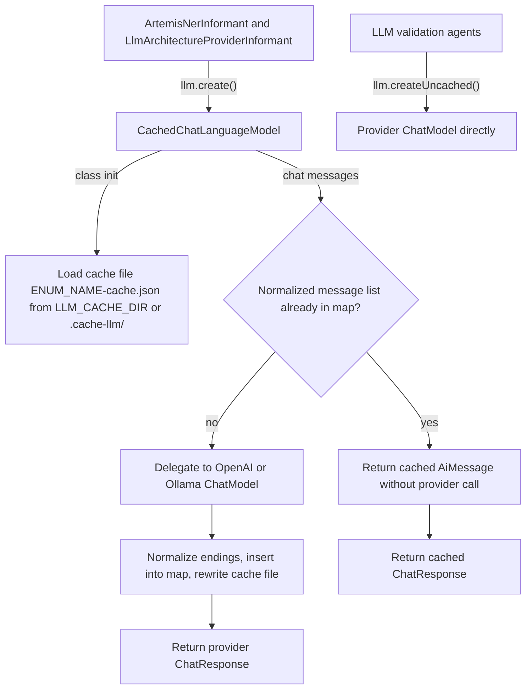
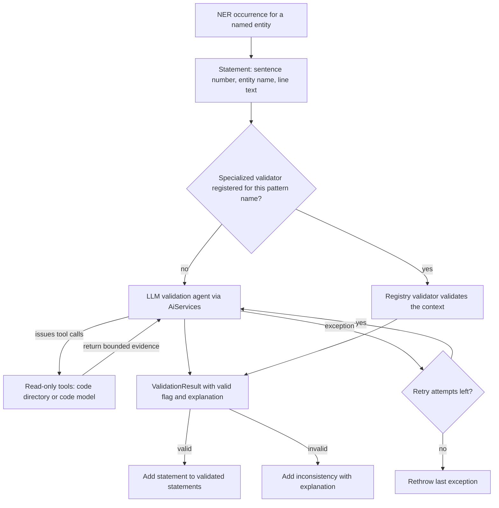

# LLM Integration

ARDoCo uses large language models in two families of stages. The TLR stages *recognize and synthesize*: ArTEMiS named-entity recognition extracts architecturally relevant entities from documentation, and the ExArch approach synthesizes an architecture model from documentation and code. The inconsistency-detection (ID) stages *validate*: the programming-language and architectural-style/pattern checkers ask an LLM agent, equipped with read-only repository tools, whether documentation statements hold against the actual code.

All of these share one provider entry point (`LargeLanguageModel`), one disk cache (`CachedChatLanguageModel`), one seed default, one prompt-resource convention for the NER stages, and one agent pattern (langchain4j **AiServices** with read-only tools). This page documents that shared machinery. Approach-level detection logic lives on [TLR Approaches](tlr-approaches.md) and [Inconsistency Detection](inconsistency-detection.md); the environment variables are tabulated on [Operations](operations.md) and [Quickstart](quickstart.md); test gating is covered on [Testing & Evaluation](testing.md).

## Where LLMs Participate

| Role | Informant / agent | Model accessor | Purpose |
|------|-------------------|----------------|---------|
| NER (ArTEMiS) | `ArtemisNerInformant` (one per `ArtemisNerStrategy`) | `create()` — cached | Recognize named architecture entities (components, classes, datafiles, programming languages, architectural patterns) per strategy prompt |
| SAM synthesis (ExArch) | `LlmArchitectureProviderInformant` | `create()` — cached | Extract component names from documentation/code packages and build an architecture model |
| Statement validation (ID) | `Code{Directory,Model}{ProgrammingLanguage,ArchitecturalStylePattern}InconsistencyInformant` | `createUncached()` | Validate documentation statements via an AiServices agent with read-only tools |
| Embedding (ArTEMiS links) | `ArtemisConnectionInformant` | direct `OpenAiEmbeddingModel` | Embed entity names with `text-embedding-3-large`; bypasses `LargeLanguageModel` |

An ID run uses **two distinct model roles**: the pipeline runners accept a `llmForNer` for the NER stage and a separate `validationAgentLlm` for the validation agent, so a large model can do recognition while a cheaper model does per-statement validation.

## LargeLanguageModel: The Provider Entry Point

[`LargeLanguageModel`](../tlr/stages-tlr/model-provider/src/main/java/edu/kit/kastel/mcse/ardoco/tlr/models/informants/LargeLanguageModel.java) is an enum in `tlr/stages-tlr/model-provider`; every constant pairs a human-readable name with a lazy `ChatModel` supplier. All LLM stages (TLR and ID) construct their models through it, which makes it the single place where provider configuration, timeouts, temperature, and the seed are applied.

### Model Variants

| Constant | Human-readable name | Provider model | Temperature |
|----------|---------------------|----------------|-------------|
| `GPT_5_5` | GPT-5.5 | `gpt-5.5-2026-04-23` | 1.0 |
| `GPT_4_O` | GPT-4o | `gpt-4o-2024-08-06` | 0.0 |
| `GPT_4_1` | GPT-4.1 | `gpt-4.1-2025-04-14` | 0.0 |
| `GPT_5_4_NANO` | GPT-5.4 nano | `gpt-5.4-nano-2026-03-17` | 0.0 |
| `GPT_5_4_MINI` | GPT-5.4 mini | `gpt-5.4-mini-2026-03-17` | 0.0 |
| `GPT_5_4` | GPT-5.4 | `gpt-5.4-2026-03-05` | 0.0 |
| `GPT_5` | GPT-5 | `gpt-5-2025-08-07` | 1.0 |
| `OPENAI_GENERIC` | value of `OPENAI_MODEL_NAME` | value of `OPENAI_MODEL_NAME` | 0.0 |
| `OLLAMA_GENERIC` | value of `OLLAMA_MODEL_NAME` | value of `OLLAMA_MODEL_NAME` | 0.0 |

The built-in OpenAI variants are pinned to **dated snapshots**, so a model name never silently floats to a newer release. The `*_GENERIC` variants read their model name from the environment at enum-class initialization and exist for custom or local deployments; a `GPT_OSS_20B` Ollama variant exists only as commented-out code. All constants are evaluated lazily — the supplier is only invoked when `create()` or `createUncached()` is called.

### Construction Behavior

- **OpenAI models** require `OPENAI_ORGANIZATION_ID` and `OPENAI_API_KEY`; if either is missing, creation throws `IllegalStateException`. The builder pins the temperature (see table), a 10-minute timeout, and the `SEED` value.
- **Ollama models** target `OLLAMA_HOST` with a 15-minute timeout, temperature 0.0, and the seed. If `OLLAMA_USER` and `OLLAMA_PASSWORD` are set, requests carry an HTTP basic `Authorization` header; if `OLLAMA_TOKEN` is set instead, the code builds an OpenAI-compatible client against the same host (30-minute timeout, temperature 0.0, seed) — this supports OpenAI-API-compatible gateways in front of Ollama.

### Deterministic Seeding

The seed is resolved once at class load from the `SEED` environment variable via the [`Environment`](../core/framework/common/src/main/java/edu/kit/kastel/mcse/ardoco/core/common/util/Environment.java) utility and **defaults to `422413373`**. An unparsable `SEED` value aborts with `IllegalArgumentException` rather than silently degrading to the default. The same seed is applied to both the OpenAI and the Ollama model builders, so changing it reproducibly changes every LLM call in a run.

### Cached vs. Uncached Creation

```java
public ChatModel create() {
    return new CachedChatLanguageModel(creator.get(), this.name());
}
```

`create()` wraps the provider model in a `CachedChatLanguageModel` whose **cache key is the enum constant name** (`this.name()`, e.g. `GPT_5_5`), giving one cache file per model variant. `createUncached()` returns the provider model directly. NER and ExArch model synthesis use the cached accessor; validation agents must use the uncached accessor because the cache does not support tool calling (see below).

Two predicates drive selection logic: `isGeneric()` (constant name ends with `_GENERIC`) and `isOpenAi()` (constant name starts with `GPT_`). The ExArch evaluation harness skips generic variants entirely and omits unconfigured generics from result reporting; the ArTEMiS evaluation harness iterates **all** declared values, so generic variants are only exercised when their environment variables are set. `LlmArchitectureProviderInformant` uses `isOpenAi()` to fail fast at construction if an OpenAI model is selected without credentials.

### Who Selects Which Model

| Runner / test | Model parameters |
|---------------|------------------|
| `Artemis` | one `llm` passed to `ArtemisNer` |
| `ExArch` | one `llm` passed to `LlmArchitectureProviderAgent` |
| `ArtemisInTransArC` | `llmForNer` passed to `ArtemisNer` |
| `ArtemisInExArch` | `llmForExArch` → `LlmArchitectureProviderAgent`, `llmForNer` → `ArtemisNer` |
| `ProgrammingLanguageInconsistencyDetection`, `ArchitecturalStylePatternInconsistencyDetection` | `llmForNer` → `ArtemisNer`, `validationAgentLlm` → the ID checker |



*Model creation and request flow: NER and architecture synthesis go through the disk cache; validation agents bypass it because their tool-calling loop is incompatible with the cache.*

## CachedChatLanguageModel: Disk Cache for Reproducible Runs

[`CachedChatLanguageModel`](../tlr/stages-tlr/model-provider/src/main/java/edu/kit/kastel/mcse/ardoco/tlr/models/informants/CachedChatLanguageModel.java) implements langchain4j's `ChatModel` by delegating to a wrapped provider model and persisting every prompt→response pair to disk. Its purpose is reproducible evaluation: rerunning an evaluation against the same prompts produces identical results without provider calls, and a crashed run resumes from the cache.

### Cache Directory Resolution

The directory is resolved once, statically at class initialization:

1. `LLM_CACHE_DIR` environment variable, if set;
2. otherwise the default `.cache-llm/` (relative to the working directory).

The directory is created eagerly (`mkdirs`); if creation fails and it is not already a directory, the class throws `IllegalStateException` and the run cannot start. All LLM-related variables are listed in [`/sample.env`](../sample.env).

### Cache Keying and Flow

- Each model variant persists one JSON map at `<ENUM_NAME>-cache.json` under the cache directory (e.g. `.cache-llm/GPT_5-cache.json`), because the cache key passed from `LargeLanguageModel.create()` is the enum constant name.
- The cache key for a request is the **full `ChatMessage` list's `toString()`** with line endings normalized (`\r\n` and `\r` → `\n`); response texts are normalized the same way on both store and load. Multi-turn conversations (as used by the ExArch informant's template chains) therefore key on the entire message history, not just the last user message.
- On a **hit**, the model returns a cached `AiMessage` without contacting the provider. On a **miss**, it delegates, inserts the normalized response, and rewrites the complete map with Jackson.
- Both `chat` overloads are `synchronized`, and `chat(ChatRequest)` simply forwards to the message-list overload, so cache reads and writes are serialized within a JVM.

### Failure Semantics

Cache I/O problems never fail a run: an unreadable or missing cache file is logged at debug level and treated as an empty cache, and a failed cache write is logged at error level while the provider response is still returned. A read-only or unwritable cache directory degrades performance and reproducibility but does not break execution.

### Interaction with Evaluation

Because a cache hit short-circuits the provider, repeated-run averaging over a warm cache measures nothing about the LLM — the ArTEMiS evaluation harness explicitly warns that multiple-runs evaluation "is not meaningful if the LLM is cached." Delete the cache file (or change `LLM_CACHE_DIR`) to force fresh provider calls.

### Tool-Calling Limitation

The cache implements the plain `ChatModel` interface only; it does not support langchain4j's tool-calling loop used by AiServices agents. This is why every validation informant constructs its agent with `validationAgentLlm.createUncached()` — the programming-language informants carry a source comment stating exactly this ("Ardoco CachedChatLanguageModel does not support Tool calling").

## Prompt Resources

The NER stages follow a strict prompt-resource convention: for every entity type there is a **task prompt** and a **formatting prompt**, named `<entity>-task-prompt.txt` and `<entity>-formatting-prompt.txt`.

| Stage module | Prompt resources | Entity type |
|--------------|------------------|-------------|
| `tlr/stages-tlr/artemis` | `class-task-prompt.txt` / `class-formatting-prompt.txt` | `CLASS` |
| `tlr/stages-tlr/artemis` | `component-task-prompt.txt` / `component-formatting-prompt.txt` | `COMPONENT` |
| `tlr/stages-tlr/artemis` | `datafile-task-prompt.txt` / `datafile-formatting-prompt.txt` | `DATAFILE` |
| `inconsistency-detection/stages-id/programming-language-inconsistency-detection` | `programming-language-task-prompt.txt` / `programming-language-formatting-prompt.txt` | `PROGRAMMING_LANGUAGE` |
| `inconsistency-detection/stages-id/architectural-style-pattern-inconsistency-detection` | `architectural-style-pattern-task-prompt.txt` / `architectural-style-pattern-formatting-prompt.txt` | `ARCHITECTURAL_PATTERN` |

The TLR files live in [`tlr/stages-tlr/artemis/src/main/resources/artemis/prompts/`](../tlr/stages-tlr/artemis/src/main/resources/artemis/prompts/component-task-prompt.txt); the ID stages mirror the same `artemis/prompts/` layout inside their own `src/main/resources`.

### How Informant Code Loads Them

Every `ArtemisNerStrategy` implementation declares its two resource file names as constants, loads their text with the shared default method `readPromptResource`, and composes the result into a `TwoPartPrompt(taskPrompt, formattingPrompt)`. `readPromptResource` reads from the classpath root `PROMPT_RESOURCE_ROOT = "/artemis/prompts/"`; a resource that is not on the classpath fails fast via `Objects.requireNonNull` (a `NullPointerException` from the eager stream check), while a read error surfaces as `IllegalStateException`. `Prompt`, `TwoPartPrompt`, `NamedEntityRecognizer`, `NamedEntityType`, and the SAD model come from the external `named-architecture-entity-recognition` artifact (`io.github.ardoco:named-architecture-entity-recognition`, version 2.1.0 in [`tlr/stages-tlr/artemis/pom.xml`](../tlr/stages-tlr/artemis/pom.xml)).

`ArtemisNerInformant.process()` builds a `NamedEntityRecognizer` with `llm.create()` (cached) and `strategy.createPrompt(dataRepository)`, recognizes entities in the SAD text, and stores the results — names, alternative names, and occurrence lines — into the per-target Artemis connection state. One strategy deviates from plain resource loading: `ComponentArtemisNerStrategy` appends a candidate list of the code model's endpoint names to the task prompt, grounding recognition in the extracted model.

The two prompt halves have distinct jobs, visible in the resource texts themselves: the **task prompt** defines what counts as an explicit mention (naming rules, alternative names, coreference resolution, and per-entity exclusions), and the **formatting prompt** pins the returned JSON shape — `name`, `type`, `alternativeNames`, `occurrences` — that the recognizer parses.

The ExArch architecture synthesis uses a different mechanism: `LlmArchitecturePrompt` is a code-defined enum of template strings (`EXTRACT_FROM_ARCHITECTURE`, `EXTRACT_FROM_CODE`, `AGGREGATION`) consumed by `LlmArchitectureProviderInformant` as sequential chat messages; it is not loaded from classpath resources.

## Validation Agents (langchain4j AiServices)

The two LLM-validated ID stages do not hand-craft chat requests. Each declares an **AiServices agent interface** — [`ProgrammingLanguageValidationLlmAgent`](../inconsistency-detection/stages-id/programming-language-inconsistency-detection/src/main/java/edu/kit/kastel/mcse/ardoco/id/informants/llmagents/ProgrammingLanguageValidationLlmAgent.java) and [`ArchitecturalStylePatternValidationLlmAgent`](../inconsistency-detection/stages-id/architectural-style-pattern-inconsistency-detection/src/main/java/edu/kit/kastel/mcse/ardoco/id/informants/llmagents/ArchitecturalStylePatternValidationLlmAgent.java) — and langchain4j generates the proxy that runs the system message, the user message, and the tool-calling loop.

### Interface Shape

Each interface declares **two methods**, one per evidence source:

- `validate...AgainstCodeDirectory(...)` takes an additional `codeProjectPath` parameter and is used when the repository is available on disk;
- `validate...AgainstCodeModel(...)` validates against the in-memory code model and has no path parameter.

Both methods are annotated with `@SystemMessage` (the validation contract and the allowed tool list) and `@UserMessage` with `@V`-bound variables: `namedEntityOccurrence`, the entity name, `fullText`, `line`, and (for the directory variant) `codeProjectPath`. Both return a small record — `ProgrammingLanguageValidationResult` or `ArchitecturalStylePatternValidationResult` — with a `valid` flag and a non-null `explanation`; the architectural-style record adds `valid(...)`/`invalid(...)` factories.

### The Validation Contract

The system messages impose the same core rules in both stages:

1. Use **only the provided read-only tools**; the message enumerates the exact tool surface (directory or model variant — see below).
2. Validate using repository evidence; do not guess.
3. Only **repository-specific claims** are falsifiable. A statement that makes no claim about the repository returns `true`; a claim contradicted by evidence returns `false`; a specific claim the evidence neither supports nor contradicts also returns `true`.
4. The final determination must be based on **actual source-code evidence**; repository documentation may be used only for orientation.

Each stage adds one domain rule: the programming-language agent must explicitly verify claims that something is implemented "**strictly, only, purely, exclusively, or entirely**" in a language, and the architectural-style agent must not accept a **naming coincidence** as proof (a package named `controller` alone does not establish MVC).

### Agent Construction and Tool Registration

All four informants build their agent identically:

```java
this.validationAgent = AiServices.builder(ProgrammingLanguageValidationLlmAgent.class)
        .chatModel(validationAgentLlm.createUncached()) //this is important because Ardoco CachedChatLanguageModel does not support Tool calling
        .tools(new CodeDirectoryReadOnlyTools(codeProjectPath))
        .build();
```

Code-directory informants install `new CodeDirectoryReadOnlyTools(codeProjectPath)`. Code-model informants install `CodeModelReadOnlyTools` and additionally register a hook:

```java
.beforeToolExecution(before -> codeModelReadOnlyTools.initializeCodeModel())
```

Because the tool object is constructed before the code model exists in the data repository, the hook lazily loads the model on the first tool execution of each validation call.

### Retry Limits

Validation calls are wrapped in a bounded retry loop with `MAX_VALIDATION_RETRIES`:

| Informant | Retries | Exception handling |
|-----------|---------|--------------------|
| `CodeDirectoryArchitecturalStylePatternInconsistencyInformant` | **5** | catches `Exception`, rethrows `RuntimeException(lastException)` |
| `CodeModelArchitecturalStylePatternInconsistencyInformant` | 3 | catches `Exception`, rethrows `RuntimeException(lastException)` |
| `CodeDirectoryProgrammingLanguageInconsistencyInformant` | 3 | catches `IllegalArgumentException`, rethrows it |
| `CodeModelProgrammingLanguageInconsistencyInformant` | 3 | catches `IllegalArgumentException`, rethrows it |

Every failed attempt logs a warning (`Validation failed. Retrying (i/n).`). The asymmetry — five attempts for the filesystem-backed architectural-style check, three everywhere else — is the only place where the two stages differ structurally beyond their tool surface.



*Validation flow in the LLM-validated ID stages: occurrences become statements; a registered specialized validator (architectural-style stage only) takes precedence over the AiServices agent, which loops against read-only tools under a bounded retry.*

## Read-Only Tool Surfaces

The validation agents are restricted to two tool classes in `core/framework/common`:

| Tool operation | `CodeDirectoryReadOnlyTools` | `CodeModelReadOnlyTools` |
|----------------|------------------------------|--------------------------|
| `listDirectory(path)` | yes | yes |
| `tree(path, maxDepth)` | yes | yes |
| `readFile(path)` | yes | — |
| `readFileLines(path, startLine, endLine)` | yes | — |
| `findFiles(glob)` | yes | yes |
| `search(query)` | yes | — |
| `getFileInfo(path)` | yes | yes |

Each class is annotated `@Deterministic`, and each agent's `@SystemMessage` enumerates exactly the surface its evidence source allows — so a code-model-grounded agent is *unable by construction* to request file contents, because the code model carries structure and metadata but no file bodies.

`CodeDirectoryReadOnlyTools` operates on a real filesystem project root (the constructor rejects null/blank paths and non-directories) and adds content access: full-file reads truncated at 20,000 characters, 1-based inclusive line ranges capped at 1,000 lines, binary detection (NUL-byte sniffing, files over 1 MB treated as unreadable), and a case-insensitive `search` over paths and UTF-8 contents that returns path matches plus line-numbered snippets with one context line and 500-character snippets. It skips the usual generated/IDE directories (`.git`, `.idea`, `.gradle`, `.mvn`, `target`, `build`, `node_modules`, `out`, `bin`) and reports file size and last-modified time via `getFileInfo`.

`CodeModelReadOnlyTools` serves the same navigation operations over the `CODE_WITH_COMPILATION_UNITS` model held in the data repository: directory listings and bounded trees are derived from the model's `CodeFile` paths, `findFiles` matches a glob against model paths, and `getFileInfo` returns model metadata (path, extension, containing directory, compilation-unit reference) rather than filesystem attributes.

### Bounded Responses

All responses are bounded so agent contexts stay small: at most 50 search results, 200 directory entries, 500 tree entries at depth 8, 20,000 characters per file read, 1,000 lines per range read, and 500-character search snippets. Truncation is marked in-band (`[TRUNCATED: …]`, `[TREE TRUNCATED]`, `[SEARCH RESULTS TRUNCATED]`).

### Path Safety

`CodeDirectoryReadOnlyTools` resolves every requested path against the configured project root and rejects **both** lexical traversal (`../../foo`) and symlink escapes (a symlink inside the project pointing outside) with `IllegalArgumentException`. `CodeModelReadOnlyTools` normalizes model-relative paths (backslashes, duplicate slashes, `./` prefixes) and rejects absolute or `../` paths the same way. Because the tools are strictly read-only and side-effect-free, tool execution cannot alter the repository or the pipeline state, which keeps validation runs deterministic.

## Statement Validation Flow

The abstract informants drive the flow. For every named entity the NER stage produced, each occurrence line (addressed by sentence number) becomes a statement; the statement is validated, and results are split into the stage's state as **validated statements** and **inconsistencies with explanations**.

The architectural-style-pattern stage adds a dispatch layer before the LLM: the abstract informant first consults an [`ArchitecturalStylePatternStatementValidatorRegistry`](../inconsistency-detection/stages-id/architectural-style-pattern-inconsistency-detection/src/main/java/edu/kit/kastel/mcse/ardoco/id/informants/validators/ArchitecturalStylePatternStatementValidatorRegistry.java). Names are normalized (trim, lowercase, underscores to dashes, whitespace collapsed) and the **first** validator whose `supports(name)` matches wins; a registered validator therefore takes precedence over the LLM for the pattern names it supports. `withDefaultValidators()` registers none, making the registry an extension point and the LLM the default validator. The registry validators receive an `ArchitecturalStylePatternValidationContext` record (data repository, occurrence, pattern name, full documentation text, sentence text, and the code project path — which only the code-directory informant supplies via `getCodeProjectPathOrNull()`). The programming-language stage has no registry; it always validates through its LLM agent hook.

The stages and their informants are wired by factory methods — `ArchitecturalStylePatternInconsistencyChecker.getForCodeDirectory/getForCodeModel` and `ProgrammingLanguageInconsistencyChecker.getForCodeDirectory/getForCodeModel` — each wrapping a single agent whose informant is constructed with the validation-agent LLM. The pipeline runners then place the NER stage (with `llmForNer`) and the checker stage (with `validationAgentLlm`) into the pipeline; state details are on [Inconsistency Detection](inconsistency-detection.md).

## Evaluation, Tests, and Operations

- **TLR integration tests** (`tests-tlr`) are environment-gated: they run only when `OPENAI_API_KEY` or `OLLAMA_HOST` is set and `CI` is unset (checked in `@BeforeAll` by `ArtemisIT` and inside the test method by `ExArchIT`). `ArtemisIT` parameterizes over **all** `LargeLanguageModel.values()` × evaluation projects; `ExArchIT` skips the `*_GENERIC` constants in its parameter source and in result reporting.
- **ID evaluation ITs** (`tests-inconsistency`, all `@Disabled("Only for manual execution")`) pin their models in code: `LLM = GPT_5_5` for NER and `VALIDATION_AGENT_LLM = GPT_5_4_MINI` for the validation agents, in both the programming-language and the architectural-style-pattern evaluation.
- **Reproducibility recipe**: pinned dated model snapshots + temperature pinning (0.0, or 1.0 for the GPT-5-family reasoning models) + the shared `SEED` (default `422413373`) + the per-model disk cache under `LLM_CACHE_DIR`. Clearing the cache directory forces fresh provider calls.
- **Switching models**: set `OPENAI_MODEL_NAME` or `OLLAMA_MODEL_NAME` and use the `OPENAI_GENERIC`/`OLLAMA_GENERIC` constants at runner call sites, or pass any other enum constant directly in the runner `setUp` calls.
- **Adding an entity type or validator**: add a prompt pair under `src/main/resources/artemis/prompts/` and an `ArtemisNerStrategy`; register specialized `ArchitecturalStylePatternStatementValidator` implementations in `ArchitecturalStylePatternStatementValidatorRegistry.withDefaultValidators()` to preempt the LLM for known patterns.

### Environment Variables

All lookups funnel through the `Environment` utility (a `.env` file takes precedence over system environment variables). The LLM-relevant variables, all declared in [`/sample.env`](../sample.env): `OPENAI_API_KEY`, `OPENAI_ORGANIZATION_ID`, `OPENAI_MODEL_NAME`, `OLLAMA_HOST`, `OLLAMA_USER`, `OLLAMA_PASSWORD`, `OLLAMA_TOKEN`, `OLLAMA_MODEL_NAME`, `SEED`, and `LLM_CACHE_DIR`. Full semantics are tabulated on [Operations](operations.md).

## Related Pages

| Page | Relationship |
|------|--------------|
| [TLR Approaches](tlr-approaches.md) | The ArTEMiS/ExArch pipelines and stage modules that consume these models |
| [Inconsistency Detection](inconsistency-detection.md) | The LLM-validated checkers, their states, and the detection logic around the agents |
| [Operations](operations.md) | Environment variable reference, dependency versions, CI |
| [Quickstart](quickstart.md) | First-run setup including `.env` and cache directory |
| [Testing & Evaluation](testing.md) | Test gating, evaluation harnesses, nondeterminism coping strategies |
| [Architecture](architecture.md) | The stage → agent → informant pattern these LLM consumers plug into |
