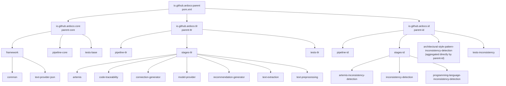
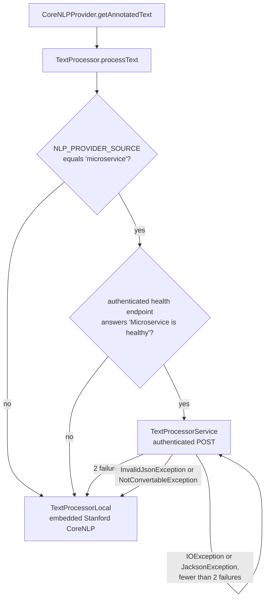

# Operations

This page covers everything needed to build, validate, and release the ARDoCo monorepo: the Maven build system and module matrix, pinned-plugin gotchas, code formatting and nullness tooling, CI/CD workflows, publishing, environment configuration, and the external services the project depends on. For pipeline internals see [Architecture](architecture.md), for the TLR stage landscape see [TLR Approaches](tlr-approaches.md), for the detection pipeline see [Inconsistency Detection](inconsistency-detection.md), for the test and evaluation infrastructure see [Testing & Evaluation](testing.md), and for a getting-started overview see [Quickstart](quickstart.md).

## Build System

### Prerequisites

- **JDK 21** or higher (`java.version` in the root [`pom.xml`](../pom.xml)); we advise at least 4 GB of RAM.
- **Maven 3.9** or higher.

Each module tree ships its own `.mvn/` configuration, so a plain `mvn` invocation inside `core/`, `tlr/`, or `inconsistency-detection/` already picks up tuned behavior:

- `.mvn/maven.config` runs Maven with `-T1C` (parallel builds per CPU core) and `-DskipTests=false` plus `-Dnet.bytebuddy.experimental=true`.
- `.mvn/jvm.config` starts the JVM with `-XX:+EnableDynamicAgentLoading -XX:-TieredCompilation -XX:TieredStopAtLevel=1`, `--add-exports` for the `jdk.compiler` packages, and `--add-opens java.base/java.lang` — required for the forking compiler and Mockito/ByteBuddy agent loading under JDK 21.

### Build Commands

```bash
mvn clean install     # Full build with tests, install to local repository
mvn clean verify      # Full build with tests, no install
mvn clean package     # Build without tests
```

The default `complete` profile is active in the root POM and in each module POM, so these commands build everything, including the test modules. `mvn clean verify` runs both the Surefire unit/architecture tests (pinned `maven-surefire-plugin` 3.6.1) and the Failsafe integration tests (`maven-failsafe-plugin` 3.6.1, bound to the `integration-test` phase with `integration-test` + `verify` goals in the root `pluginManagement`). Add `-Pdeployment` to build only the publishable modules (see [Module Matrix](#module-matrix)).

### Build Gotcha: Pinned `flatten-maven-plugin`

All POMs use CI-friendly version placeholders: the root POM sets `<revision>2.2.0-SNAPSHOT</revision>` and every module inherits it via `<version>${revision}</version>`. The root POM resolves these placeholders with `org.codehaus.mojo:flatten-maven-plugin`, which is **pinned to `1.9.0`**. Do **not** remove this pin or let it float to an arbitrary version: the pin comment records that 1.8.0's CI-friendly interpolator threw an NPE against this POM (`mojohaus/flatten-maven-plugin#523`), which is fixed in 1.9.0. The plugin runs with `flattenMode=resolveCiFriendliesOnly` and `updatePomFile=true`, expands `dependencyManagement` and `dependencies`, and executes at the `clean` and `process-resources` phases. This also means the deployed POMs carry fully resolved versions rather than `${revision}` placeholders.

## Module Matrix

The root POM (`io.github.ardoco:parent`) aggregates the three top-level trees; each tree has its own aggregator POM that narrows the module set per profile.



*Reactor hierarchy of the monorepo: three top-level trees, each with an aggregator POM and per-profile module lists. Note that `architectural-style-pattern-inconsistency-detection` is aggregated directly by `parent-id`, not via the `stages-id` aggregator.*

| Tree | POM | Aggregator modules |
|------|-----|--------------------|
| **Core** | [`core/pom.xml`](../core/pom.xml) | `framework` (aggregating `common`, `text-provider-json`), `pipeline-core`, `tests-base` |
| **TLR** | [`tlr/pom.xml`](../tlr/pom.xml) | `pipeline-tlr`, `stages-tlr` (aggregating `artemis`, `code-traceability`, `connection-generator`, `model-provider`, `recommendation-generator`, `text-extraction`, `text-preprocessing`), `tests-tlr` |
| **ID** | [`inconsistency-detection/pom.xml`](../inconsistency-detection/pom.xml) | `pipeline-id`, `stages-id` (aggregating `artemis-inconsistency-detection`, `inconsistency-detection`, `programming-language-inconsistency-detection`), plus `stages-id/architectural-style-pattern-inconsistency-detection` aggregated directly by the ID parent, and `tests-inconsistency` |

**Profiles.** The `complete` profile (`activeByDefault=true`) is defined in the root POM and in each module POM and includes the test modules listed above (`tests-tlr`, `tests-inconsistency`; `tests-base` is a published module and appears in both core profiles). The explicit `deployment` profiles restrict each tree to its publishable modules (`core`: `framework`, `pipeline-core`, `tests-base`; `tlr`: `pipeline-tlr`, `stages-tlr`; `inconsistency-detection`: `pipeline-id`, `stages-id`), skip test compilation, and GPG-sign artifacts with the pinned KIT signing key (`2673EE7DF64D33426A93D642E88F0DA2FB06A126`). The root additionally carries a `deployment-parent` profile with the same build tweaks for the root POM itself. The `inconsistency-detection` tree also declares the JaCoCo Maven plugin (unpinned, without bound executions, so it does not instrument anything by default) and the `pipeline-id` module defines an extra default-active `test-dependencies` profile that pulls the `pipeline-core` test-jar; the `pipeline-tlr` module wires the same test-jar directly in its dependencies.

## Key Dependencies

The root POM pins the versions shared by all modules:

| Dependency | Version | Role |
|------------|---------|------|
| Stanford CoreNLP | 4.6.0 | NLP preprocessing (root version property; declared by `text-preprocessing` and `code-traceability` incl. the `models` classifier artifact) |
| Jackson 3 (`tools.jackson:jackson-bom`) | 3.3.0 | JSON serialization (the codebase standard) |
| Jackson 2 (`com.fasterxml.jackson:jackson-bom`) | 2.23.0 | Alignment only for transitive users (e.g. langchain4j); Jackson 2 core/databind are forbidden in ARDoCo code by ArchUnit |
| Eclipse Collections | 13.0.0 | preferred collection types (enforced by ArchUnit) |
| JavaParser | 3.28.2 | Java code parsing (declared by `model-provider`) |
| JUnit (Jupiter) | 6.1.3 | testing |
| Mockito | 5.24.0 | mocking |
| SLF4J | 2.0.20 | logging |
| ArchUnit (`archunit-junit5`) | 1.5.1 | architecture tests |
| ANTLR runtime | 4.13.2 | code-model parsers (declared by `model-provider`, together with the ANTLR grammar generator for C++/Java/Python) |
| Eclipse JGit | 7.8.0.202609011348-r | git access in `common` |
| commons-lang3 | 3.22.0 | shared utilities (with commons-text 1.15.0, commons-io 2.22.0, httpclient5 5.6.5) |
| `io.github.ardoco:metrics` | 0.3.0 | evaluation metrics (declared by `tests-base`) |

Strictly speaking, only the Jackson 2/3 BOMs, ArchUnit, commons-* , httpclient5, assertj, Eclipse Collections, JGit, JUnit, Mockito, SLF4J, and `reflections` (0.10.2) are pinned in the root `dependencyManagement`; CoreNLP, JavaParser, ANTLR, and `io.github.ardoco:metrics` are pinned as root version *properties* (`stanford.corenlp.version`, `javaparser.version`, `antlr.version`, `metrics.version`) that the consuming module POMs apply.

The `versions-maven-plugin` (2.21.0) is configured to ignore `alpha`/`beta`/`RC` versions when checking for updates.

**Dependency updates are managed by Renovate**, not Dependabot: the root [`renovate.json`](../renovate.json) is minimal (`{"extends": ["local>ArDoCo/actions:renovate-preset"]}`) and inherits the shared preset from the [ardoco/actions](https://github.com/ardoco/actions) repository. There is no root `.github/dependabot.yml` — Dependabot was removed in favor of Renovate (see [Constraints](constraints.md)).

Some notable dependencies are **not** versioned in the root POM:

- **OpenNLP `opennlp-tools` 2.5.11** is pinned in `core/framework/common/pom.xml` (with its transitive `slf4j-api` excluded). OpenNLP's `PorterStemmer` is used by ArCoTL's `NameComparisonUtils` for stemming, and that utility also builds a local Stanford CoreNLP `tokenize,pos,lemma` pipeline for lemmatization-based name comparison.
- **`dev.langchain4j:langchain4j-bom` 1.19.0** is imported by `tlr/stages-tlr/model-provider/pom.xml` for the OpenAI and Ollama chat-model integrations (see [LLM Integration](llm-integration.md)).
- **`io.github.ardoco:magika` 0.7.0** is pinned in `tlr/stages-tlr/model-provider/pom.xml` (file-type detection for code model loading).
- **`com.networknt:json-schema-validator` 3.0.9** is pinned in `core/framework/text-provider-json/pom.xml` (text-provider JSON schema validation).

## Code Formatting

### Spotless

ARDoCo uses [Spotless](https://github.com/diffplug/spotless/tree/main/plugin-maven) (3.10.4, configured once in the root `pluginManagement` and inherited by every module) for consistent code formatting:

```bash
mvn spotless:apply   # Apply formatting before committing
mvn spotless:check   # Check formatting locally
```

The configuration, resolved relative to the multi-module project directory (so each tree uses **its own** copies, kept in sync):

- **Formatter profile**: `{module}/formatter.xml` (Eclipse formatter config) — import this into your IDE.
- **Import order**: `{module}/spotless.importorder` — `java`, `javax`, `org`, `com`, then everything else.
- **License header**: `{module}/license-header` — `/* Licensed under MIT $YEAR. */` is enforced on all Java sources.
- **Unused imports** are removed automatically.
- **POMs** are sorted (`sortPom`: dependencies, plugins, modules, and executions sorted; two-space indent).
- **Markdown and `.gitignore`**: trailing whitespace trimmed, files end with a newline, tab indentation.
- **`ratchetFrom origin/main`**: only files changed relative to `origin/main` are formatted, so `spotless:apply` never rewrites untouched code.

### JSpecify Nullness Annotations

ARDoCo uses [JSpecify](https://jspecify.dev/) for null-safety annotations:

- **Default**: All references are non-null (`@NullMarked` applied to packages during build).
- **Nullable references**: Explicitly mark with `org.jspecify.annotations.Nullable`.
- **No other annotations**: Do not use `javax.annotation.Nullable` or similar variants.
- **Auto-generated**: `package-info.java` files are generated by `org.fuchss:jspecify-maven-plugin` (0.1.0) during the `process-sources` phase directly into the module source directory and are **git-ignored** — do not commit them manually.

The plugin is inherited from the root POM and `org.jspecify:jspecify:1.0.1` is a root-POM dependency, so every module is null-marked by default without any per-module setup.

## Code Quality and Architecture Tests

### ArchUnit Suites (`tests-base`)

The `core/tests-base` module hosts the ArchUnit suites that all module test trees inherit as test dependencies. The suites live in `src/main` (not `src/test`) so they compile into the published `tests-base` jar, and they execute only where `tests-tlr` and `tests-inconsistency` re-enable them via small `@AnalyzeClasses` subclasses (see [Testing & Evaluation](testing.md)). They enforce the architecture at build time:

- **`ArchitectureTest`** — the layered architecture (Common → TextExtractor → ModelExtractor → RecommendationGenerator → ConnectionGenerator → InconsistencyDetection / CodeTraceability, plus an **Artemis** layer for the NER-based connection stage, wrapped by Pipeline and Execution layers) with access restrictions, plus naming rules such as *model instances only after model extraction*, *`*Link` naming confined to trace-link packages*, and *`Inconsistency` types only visible after inconsistency detection*. Details of the layering are described in [Architecture](architecture.md).
- **`BasicArchitectureTest`** — cross-cutting rules: `@Configurable` fields only in `AbstractConfigurable` subclasses; `TraceLink` subclasses must be `final`; Jackson `ObjectMapper` creation/configuration confined to `JsonHandling`; **no use of Jackson 2** (`com.fasterxml.jackson.core`/`databind`) — ARDoCo uses Jackson 3 (`tools.jackson`), only the shared Jackson annotations remain allowed; **environment access only through the `Environment` utility** (rule `noGetEnv`); no `forEach` side effects on streams/lists; interfaces must prefer Eclipse Collections over JDK `List`/`Set`/`Map` types (outside `..metrics..`).
- **`DeterministicArdocoTest`** — forbids unordered JDK collections (`HashSet`, `HashMap`, …) outside `@Deterministic`-annotated classes (excluding `..tests..`, `..metrics..`, `..magika..`) and pushes `HashMap`/`HashSet` usage toward the linked variants, keeping pipeline runs reproducible.

## CI/CD

### GitHub Actions Workflows

Located in `/.github/workflows/`:

| Workflow | File | Purpose |
|----------|------|---------|
| Maven Verify | [`verify.yml`](../.github/workflows/verify.yml) | Runs Maven verify on push to `main` (ignoring `v*` tags and `docs/**`, `openwiki/**` paths) and on pull requests, via the reusable `ardoco/actions` workflow with `deploy: false`. The call site passes empty `CENTRAL_USER`, `CENTRAL_TOKEN`, and `GPG_KEY` secrets, so CI verifies without publishing. (Unlike the module-tree copies, the root call site does not set `with-submodules`.) |
| Format | [`format.yml`](../.github/workflows/format.yml) | On pull requests to `main` and manual dispatch: checks out with submodules and full history (`actions/checkout@v7`), determines the Java major version by probing `maven.compiler.target`, `maven.compiler.release`, and `java.version` in the POM with `mvn help:evaluate` (the job fails with an error if none resolves), sets up Temurin with Maven caching via `actions/setup-java@v6`, runs `mvn -B spotless:apply`, and auto-commits the reformat as "Apply formatting changes" via `stefanzweifel/git-auto-commit-action@v7` — Spotless violations on a PR are fixed by a bot commit rather than failing the build. Requires full git history because Spotless ratchets against `origin/main`. |
| Docs | [`docs.yml`](../.github/workflows/docs.yml) | On pushes to `main` (and version tags) touching `docs/**`, `openwiki/**`, or the workflow itself: republishes the GitHub Wiki from `/docs` plus `/openwiki` (see [Wiki Publishing](#wiki-publishing)). |
| OpenWiki Update | [`openwiki.yml`](../.github/workflows/openwiki.yml) | Weekly (Monday 06:00 UTC) plus `workflow_dispatch` run that delegates to the shared `ardoco/actions` OpenWiki reusable workflow, passing the `OPENROUTER_API_KEY` secret; the call site declares `contents: write` and `pull-requests: write`. The reusable workflow performs the commit-relevance check, installs OpenWiki, runs `openwiki --update`, and opens the update PR. |
| Deploy Snapshot | [`deploy-snapshot.yml`](../.github/workflows/deploy-snapshot.yml) | Manual `workflow_dispatch` only: deploys the selected branch's `-SNAPSHOT` artifacts to the GitLab package registry (see [Publishing](#publishing)). Needs the `GITLAB_SNAPSHOT_TOKEN` secret, which must be available in the repository. |

### Wiki Publishing

`docs.yml` performs a destructive sync of the GitHub Wiki:

1. Checks out the repository and the `<repo>.wiki` repository side by side (authenticated with the `SDQ_TOKEN` secret).
2. Removes everything in the wiki except `.git`.
3. Copies `/docs` into the wiki root and preserves the `openwiki` folder under `wiki/openwiki`.
4. Renders each root-level `/openwiki/*.md` page as `OpenWiki-<name>.md` in the wiki root namespace, rewriting same-directory links: `](name.md)` (and `](name.md#anchor)` for lowercase names) become `](OpenWiki-name)`, because subfolder links can resolve to file view instead of wiki page view.
5. Commits via `git-auto-commit`.

**OpenWiki page constraint**: because step 4 only globs `./openwiki/*.md`, wiki pages must stay **flat** in `/openwiki/*.md` — nested directories are never rendered as wiki pages. Do **not** delete [`quickstart.md`](quickstart.md): the rendered `OpenWiki-quickstart` page is the entry point linked from `docs/Home.md` and the wiki sidebar.

### OpenWiki Maintenance Contract (AGENTS.md / CLAUDE.md)

The repository root [`AGENTS.md`](../AGENTS.md) carries an `OPENWIKI:START` / `OPENWIKI:END` block defining how agents working in this repository may consume the generated `openwiki/` evidence index, and [`CLAUDE.md`](../CLAUDE.md) simply delegates to it via an `@AGENTS.md` reference, so the same contract governs Claude sessions:

- **Just-in-time, not startup reading.** `openwiki/` is an optional generated evidence index, not required startup reading. Do not enumerate, preload, or search the wiki at task start; reach for it only when the user asks for it, when unfamiliar architecture or dependency behavior materially affects the task, or when source inspection leaves an important uncertainty — and stop once the question is grounded.
- **Retrieval tooling.** When those conditions apply and OpenWiki retrieval tools are available, use `openwiki_search` for just-in-time context and `openwiki_read` for the relevant complete sections. If search returns `workspace_required`, ask which listed workspace to use and retry with its ID; use `openwiki_list_workspaces` / `openwiki_list_wikis` when workspace membership itself needs to be discovered. If the retrieval tools are unavailable, read [`openwiki/quickstart.md`](quickstart.md) and follow its links to the relevant pages.
- **Source is authoritative.** Treat source code and tests as authoritative; a brief's unknowns and review items are verification gaps, not automatic requirements. Prefer the narrowest quiet validation that proves the changed behavior, and preserve complete failure output.
- **Don't hand-edit generated pages.** Do not hand-edit generated OpenWiki pages unless explicitly asked. Prefer updating source code and `/docs` content and letting OpenWiki regenerate the pages via the repository's documented maintenance process — this page's own build/CI/dependency sections above are produced and refreshed by that process, so a hand edit would be overwritten by the next regeneration.
- **Check runs before relying on automatic updates.** The weekly [`openwiki.yml`](../.github/workflows/openwiki.yml) schedule (Monday 06:00 UTC, plus `workflow_dispatch`) drives the OpenWiki update PRs; check its configuration and its completed runs before relying on automatic page updates.

### Module-Level Workflows and Sync Scripts

Each module tree (`core`, `tlr`, `inconsistency-detection`) carries its own `.github/workflows/` (`verify.yml`, `format.yml`) replicating the root workflows for the standalone repositories. The tree `verify.yml` copies set `with-submodules: true` on the reusable `ardoco/actions` Maven workflow — which the root call site does not — and, unlike the root, they do not ignore `docs/**`/`openwiki/**` paths. The module `format.yml` copies are identical to each other and step-for-step the same as the root Format workflow (same triggers, same inline POM-based Java-version probe, `mvn -B spotless:apply`, `git-auto-commit-action@v7` "Apply formatting changes" commit), but they still pin `actions/checkout@v6` and `actions/setup-java@v5` where the root has already moved to `actions/checkout@v7` and `actions/setup-java@v6`. Each tree also keeps its own `.github/dependabot.yml` (github-actions ecosystem, weekly Wednesday 11:00 Europe/Berlin, `Dependency` commit prefix); these are inert in the monorepo and apply only when a tree is used as its own standalone GitHub repository — the monorepo itself relies on Renovate (see [Key Dependencies](#key-dependencies)). The `tlr` and `inconsistency-detection` trees also contain `update_integration_tests.sh`, which syncs the `tests/integration-tests` prefix from the `ardoco/IntegrationTests` repository via `git subtree pull`:

```bash
git remote add -f integrationTests git@github.com:ardoco/IntegrationTests.git
git fetch integrationTests main
git subtree pull --prefix tests/integration-tests integrationTests main --squash
```

## Publishing

- **Snapshots** are published to the **Sonatype Central Snapshots** repository (`https://central.sonatype.com/repository/maven-snapshots/`, configured in `distributionManagement`) and to the **GitLab package registry** of the ARDoCo mirror group on `gitlab.kit.edu` (see below).
- **Releases** are uploaded by `central-publishing-maven-plugin` (0.11.0, Sonatype Central) with `autoPublish=true`, `waitUntil=published`, and per-tree deployment names (`ardoco`, `ardoco-core`, `ardoco-tlr`, `ardoco-id`).
- Release builds activate the `deployment` profiles, which GPG-sign all artifacts with the pinned KIT key and skip test compilation.

### GitLab Package Registry (Snapshots)

Development versions (`-SNAPSHOT`) are published to the public Maven package registry of the [ARDoCo mirror group on gitlab.kit.edu](https://gitlab.kit.edu/kit/kastel/sdq/research-projects/ardoco). All four tree POMs (root, `core`, `tlr`, `inconsistency-detection`) declare the read-only `ardocoSnapshots` resolution repository (`https://gitlab.kit.edu/api/v4/groups/253644/-/packages/maven`, snapshots only), so projects using `io.github.ardoco:parent` resolve ARDoCo snapshots automatically.

Publishing paths:

- **Manual workflow**: [`deploy-snapshot.yml`](../.github/workflows/deploy-snapshot.yml) is triggered only via `workflow_dispatch` for a selected branch. It delegates to the reusable `ardoco/actions` `maven-snapshot.yml` workflow with `gitlab-project-id: "203206"` (the Maven package registry of the read-only mirror project) and `secrets: inherit`. It only deploys `-SNAPSHOT` versions and needs the `GITLAB_SNAPSHOT_TOKEN` secret — a GitLab group **deploy token with the `write_package_registry` scope**.
- **Manual Maven command**: configure a GitLab personal or group access token with `api` access in `~/.m2/settings.xml` under the `ardocoSnapshots` server id (sent as a `Private-Token` header; a deploy token uses the `Deploy-Token` header instead), then run:

```shell
mvn -Pdeployment -DskipTests -Dgpg.skip package deploy:deploy -DaltDeploymentRepository=ardocoSnapshots::https://gitlab.kit.edu/api/v4/projects/203206/packages/maven
```

## Environment Configuration

All environment variables are documented in [`/sample.env`](../sample.env). Every lookup in the codebase goes through the `Environment` utility (`core/framework/common`), backed by `io.github.cdimascio:dotenv-java`:

- If a `.env` file exists in the working directory, it is loaded once at class initialization (both `.env` and the default LLM cache directory `.cache-llm/` are git-ignored).
- `Environment.getEnv(key)` returns the **`.env` value first** and falls back to the system environment, so `.env` entries override system environment variables; missing values return `null`.
- `Environment.getEnvNonNull(key)` logs an error ("environment variable `<KEY>` is missing, use `.env` or your system to set it up") when the variable is missing but still returns `null` — the strictness is in the log, not an exception.
- The ArchUnit rule `noGetEnv` in `tests-base` forbids every class except `Environment` from calling `System.getenv`, making this utility the single environment-variable gateway (see [Constraints](constraints.md)).

Key configuration areas:

### NLP Preprocessing

| Variable | Purpose |
|----------|---------|
| `NLP_PROVIDER_SOURCE` | Set to `microservice` to use the remote service; otherwise local Stanford CoreNLP |
| `MICROSERVICE_URL` | URL of the StanfordCoreNLP microservice |
| `SCNLP_SERVICE_USER` | Microservice username (HTTP basic auth) |
| `SCNLP_SERVICE_PASSWORD` | Microservice password (HTTP basic auth) |

### LLM Integration

| Variable | Purpose |
|----------|---------|
| `OPENAI_API_KEY` | OpenAI API key (required for OpenAI models and the ArTEMiS embedding model) |
| `OPENAI_ORGANIZATION_ID` | OpenAI organization ID (required for OpenAI chat models) |
| `OPENAI_MODEL_NAME` | Model name for the `OPENAI_GENERIC` model variant |
| `OLLAMA_HOST` | Ollama host URL (also enables Ollama-based integration tests) |
| `OLLAMA_USER` / `OLLAMA_PASSWORD` | Ollama credentials (sent as HTTP basic auth header) |
| `OLLAMA_TOKEN` | OpenAI-compatible API token against the Ollama host |
| `OLLAMA_MODEL_NAME` | Model name for the `OLLAMA_GENERIC` model variant |
| `MODEL_NAME_NER` | Declared in `sample.env` as a template placeholder; currently no consumer in this codebase (the ArTEMiS connection stage embeds names with the fixed OpenAI model `text-embedding-3-large`) |
| `LLM_CACHE_DIR` | Cache directory for LLM requests (reproducibility; see below) |

### Reproducibility

| Variable | Purpose |
|----------|---------|
| `SEED` | Random seed for deterministic behavior; defaults to `422413373`, invalid values abort the run |
| `CI` | Read by integration tests (via `Environment`) to skip LLM evaluations on CI runners |

## LLM Integration and Reproducibility

`LargeLanguageModel` (`tlr/stages-tlr/model-provider`) is the single provider entry point for the LLM-based TLR and inconsistency-detection stages:

- Built-in OpenAI models are pinned to **dated snapshots** (e.g. `gpt-4o-2024-08-06`, `gpt-4.1-2025-04-14`, `gpt-5-2025-08-07`, plus the 2026-dated GPT-5.x family such as `gpt-5.5-2026-04-23` and `gpt-5.4-nano-2026-03-17`) with temperature `0.0` (`1.0` only for `GPT_5` and `GPT_5_5`), a 10-minute timeout, and the `SEED` value; `OPENAI_ORGANIZATION_ID` and `OPENAI_API_KEY` must be set or creation fails.
- `OPENAI_MODEL_NAME` and `OLLAMA_MODEL_NAME` expose generic model variants for custom deployments.
- Ollama models target `OLLAMA_HOST` (15-minute timeout, temperature `0.0`, `SEED`); with `OLLAMA_USER` + `OLLAMA_PASSWORD` they authenticate via a basic-auth header, with `OLLAMA_TOKEN` they use an OpenAI-compatible client against the host instead (30-minute timeout).
- **Caching**: every model created via `create()` is wrapped in `CachedChatLanguageModel`, which persists a per-model prompt→response map to `<model-name>-cache.json` under `LLM_CACHE_DIR` (default `.cache-llm/`). Cache keys are line-ending-normalized, repeated prompts are served from disk without provider calls, and cache I/O failures are logged (debug on read, error on write) instead of failing the run — this makes LLM runs reproducible and cheap to re-execute. Tool-calling validation agents bypass the cache via `createUncached()`.

The ArTEMiS connection stage (`tlr/stages-tlr/artemis`) embeds named-architecture-entity and model-entity names via OpenAI's fixed `text-embedding-3-large` model and requires `OPENAI_API_KEY`. Model selection details, prompt layout, and the validation-agent pattern are documented in [LLM Integration](llm-integration.md); the environment variables are summarized above.

## External Services

### StanfordCoreNLP Provider Service

A RESTful microservice wrapping Stanford CoreNLP for text preprocessing. See [docs/Text-Preprocessing-Microservice.md](../docs/Text-Preprocessing-Microservice.md).

- **Repository**: [ardoco/StanfordCoreNLP-Provider-Service](https://github.com/ardoco/StanfordCoreNLP-Provider-Service)
- **Benefits**: Models stay loaded in memory, faster execution, reduced local memory usage, shared infrastructure, consistent results across executions
- **Auth**: HTTP basic authentication via `SCNLP_SERVICE_USER` / `SCNLP_SERVICE_PASSWORD` environment variables

The provider is selected at request time, not at startup — every text triggers the fallback chain below:



*NLP preprocessing provider selection: the microservice is used only when `NLP_PROVIDER_SOURCE=microservice` and the health check succeeds; every failure path degrades to local CoreNLP processing.*

Defaults come from `config.properties` on the classpath (`nlpProviderSource=microservice`, `microserviceUrl=http://localhost:8080`, `corenlpService=/stanfordnlp`, `healthService=/stanfordnlp/health`) and are overridden by the `NLP_PROVIDER_SOURCE` and `MICROSERVICE_URL` environment variables.

### LiSSA Framework

LLM-based generic TLR framework using LLMs + IR techniques. See [docs/LiSSA.md](../docs/LiSSA.md).

- **Repository**: [ardoco/lissa](https://github.com/ardoco/lissa)
- **Documentation**: [docs/architecture.md](https://github.com/ardoco/lissa/blob/main/docs/architecture.md), [docs/configuration.md](https://github.com/ardoco/lissa/blob/main/docs/configuration.md), [docs/cli.md](https://github.com/ardoco/lissa/blob/main/docs/cli.md), [docs/caching.md](https://github.com/ardoco/lissa/blob/main/docs/caching.md), [docs/development.md](https://github.com/ardoco/lissa/blob/main/docs/development.md)

### Benchmark, Evaluation, and Visualization

- **Benchmark repository**: [ardoco/benchmark](https://github.com/ardoco/benchmark) — evaluation datasets and gold standards; `tests-base` also bundles a snapshot of these datasets as test resources (e.g. `mediastore`, `teastore`, `teammates`)
- **Evaluator**: [ardoco/evaluator](https://github.com/ardoco/evaluator) — evaluation code for comparing results (`io.github.ardoco:metrics`)
- **TraceView**: [ardoco/traceview-v2](https://github.com/ardoco/traceview-v2) — visualization tool for TLR and ID outputs
- **Actions**: [ardoco/actions](https://github.com/ardoco/actions) — the reusable Maven, snapshot-deploy, and OpenWiki workflows called by the root CI workflows

### Integration Test Data

The integration tests in `tests-tlr` and `tests-inconsistency` run under Maven Failsafe, but the LLM-based ones (e.g. `ArtemisIT`, `ExArchIT`, and the ArTEMiS-based ID ITs) are **disabled by default** (`@Disabled("Only for manual execution")`): the TLR ArTEMiS/ExArch ITs additionally assume that `OPENAI_API_KEY` or `OLLAMA_HOST` is set and that the `CI` environment variable is absent (in `@BeforeAll` or per test method), and they offer `mutipleRuns`-gated multi-run evaluation variants (a `@DisabledIfEnvironmentVariable`/`@EnabledIfEnvironmentVariable` pair on the single-run/multi-run methods). The non-LLM `InconsistencyDetectionEvaluationIT` is not `@Disabled` — it runs under Failsafe on every `mvn verify`, with only its baseline method gated by a `testBaseline` environment variable. The test trees are refreshed from `ardoco/IntegrationTests` via the `update_integration_tests.sh` subtree sync described above; the full gating matrix is on [Testing & Evaluation](testing.md).
