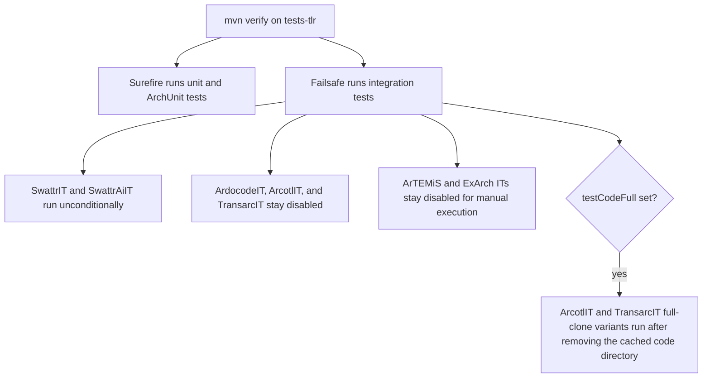
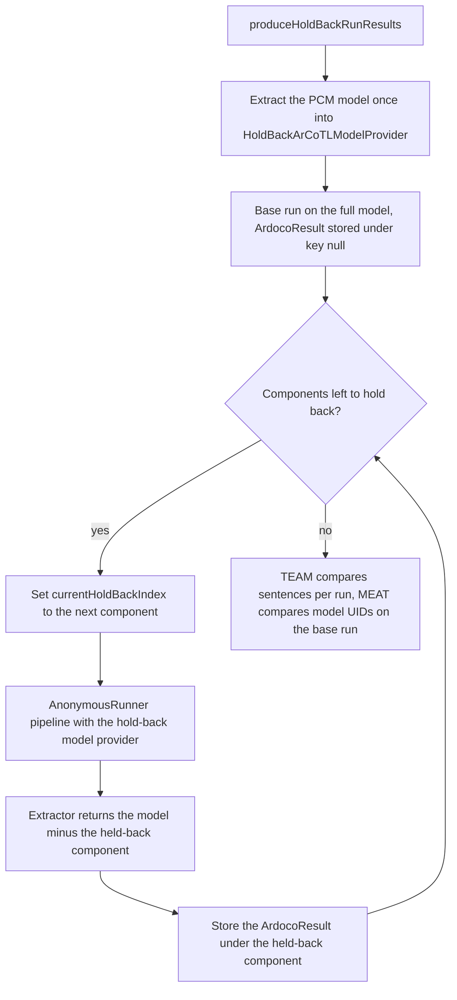
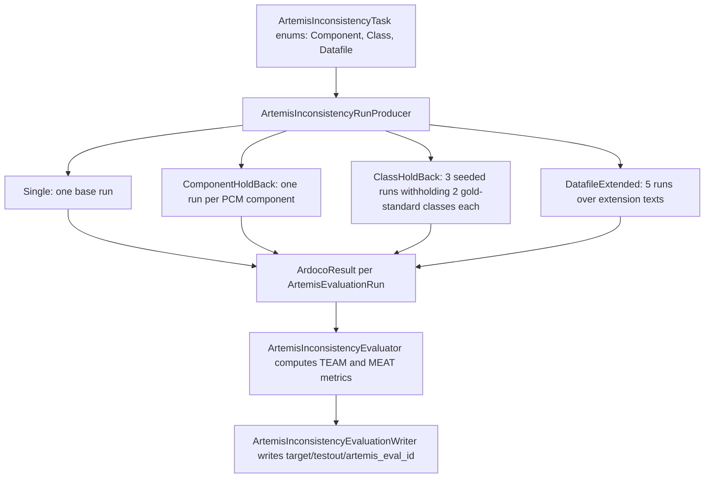

# Testing & Evaluation

ARDoCo's tests serve two purposes: they *check* the implementation (unit, architecture, and integration tests) and they *measure* it (benchmark evaluations whose precision/recall/F1/accuracy/phi results are asserted against hard-coded minimums). This page maps the infrastructure; the enforced layering itself is described in [Architecture](architecture.md), the approach pipelines in [TLR Approaches](tlr-approaches.md), the detection logic in [Inconsistency Detection](inconsistency-detection.md), and build/CI/environment details in [Operations](operations.md).

## Where the Tests Live

| Module | Path | What it provides |
|--------|------|------------------|
| `tests-base` | [`core/tests-base`](../core/tests-base/pom.xml) | Shared ArchUnit rule suites, `ConfigurationTestBase`, `ExpectedResults`, `EvaluationProject`, `EvaluationHelper`, and the bundled benchmark snapshot under `src/main/resources/benchmark` plus filter configs under `src/main/resources/configurations` |
| `tests-tlr` | [`tlr/tests-tlr`](../tlr/tests-tlr/pom.xml) | TLR integration/evaluation tests (`*IT.java`) for all approaches — including the per-entity ArTEMiS evaluations — plus module-local subclasses of the shared ArchUnit suites |
| `tests-inconsistency` | [`inconsistency-detection/tests-inconsistency`](../inconsistency-detection/tests-inconsistency/pom.xml) | The classic ID hold-back evaluation harness and baseline, the ArTEMiS-based ID evaluation harness, and the LLM-based style/pattern and programming-language ID evaluations, plus module-local subclasses of the shared ArchUnit suites |

`tests-tlr` and `tests-inconsistency` declare `tests-base` as a **test-scoped** dependency and bind the `maven-failsafe-plugin` (root POM, version 3.5.6, goals `integration-test` + `verify` at the `integration-test` phase), so `mvn verify` runs both Surefire unit/ArchUnit tests and Failsafe integration tests. In addition to these three test modules, the pipeline modules (`pipeline-core`, `pipeline-tlr`, `pipeline-id`) each carry a few runner smoke tests in their own `src/test` trees — see [Runner Smoke Tests in the Pipeline Modules](#runner-smoke-tests-in-the-pipeline-modules).

## Shared Rule Suites in `core/tests-base`

A structural quirk that matters when editing these files: the ArchUnit suites live in **`src/main`**, not `src/test`. They compile into the regular `tests-base` jar (with compile-scoped `archunit-junit5`, `junit-jupiter-*`, `io.github.ardoco:metrics`, and `reflections` dependencies) so that every other module can consume them on its own test classpath. They are never executed in `tests-base` itself (the module has no test tree).

- **`ArchitectureTest`** — enforces the product architecture. The `layerRule` defines the layers `Common` (common/data/api/tests packages), `TextExtractor`, `ModelExtractor`, `RecommendationGenerator`, `ConnectionGenerator`, `Artemis` (`..artemis..`), `InconsistencyDetection` (`..inconsistency..`/`..id..`), `CodeTraceability`, `Pipeline`, and `Execution`, restricting which layers may access which (e.g., `Execution` may only be accessed by `Common` — needed for tests — and the detection layer may only be accessed by `Pipeline`, `Common`, and `Execution`; the `Artemis` layer may only be accessed by `ConnectionGenerator`, `Pipeline`, `Execution`, `Common`, `InconsistencyDetection`, and `CodeTraceability`). Additional rules: execution classes are only used by execution and test code; classes named `Model` are only used after model extraction (the `Artemis` package being an allowed consumer); classes whose simple name ends in `Link` are only used after the connection generator, and `*Link` naming is confined to the `tracelink`, `codetraceability`, and `connectiongenerator` packages; `Inconsistency`-named classes are only used after inconsistency detection.
- **`BasicArchitectureTest`** — cross-cutting rules: `@Configurable` fields may only be declared in `AbstractConfigurable` subclasses; all `TraceLink` subclasses must be `final`; Jackson mappers may only be created or configured inside `JsonHandling` — the `jacksonIsConfiguredGlobally` rule covers `ObjectMapper`/subclass constructors and the `builder`, `shared`, and `rebuild` methods; a companion `noJackson2` rule bans dependencies on `com.fasterxml.jackson.core`/`com.fasterxml.jackson.databind` because ARDoCo uses Jackson 3 (`tools.jackson`), with only the shared Jackson annotations remaining allowed; `System.getenv` may only be called by the `Environment` utility (rule `noGetEnv`); no `forEach`/`forEachOrdered` on streams or lists ("lambdas should be functional"); and interface methods must not expose or accept JDK `List`/`Set`/`Map`/`Sorted*` raw types, preferring Eclipse Collections (outside `..metrics..`).
- **`DeterministicArdocoTest`** — keeps pipeline runs reproducible: classes that are not directly annotated `@Deterministic` must not access `Set`/`HashSet`/Eclipse `MutableSet`/`ImmutableSet`/`Sets`/`Map`/`HashMap`/`MutableMap`/`ImmutableMap`/`Maps` (excluding `..tests..`, `..metrics..`, `..magika..`); `HashMap`/`HashSet` are forbidden outright in favor of linked versions; classes annotated `@NoHashCodeEquals` must not implement `equals`/`hashCode`; classes implementing `Comparable` directly must implement both `equals` and `hashCode`; and sorted collection fields/returns may only be parameterized with `Comparable` types.
- **`ConfigurationTestBase`** — uses Reflections to find every concrete `AbstractConfigurable` subclass under `edu.kit.kastel.mcse.ardoco` (non-abstract, outside `tests` packages), validates that all `@Configurable` fields are neither `final` nor `static`, and prints the complete default configuration in `key=value` form. It is assertion-framework agnostic (abstract `assertFalse`/`fail` hooks) so each module binds it to JUnit.
- **`ExpectedResults`** — a record of six minimum metrics (`precision`, `recall`, `f1`, `accuracy`, `phiCoefficient`, `specificity`) used by every benchmark evaluation.
- **`EvaluationHelper`** — loads classpath resources (benchmark files) into temporary files (marked `deleteOnExit`), since the extraction APIs take `File` arguments.
- **`archunit.properties`** — sets `archRule.failOnEmptyShould=false`, so a rule that matches nothing on a given module's classpath does not fail that module.

## Re-enabling the Suites per Module

The suites are plain classes with `@ArchTest` static rules; ArchUnit only runs them when a test class carrying `@AnalyzeClasses` is executed. Because the analysis classpath differs per module, `tests-tlr` and `tests-inconsistency` each re-enable the suites through tiny subclasses in their own test trees:

- `tlr/tests-tlr/.../tlr/tests/ArchitectureTest.java` and `DeterministicArdocoTest.java` extend the `core.tests.architecture` base classes and analyze `edu.kit.kastel.mcse.ardoco.core` + `edu.kit.kastel.mcse.ardoco.tlr` ("Has to be executed in this module").
- `inconsistency-detection/tests-inconsistency/.../id/tests/ArchitectureTest.java` and `DeterministicArdocoTest.java` analyze `core` + `tlr` + `id`.
- Both modules also have a `ConfigurationTest extends ConfigurationTestBase` that binds the base class to JUnit assertions.

Consequence: the same rules are effectively re-evaluated against each module's classpath, so a violation introduced in a TLR or ID module is caught even though the rule classes live in core. These subclasses run as ordinary Surefire tests during `mvn test`/`verify`.

## Benchmark Data and Evaluation Projects

All benchmark evaluation is built around the `EvaluationProject` enum in `core/tests-base`, which currently defines **ten** projects. The five classic ones — `MEDIASTORE`, `TEASTORE`, `TEAMMATES`, `BIGBLUEBUTTON`, and `JABREF` — each carry classpath locations for a PCM architecture model (`/benchmark/<p>/.../pcm/*.repository`, with UML resolved by path rewriting), the SAD text file, a GitHub code repository URL plus a **pinned commit hash**, and a cached `codeModel.acm` fixture. The five newer projects — `ZENGARDEN`, `SCONS`, `BEETS`, `ROD`, and `CORONAWARNAPP` — are code-focused: their `architectureModelResource` is a `/benchmark/<p>/notAvailable` placeholder, and they are consumed by the class- and datafile-level ArTEMiS tasks and the LLM-based ID evaluations rather than by the PCM-based suites. The benchmark snapshot under `core/tests-base/src/main/resources/benchmark` is a bundled copy of the [ardoco/benchmark](https://github.com/ardoco/benchmark) datasets; the per-project filter configurations (e.g. `/configurations/ms/filterlists_all.txt`) live under `src/main/resources/configurations` with one folder per classic project (`ms`, `ts`, `tm`, `bbb`, `jabref`).

Two access paths exist for code:

- `getCodeModelFromResources()` returns the cached ACM fixture — fast, deterministic, used by default (e.g., `ArcotlEvaluation`/`TransarcEvaluation` with `CodeConfigurationType.ACM_FILE`, `ArdocodeEvaluation` always, and the class/datafile ArTEMiS tasks).
- `getCodeDirectory()` shallow-clones the GitHub repository into `$TMPDIR/ARDoCo/<PROJECT>` via `RepositoryHandler.shallowCloneRepository` (clone with depth 1, unshallow + checkout of the pinned commit if the fetched tip differs) and is used by the `testCodeFull`-gated full-clone variants and the LLM-based ID evaluations that validate statements against real repositories.

Per-approach task enums resolve the remaining inputs: `DocumentationToArchitectureModelTlrTask` (SAD→SAM gold standard CSVs: sentence number ↔ model element id), `ModelToCodeTlrTask` (SAM→Code CSVs: architecture id ↔ code path; entries ending in `/` are packages), `DocumentationToCodeTlrTask` and `DocumentationToModelToCodeTlrTask` (sentence number ↔ code path), and `DocumentationToModelToCodeTlrTask` additionally exposes the architecture model for TransArC. The newer `TlrTask`-implementing enums (`ComponentSadSamTlrTask`, `ClassSadCodeTlrTask`, `DatafileSadCodeTlrTask`) provide the gold standards for the per-entity ArTEMiS evaluations. The ID side uses several task enums built on `EvaluationProject`: `InconsistencyDetectionTask` (see below) plus the ArTEMiS and LLM-validated task enums described in [LLM-Based ID Evaluations](#llm-based-id-evaluations-tests-inconsistency).

## How Evaluation Metrics Work

All comparisons funnel through `ClassificationMetricsCalculator` from the `io.github.ardoco:metrics` library (the [ardoco/evaluator](https://github.com/ardoco/evaluator) code, pulled in by `tests-base`). A test converts results and gold standard into sorted string sets, then asks the calculator for a `SingleClassificationResult` with an explicit **confusion matrix denominator**:

- ID TEAM evaluation (`InconsistencyDetectionEvaluationUtil.compareInconsistencies`): the number of sentences in the text.
- SAD-SAM TLR (`SwattrEvaluation`, `ComponentArtemisEvaluation`): sentences × architecture model endpoints (`ComponentArtemisEvaluation` counts the lines of the preprocessed text).
- SAM-Code TLR (`ArcotlEvaluation`): code model endpoints × architecture model endpoints.
- Per-entity ArTEMiS TLR (`ClassArtemisEvaluation`, `DatafileArtemisEvaluation`): sentences × classes and sentences × code files respectively.
- Documentation-to-Code TLR (`AbstractDocumentationToCodeTlrEvaluation`, the shared base of `ArdocodeEvaluation`, `TransarcEvaluation`, `ExArchEvaluation`, `ArtemisInTransarcEvaluation`, and `ArtemisInExArchEvaluation`): input text lines × code model endpoints.

For code-based TLR the gold standard is *enrolled* first (`AbstractEvaluation.enrollGoldStandard`): a gold entry whose code id ends in `/` is a package and is expanded into one link per code-model endpoint whose path starts with that prefix. Multiple per-run results are aggregated with micro/weighted/macro averages into an `AggregatedClassificationResult`.

## TLR Integration Tests (`tests-tlr`)

`AbstractArdocoIT` switches ardoco-core logging to `info` for the test class (restoring `error` in `@AfterAll`) and provides `averageAndLog`, which averages repeated runs per metric and logs `mean ± stddev` — the coping mechanism for LLM nondeterminism in the ArTEMiS/ExArch evaluations. The per-approach `*Evaluation` classes (in `integration/evaluation/`) build the runner, run it, compare trace links against the gold standard, log results alongside the expected minimums, and call `compareResults`.

| Test | Approach | Status |
|------|----------|--------|
| `SwattrIT` | SWATTR (SAD-SAM) | runs unconditionally |
| `ArdocodeIT` | ARDoCode (SAD-Code, ACM fixture) | `@Disabled("temporarily disabled")` |
| `ArcotlIT` | ArCoTL (SAM-Code, ACM fixture) | `@Disabled("temporarily disabled")`; full-clone variant gated by `testCodeFull` |
| `TransarcIT` | TransArC (SAD-SAM-Code, ACM fixture) | `@Disabled("temporarily disabled")`; full-clone variant gated by `testCodeFull` |
| `SwattrAiIT` | SWATTR fed pre-generated LLM component listings (`ModelFormat.COMPONENT_LISTING` from `src/test/resources/mediastore/mediastore_gpt4o_from_docs.txt` and `src/test/resources/bbb/bbb_codellama13b_from_docs.txt`) | runs unconditionally; disables metric assertions, writes to `target/testout-tlr-it-llm` |
| `ArtemisIT` | ArTEMiS per-entity TLR (Component / Class / Datafile) | `@Disabled("Only for manual execution")`, LLM-gated, skips on CI |
| `ArtemisInTransarcIT` | ArTEMiS NER inside TransArC (NER LLM fixed to `GPT_5`, results logged without metric assertions) | `@Disabled("Only for manual execution")`, LLM-gated |
| `ExArchIT`, `ArtemisInExArchIT` | ExArch variants | `@Disabled("Only for manual execution")`, LLM-gated, CI-skipped per test |



*Environment-gated selection of the TLR integration tests under Maven Failsafe.*

Details worth knowing:

- The full-clone variants (`evaluateSamCodeTlrITFull`, `evaluateSadSamCodeTlrITFull`) first call `RepositoryHandler.removeRepository` on the cached code directory so the pinned commit is genuinely re-cloned from GitHub, then evaluate with `CodeConfigurationType.DIRECTORY`.
- **`ArtemisIT` (manual-only)** parameterizes over the cross product of **all** `LargeLanguageModel` values (generic variants included, so they are only exercised when their environment variables are set) × the three `ArtemisEvaluationProject` families via a `@MethodSource`, with four single-run tests (Component TLR, Class TLR, Datafile TLR, Datafile TLR Extended) plus a multi-run variant: setting the env variable `mutipleRuns` (sic — the typo is in the code) disables the single-run tests via `@DisabledIfEnvironmentVariable` and enables `@EnabledIfEnvironmentVariable` multi-run tests that execute `NUMBER_OF_RUNS = 5` repetitions aggregated by `averageAndLog`. The Datafile Extended test always runs the five text extensions (below) through `DatafileExtensionArtemisEvaluation` and averages them.
- **`ArtemisInTransarcIT` (manual-only)** runs per `TransarcEvaluationProject` with the NER LLM fixed to `GPT_5` and only logs its results (`ArtemisInTransarcEvaluation` skips `compareResults`); its `mutipleRuns` variant repeats the run five times and computes metrics via the static `ArtemisInExArchEvaluation` helpers before averaging.
- The ArTEMiS evaluation project enums (`ComponentArtemisEvaluationProject`, `ClassArtemisEvaluationProject`, `DatafileArtemisEvaluationProject`) carry uniform `0.420` minimums for all metrics — deliberately loose, since LLM output is nondeterministic — and the `ArtemisIT` paths assert against them through the evaluation classes; the TransArC/ExArch LLM variants skip metric assertions entirely.
- A `@BeforeAll` assumption in the LLM-gated classes requires `OPENAI_API_KEY` or `OLLAMA_HOST` to be set; `ArtemisIT` and the ExArch ITs additionally assume `CI` is unset (in `@BeforeAll` or per test method), so they never run on CI even if someone removes the `@Disabled` annotation locally.
- The ExArch ITs exist mainly to produce comparison tables: `ExArchIT` collects results per project × LLM in an `@AfterAll` and prints a LaTeX-style P/R/F1 row per LLM with macro and weighted averages (skipping unconfigured generic LLMs via `isGeneric()`).

## The ArTEMiS Evaluation Harness (TLR, manual-only)

The per-entity ArTEMiS evaluations share `AbstractArtemisEvaluation`, which extends `AbstractEvaluation`: a subclass supplies an `ArtemisNerStrategy` (`ComponentArtemisNerStrategy`, `ClassArtemisNerStrategy`, or `DatafileArtemisNerStrategy`), builds an `Artemis` runner via `createArtemisRunner()`, and the base class runs it, reads the `ArtemisConnectionState` for the strategy's target, converts the trace links to `sentence -> endpoint` strings (with the gold standard enrolled for code metamodels), and computes metrics with the subclass's confusion-matrix denominator. `ComponentArtemisEvaluation` feeds the classic five PCM projects, `ClassArtemisEvaluation` and `DatafileArtemisEvaluation` feed the code-only projects from the cached ACM fixture. `DatafileExtensionArtemisEvaluation` overrides the documentation file with `/datafile-artemis-text-extensions/<project>/extension-N.txt` and adds the links from `goldstandard-extension-N.csv` to the gold standard before scoring — the TLR twin of the ID-side text-extension evaluations.

## Runner Smoke Tests in the Pipeline Modules

Separate from the evaluation ITs, the pipeline modules carry a small set of **runner smoke tests** under Surefire. They build on `RunnerBaseTest`, shipped in the `pipeline-core` **test-jar** (`core/pipeline-core` attaches a test-jar and installs it as classifier `tests`): the base class copies the TeaStore fixtures (text, PCM `.repository`, UML, `additionalConfig.txt`) into a fresh temp directory per test class, cleans `target/testout-<TestClass>` in `@AfterEach`, and exposes `testRunnerAssertions` (runner exists and `isSetUp()`); subclasses `setUp(...)` a concrete `ArdocoRunner` and assert that `run()` completes with a non-null result.

- `CodeRunnerBaseTest` adds a TeaStore `codeModel.acm` `CodeConfiguration`; when the environment variable `testCodeFull` is set it switches to a full shallow clone of the TeaStore repository at a pinned commit instead — the second consumer of the `testCodeFull` gate.
- The TLR tree wires the base classes in via a test-scoped `pipeline-core` `test-jar` dependency (`tlr/pipeline-tlr/pom.xml`); `inconsistency-detection/pipeline-id` obtains them through its default `test-dependencies` profile.
- `tlr/pipeline-tlr` hosts `SwattrTest`, `ArcotlTest`, `ArdocodeTest`, and `TransarcTest`; `SwattrTest` is `@Disabled` ("other (integration) tests cover the same functionality") and the UML variants of the others are disabled for faster builds.
- `inconsistency-detection/pipeline-id` hosts the ID runner test — the file `ArDoCoForInconsistencyDetectionTest.java` declares `InconsistencyDetectionTest extends RunnerBaseTest` and checks the `InconsistencyDetection` runner with both PCM and UML architecture models.

These tests assert only that a runner sets up and completes; quality gating stays with the benchmark evaluations above.

## ID Hold-Back Evaluation Harness (`tests-inconsistency`)

`InconsistencyDetectionEvaluationIT` (ordered via `@TestMethodOrder(MethodOrderer.OrderAnnotation.class)`) evaluates TEAM and MEAT inconsistency detection on the `InconsistencyDetectionTask` projects. Its javadoc also documents the **EnumSource names trick**: to run a single project, temporarily change `@EnumSource(InconsistencyDetectionTask.class)` to `@EnumSource(value = InconsistencyDetectionTask.class, names = { "BIGBLUEBUTTON" })` — and revert before committing.



*Hold-back run structure: one base run plus one run per architecture component, each removing exactly one component.*

- **Run production (`HoldBackRunResultsProducer`)**: the first run uses the full model and is stored under the `null` key; each subsequent run removes exactly one component (`HoldBackArCoTLModelProvider` supplies a `PipelineAgent` whose extractor returns the initial model minus the current hold-back; a negative index holds nothing back). Every run is an `AnonymousRunner` pipeline `TextPreprocessingAgent → TextExtraction → hold-back model provider → RecommendationGenerator → ConnectionGenerator → InconsistencyChecker` (or `InconsistencyBaseline` for the baseline variant), configured from the project's filter-list file.
- **TEAM evaluation (order 1)**: for every held-back run, the test collects the sentence numbers of the detected `TextEntityAbsentFromModelInconsistency` entries and compares them with the gold-standard sentences that mention the removed element (`getGoldstandardForArchitectureModel`); the comparison string is `<sentenceNumber> -> <componentName>` so that false positives sharing a sentence number but naming a different component are distinguished. Per-run results are aggregated with the **micro-average** and asserted against the project's `ExpectedResults` minimums by `checkResults` — dropping below a minimum fails the build. Base runs (`null` key) are excluded from scoring but their inconsistency count is logged.
- **Baseline (order 5, env-gated)**: enabled only when the environment variable `testBaseline` is set to any value. It swaps `InconsistencyChecker` for `InconsistencyBaseline`, whose informant flags *every sentence without a trace link* as a TEAM inconsistency with fixed confidence `0.69` — a trivial upper-bound comparison point. Its **weighted-average** metrics are logged, never asserted.
- **MEAT evaluation (order 10)**: reuses the base run's `ArdocoResult` (cached in a static `EnumMap` by the TEAM test; recomputed if missing) and compares the UIDs of all reported `ModelInconsistency` instances against the ids listed in the project's `*_UME.csv` gold standard (header and blank lines stripped). Explicit TP/FP/FN counts are logged; no minimum assertions here.
- **Outputs**: everything lands under `target/testout` — `ardoco_eval_id/inconsistencies_<PROJECT>.txt` and `detailed_inconsistencies_<PROJECT>.txt` (per hold-back run: removed instance, metrics, TP/FP/FN lists), `ardoco_eval_id/inconsistentModelElements_<PROJECT>.txt` (MEAT), plus `traceLinks_<PROJECT>.txt` and `inconsistencyDetection_<PROJECT>.txt` for the base run. TLR ITs write their runner outputs to `target/<project>-output`.

The detection logic these tests exercise is described in [Inconsistency Detection](inconsistency-detection.md).

## LLM-Based ID Evaluations (`tests-inconsistency`)

A newer layer of manual-execution evaluations exercises the ArTEMiS pipeline and the LLM-validated ID stages. None of these run in CI; they are `@Disabled("Only for manual execution")` and rely on the shared LLM machinery (see [LLM Integration](llm-integration.md)): models are built via `LargeLanguageModel.create()`, which wraps the provider in `CachedChatLanguageModel` so repeated manual runs replay cached responses from the per-model cache file (`LLM_CACHE_DIR` or `.cache-llm/`). The multi-run ArTEMiS tests explicitly warn that repeated-run averaging "is not meaningful if the LLM is cached" — delete the cache file to measure real nondeterminism.

### ArTEMiS-Based Inconsistency Detection (`InconsistencyDetectionEvaluationArtemisIT`)

`InconsistencyDetectionEvaluationArtemisIT` (hard-coded `LLM = GPT_5_5`) evaluates ArTEMiS-based inconsistency detection over three task enums:

- **`ComponentArtemisInconsistencyTask`** — the five classic PCM projects, with a PCM `ArchitectureConfiguration`, the `*_UME.csv` gold standard, the sentence-to-architecture gold standard, and project-specific `ExpectedResults`.
- **`ClassArtemisInconsistencyTask`** — `TEAMMATES`, `SCONS`, `BEETS`, `ZENGARDEN`, with a cached-ACM `CodeConfiguration`, a class-level TEAM gold standard (`goldstandard_class_team_inconsistencies.csv`), the sentence↔class trace-link gold standard, and uniform `0.420` minimums.
- **`DatafileArtemisInconsistencyTask`** — `CORONAWARNAPP`, `BIGBLUEBUTTON`, `ROD`, `TEAMMATES`, with a cached-ACM `CodeConfiguration`, a datafile TEAM gold standard, and uniform `0.420` minimums.

An `ArtemisInconsistencyEvaluationConfiguration` (factories `component()`, `clazz()`, `datafile()`) pins the entity type's `ArtemisNerStrategy`. Six ordered tests cover Component MEAT, Component TEAM, Class TEAM, Class TEAM with hold-backs, Datafile TEAM, and Datafile TEAM extended.



*The ArTEMiS ID harness: task enums feed run producers; evaluators score the produced runs; the writer persists them.*

- **Run producers (`ArtemisInconsistencyRunProducer` implementations)** all run through `ArtemisInconsistencyRunSupport`, which sets up an `ArtemisInconsistencyDetection` runner (Artemis preprocessing → `ArtemisNer` → connection generation → `ArtemisInconsistencyChecker`) with the configuration's strategies and writes runner outputs to `target/testout/artemis-id-runs/<configuration>/<PROJECT>/<run>`:
  - `SingleArtemisInconsistencyRunProducer` produces just the base run, keyed by `BaseEvaluationRun`.
  - `ComponentHoldBackArtemisInconsistencyRunProducer` iterates the PCM components with the shared `HoldBackArCoTLModelProvider` and, per run, excludes the held-back component from the NER prompt's candidate list via `HoldBackComponentArtemisNerStrategy` — the ArTEMiS analogue of holding the model element back; runs are keyed by `HeldBackArchitectureItemRun`.
  - `ClassHoldBackArtemisInconsistencyRunProducer` runs a configurable number of seeded runs (the IT uses 3 runs withholding 2 classes each, `seed = 42`), selecting classes from the TLR gold standard with a **rarity-weighted random draw** (`weight = 1 / occurrences^0.5`, seeded per run) and building a custom `AnonymousRunner` pipeline whose `HoldbackClassArtemisConnectionInformant` filters the held-back classes out of the connection stage; runs are keyed by `HeldBackClassesRun`.
  - `DatafileExtendedArtemisInconsistencyRunProducer` runs the five SAD extension texts `extension-0.txt` … `extension-4.txt`; runs are keyed by `ExtendedSadRun`.
- **Eval runs**: every key is an `ArtemisEvaluationRun` record (`id`, `displayName`, `isBaseRun`) — `BaseEvaluationRun`, `HeldBackArchitectureItemRun`, `HeldBackClassesRun`, or `ExtendedSadRun` — so evaluators can skip base runs and the writer can label each section.
- **Evaluators (`ArtemisInconsistencyEvaluator` implementations)**: `ComponentArtemisInconsistencyEvaluator` compares MEAT (`ModelEntityAbsentFromTextInconsistency` UIDs vs the `*_UME.csv` list) and TEAM (sentences of trace links pointing at the held-back component plus sentences of unlinked named entities vs the gold sentences for that component) against the preprocessed text-line count as denominator; `ClassArtemisInconsistencyEvaluator` compares detected class TEAM sentences (package prefixes stripped) against the class TEAM gold standard — extended by the gold links of the held-back classes in the hold-back variant; `DatafileArtemisInconsistencyEvaluator` compares detected datafile TEAM sentences against the datafile gold standard — extended by the links from `goldstandard-extension-N.csv` in the extended variant.
- **Reporting**: results are logged (single results with the expected minimums, multi-run sets as weighted average) and written to `target/testout/artemis_eval_id/TEAM_<CONFIG>_<PROJECT>.txt` / `MEAT_<CONFIG>_<PROJECT>.txt` by `ArtemisInconsistencyEvaluationWriter`, which appends TP/FP/FN sets and the overall weighted average. Nothing here asserts minimums — this harness measures and documents, while the classic `InconsistencyDetectionEvaluationIT` gates the build.

### LLM-Validated ID Stages (`ArchitecturalStylePattern…` / `ProgrammingLanguage…`)

`ArchitecturalStylePatternInconsistencyDetectionEvaluationIT` and `ProgrammingLanguageInconsistencyDetectionEvaluationIT` evaluate the two LLM-validated ID stages on the documentation-only/code projects (`TEAMMATES`, `BEETS`/`SCONS`, `ROD`, `ZENGARDEN`, `CORONAWARNAPP`). Both fix the model pair — `LLM = GPT_5_5` for NER and `VALIDATION_AGENT_LLM = GPT_5_4_MINI` for the validation agent — and parameterize over the task enum × `CodeConfigurationType` (either `DIRECTORY` from `getCodeDirectory()` — a real pinned-commit clone — or `ACM_FILE` from the bundled resources). Their tests are disabled when `mutipleRuns` is set (these ITs have no multi-run variants) and cover:

- the **inconsistency-detection** test (statements flagged as invalid by the validation agent vs the gold standard's `valid=false` entries),
- the **extended** variant (five runs over the text extensions below, aggregated as the weighted average), and
- the **NER** test (all recognized style/pattern or programming-language occurrences vs all gold entries — recognition quality in isolation).

The style/pattern evaluation normalizes LLM-returned names to canonical forms (`mvc`, `layered architecture`, `microservices`, `client-server`, `pipe-and-filter`, `event-driven architecture`, `hexagonal architecture`) before comparing. Both evaluations compute metrics with a **`null` confusion-matrix sum** — the number of distinct styles/languages is not fixed, so the denominator cannot be computed — which makes these results directional rather than strictly comparable. Metrics are only logged against the loose `0.420` `ExpectedResults`, never asserted.

### Text-Extension Resource Sets

The "extended" evaluations run LLM-generated SAD continuations that are versioned with the tests: each of the three resource folders holds, per project, five `extension-N.txt` texts (one sentence per line) and the matching `goldstandard-extension-N.csv` (extension entries are appended to the regular gold standard before scoring):

- `datafile-artemis-text-extensions/` (`bigbluebutton`, `coronawarnapp`, `rod`, `teammates`) — used by both `tests-inconsistency` (Datafile TEAM extended) and `tests-tlr` (`DatafileExtensionArtemisEvaluation`); the folder `README.md` documents that the datafiles and texts were generated with `gpt-5.6-terra` and includes the generation prompts.
- `architectural-style-pattern-text-extensions/` (`beets`, `coronawarnapp`, `rod`, `teammates`) — LLM-written continuations that present (fictional) styles and patterns as established facts; the gold standard marks each occurrence valid/invalid.
- `programming-language-text-extensions/` (`rod`, `scons`, `teammates`, `zengarden`) — template-generated sentences about implementation languages (six sentence types, fixed seed), with the same valid/invalid gold format.

Because the extension texts live in the test trees of the modules that run the evaluations, adding a project's extensions is part of the test-tree sync described below.

## Running the Tests

All commands work from the repository root (the root POM aggregates `core`, `tlr`, and `inconsistency-detection`; each tree's own `.mvn/maven.config` additionally enables parallel builds and tests when you invoke Maven inside a tree — see [Operations](operations.md)). CI runs `mvn verify` through the shared `ardoco/actions` Maven workflow (the root [`verify.yml`](../.github/workflows/verify.yml) declares `deploy: false` and empty publish secrets — unlike the module-tree workflow copies it does not set `with-submodules`), so the effective CI coverage is the unconditional benchmark ITs (`SwattrIT`, `SwattrAiIT`, and the ID TEAM/MEAT evaluations) while every `@Disabled` or env-gated variant stays out because its variables are absent on the runner.

```bash
# Everything: unit + ArchUnit + integration tests (gated ones skip without env)
mvn clean verify

# TLR tree only (tests-tlr ITs included)
mvn -pl tlr clean verify

# ID tree only (tests-inconsistency ITs included)
mvn -pl inconsistency-detection clean verify

# A single TLR IT class (Failsafe's it.test selector)
mvn -pl tlr clean verify -Dit.test=SwattrIT -DfailIfNoSpecifiedTests=false

# Single ID project: edit @EnumSource(..., names = { "BIGBLUEBUTTON" }) in
# InconsistencyDetectionEvaluationIT, then run; revert before committing
mvn -pl inconsistency-detection clean verify

# Full-clone code variants for ArCoTL/TransArC (clones from GitHub at the pinned commit)
testCodeFull=1 mvn -pl tlr clean verify

# ID baseline (logs only, never asserts)
testBaseline=1 mvn -pl inconsistency-detection clean verify

# Quick architecture-rule check for one module
mvn -pl tlr test -Dtest='ArchitectureTest,DeterministicArdocoTest,ConfigurationTest'
```

The ArTEMiS/ExArch ITs and the LLM-based ID ITs are `@Disabled("Only for manual execution")`; to run one locally, temporarily remove the annotation (and revert before committing), then execute the class directly, e.g. `OPENAI_API_KEY=... mvn -pl tlr clean verify -Dit.test=ArtemisIT`. Setting `mutipleRuns` switches the ArTEMiS/ExArch ITs to their multi-run variants. Network access is needed by the `testCodeFull`-gated full-clone variants and by the LLM-validated ID evaluations when `CodeConfigurationType.DIRECTORY` clones at the pinned commit (cached under `$TMPDIR/ARDoCo/<PROJECT>`); the cached-ACM paths run purely from bundled resources.

## Keeping Test Trees in Sync

The `tlr/tests-tlr` test tree is synced from the separate [ardoco/IntegrationTests](https://github.com/ardoco/IntegrationTests) repository via [`tlr/update_integration_tests.sh`](../tlr/update_integration_tests.sh), which adds the `integrationTests` remote, fetches `main`, and runs `git subtree pull --prefix tests/integration-tests integrationTests main --squash` (note the prefix as written; the script ends with an interactive pause). The `inconsistency-detection` tree carries an identical [`update_integration_tests.sh`](../inconsistency-detection/update_integration_tests.sh) for the same subtree sync of its test tree.

## The `ExpectedResults` Invariant

Every benchmark minimum lives as a literal in a test-side enum (`SwattrEvaluationProject`, `ArcotlEvaluationProject`, the `ArtemisEvaluationProject` families, `InconsistencyDetectionTask`, the ArTEMiS ID task enums, …) and is asserted with `assertTrue(metric >= minimum)` inside `Assertions.assertAll`, so a regression in **any** single metric fails the build. The assertions cover precision, recall, F1, accuracy, and the phi coefficient; specificity is carried and logged but not currently asserted. The ArTEMiS and LLM-validated evaluations use deliberately loose `0.420` minimums (or only log), since LLM output is nondeterministic even with the seed and cache. This creates the invariant for contributors:

> **Any change that shifts evaluation metrics — heuristics, filters, thresholds, pipeline composition, model extraction — requires a deliberate, justified update to the affected `ExpectedResults` constants.** Silently lowering a minimum to make the build pass is a correctness failure, not a fix; improvements should instead raise the minimums so regressions stay visible.

This is also why the determinism rules (`DeterministicArdocoTest`) and the LLM disk cache exist: with unordered collections or unrepeatable LLM calls, evaluation metrics could drift between runs and trip exactly these assertions.

## Pointers

- Changing pipeline stages or the DataRepository? See [Architecture](architecture.md) — the ArchUnit rules described above enforce those invariants at build time.
- Understanding *why* a TLR evaluation score moved? Start with the approach pipeline in [TLR Approaches](tlr-approaches.md).
- Understanding TEAM/MEAT detection behavior, the filter funnel, and the LLM-validated stages? See [Inconsistency Detection](inconsistency-detection.md).
- LLM provider configuration, caching, prompts, and validation agents: [LLM Integration](llm-integration.md).
- Build prerequisites, CI workflows, and general environment variables: [Operations](operations.md) and [Quickstart](quickstart.md).
